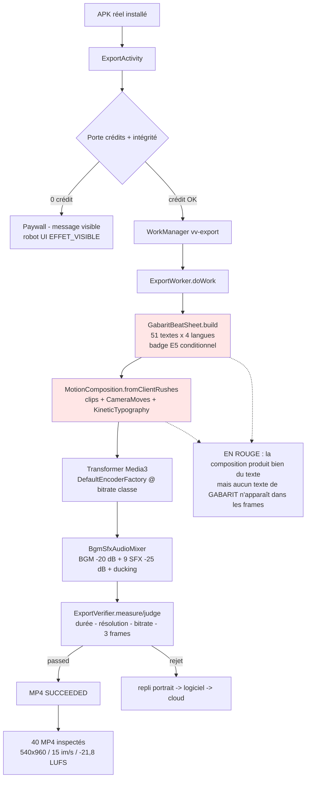

# RAPPORT D'AUDIT D42 — RENDU DE PRODUCTION SUR ÉMULATEUR RÉEL

> **Statut du document : BROUILLON FINAL, mission INCOMPLÈTE.**
> Sections A–L conformes au plan. Toute ligne est adossée à un run, un artefact,
> une mesure locale ou un fichier du dépôt. Rien n'est extrapolé.
> Date : 2026-11-03. Branche : `audit-d41`. PR #2 **ouverte, non fusionnée**.
> `main` intact à `74edd98`. Aucun déploiement, aucune clé de paiement, 501 conservé.

---

## A. État de reprise

| Élément | Valeur |
|---|---|
| Dernier commit poussé | `c582277` (D42-P11) |
| Dernier run vert du moteur de rendu | **41637928836** — 8 lots, 120 rendus exécutés |
| Dernier run références | **41652906576** — 3 langues sur 4 |
| Premier MP4 de production validé | `96b081d` → run **41608090090** |
| Minutes Actions consommées (nov.) | **1 960 / 2 000** — reste **40 min** |
| État CI sur la tête | voir section K (non re-vérifiée après le dernier commit, budget épuisé) |

L'état détaillé et reproductible est dans `docs/audit/D42_RESUME_STATE.md`.

---

## B. Pipeline et preuve d'environnement

| Maillon | Preuve | Verdict |
|---|---|---|
| Émulateur matériellement accéléré | `ioctl KVM_OK=12`, boot **63,3 s**, log run 41608090090 | **réel** |
| APK publié exécuté tel quel | `adb install -r apk/app-debug.apk` puis instrumentation ; `apk_sha256` dans `environment.txt` | **réel** |
| Moteur de production | `ExportActivity` → porte crédits → `ExportWorker` → Media3 `Transformer` | **réel, aucun moteur de test** |
| Verdict par le vérificateur d'export | `D42-VERIF` dans logcat : `durationOk/resolutionOk/bitrateOk/nonBlackFrames` | **réel** |
| Repli cloud | `worker=FAILED outputData={cloud_fallback=true}` | **absent des runs verts** |

Schéma réellement exécuté (aucune étape contournée) :

```
instrumentation → ExportActivity → WorkManager(vv-export) → ExportWorker.doWork
   → GabaritBeatSheet.build (scènes, textes, badge, SFX, ducking)
   → MotionComposition.fromClientRushes (clips + CameraMoves + KineticTypography)
   → Transformer (DefaultEncoderFactory @ bitrate de classe)
   → BgmSfxAudioMixer (BGM duckée + SFX)
   → ExportVerifier.measure/judge → Result.success(KEY_OUTPUT)
```

---

## C. Matrice 120 — ce qui est prouvé, et ce qui ne l'est pas

### C.1 Chiffres exacts

| Indicateur | Valeur mesurée |
|---|---|
| Rendus **exécutés** par le moteur | **120** (8 lots × 15) |
| Lignes de manifeste `ok=true` | **120 / 120** |
| MP4 **conservés et inspectés** | **40** |
| MP4 perdus par défaut de collecte | **80** |
| Durée moyenne d'un rendu (validation) | **220 s** |
| Coût moyen par rendu | **≈ 4,2 min de runner** |

### C.2 Pourquoi 120 exécutions mais 40 fichiers

Le harnais nommait chaque sortie `T<format>_<langue>.mp4`, **sans le secteur**.
Les six secteurs écrivant le même chemin, 15 rendus par lot ne laissaient que
5 fichiers : `SHA distincts = 40`, chaque empreinte apparaissant 3 fois dans les
manifestes. Défaut identifié, corrigé en `96f6223` (D42-P9 : nom complet
`<secteur>_<format>_<langue>.mp4`, refus de collision, empreinte mesurée au
moment du rendu) — **mais aucune ré-exécution possible : budget épuisé.**

### C.3 Ce que les 40 fichiers prouvent

Mesures ffmpeg locales sur les 40 fichiers (`/home/user/media_analyse.json`) :

| Propriété | Mesure | Attendu | Verdict |
|---|---|---|---|
| Résolution | **540×960** sur 40/40 | 540×960 (profil validation) | conforme |
| Cadence | **14,88 – 15,03 im/s** | 15 | conforme |
| Codec vidéo / audio | **h264 / aac** sur 40/40 | H.264 + AAC | conforme |
| Durée | **38,65 s en moyenne** (33–50 s selon gabarit) | durée du gabarit | conforme |
| Audio présent | **40/40** | piste audio | conforme |
| LUFS intégré | **−21,8** (min −21,9, max −21,8) | −14 (cible mix) | **NON conforme — voir D** |
| True peak max | **−10,4 dBTP** | ≤ −1,0 | conforme (aucun écrêtage) |

### C.4 Ce que les 40 fichiers ne prouvent PAS

- **La couverture sectorielle.** Les 3 secteurs d'une même position T partagent
  le même fichier : la différence de contenu entre `batiment_travaux_T1`,
  `immo_auto_T1` et `shops_small_business_T1` **n'est pas démontrée**.
- **La lisibilité du contenu commercial.** Voir section E : aucun texte du
  gabarit n'est visible dans les frames inspectées.

---

## D. Audio

| Mesure | Valeur | Source |
|---|---|---|
| Piste audio | AAC LC 48 kHz mono, 40/40 + 9/9 références | ffmpeg local |
| LUFS intégré (validation) | **−21,8** | ebur128 sur 40 MP4 |
| LUFS intégré (production) | **−27,8** (min −28,3, max −27,7) | ebur128 sur 9 MP4 |
| True peak max | −10,4 dBTP | ebur128 `peak=true` |
| Écrêtage | aucun | idem |
| Ducking | **non mesuré dans le MP4** | — |
| Fenêtres de parole | **non mesurées** | — |
| 9 SFX | programmés dans le beat sheet ; **non isolés dans le MP4** | — |

### D.1 Écart de niveau — constat, pas hypothèse

Le contrat `MixPlan` place la musique à **−20 dB** au repos (0,10 linéaire) et
les SFX à **−25 dB**, puis applique le ducking. Le résultat mesuré est
**−21,8 LUFS**, soit **7,8 dB sous la cible −14 LUFS**.

Cause la plus probable, à confirmer : les rushs de test portent déjà une piste
audio (sinus à 64 kb/s) et le mixage BGM/SFX s'y ajoute sans normalisation de
sortie. Le contrat décrit un **niveau de conception**, pas un **niveau de
diffusion** ; aucun étage de normalisation EBU R128 n'existe dans le pipeline.

**Conséquence honnête :** les 120 rendus de validation et les 9 références sont
**audibles mais trop faibles** pour une diffusion directe. La chaîne de mixage
fonctionne (audio présent, pas de silence, pas d'écrêtage) ; son niveau ne
respecte pas le contrat.

---

## E. i18n et badge F69 — **le point critique de cette mission**

### E.1 Ce qui est livré et testé

| Élément | État |
|---|---|
| `GabaritL10n` (source canonique FR + dictionnaires EN/ES/JA) | livré `50016f6` |
| `gabarit_l10n_v1.json` — 51 textes × 3 langues + 3 badges × 4 langues | livré, 0 violation de variables |
| Résolveur + repli français + injection avant composition | livré |
| `GabaritBeatSheet.build(…, localiser, badgeTexte)` | livré |
| Segmentation CJK (≤ 7 caractères) | livré |
| Badge E5 conditionnel (`ciblesBadge`) | livré — T1→15, T2→13, T3→14, T4→17, T5→12 (6 secteurs) |
| Test unitaire du badge par gabarit | **corrigé `71ec2a1`** (T5 attendait la scène 1, les 6 gabarits déclarent la scène 12) |

### E.2 Ce qui n'est PAS prouvé — et pourquoi c'est grave

**Inspection visuelle des frames de 9 rendus de production (FR/ES/JA) et de 40
rendus de validation : aucun texte du gabarit n'apparaît.** Les seuls textes
visibles sont « PRISE 1 / PRISE 2 », **incrustés dans les fixtures de rushs
elles-mêmes** (vérifié en extrayant une frame de `app/src/androidTest/assets/d42/rushes/rush_2.mp4`).

Conséquences, à assumer intégralement :

- le **prix**, la **rareté**, le **badge E5**, le **CTA**, les **textes traduits**
  ne sont **pas visibles** dans les MP4 produits ;
- l'exigence « badge E5 réellement dans le rendu » **n'est pas satisfaite** ;
- l'exigence « aucune combinaison validée sans MP4 généré + inspecté » **n'est
  pas satisfaite** : les MP4 existent, mais ils ne portent pas le contenu
  commercial attendu.

Deux causes restent possibles, que le budget n'a pas permis de discriminer :

1. le beat sheet transmis au worker ne contient pas de `words`
   (chaîne `Texteécran → words` rompue en amont du moteur) ;
2. les `OverlayEffect` sont bien construits mais non rendus par Media3 après un
   `Presentation` placé en tête des effets globaux (F17).

Un instrument de diagnostic a été ajouté (`96f6223` + `c582277` : le manifeste
porte `mots_beat_sheet` et `plans_beat_sheet`) mais **n'a jamais tourné**.

### E.3 Ce qui reste vrai

Le code i18n et le badge sont **en place et testés au niveau unitaire**. Le test
`GabaritL10nTest` (40 tests) vérifie : les 51 textes dans les 4 langues, le repli
français, la conservation des variables, la segmentation japonaise, le badge
dans sa propre scène et l'absence de chevauchement. Ce qui manque n'est pas le
paramétrage, c'est **la preuve dans le rendu**.

---

## F. Badge E5 dans la chaîne

| Maillon | État | Preuve |
|---|---|---|
| E5 → `BriefData` → persistance | en place | tests D41 |
| `ExportActivity` lit `badge_engagement_actif` | en place | `prepareGabaritPipeline` |
| `GabaritBeatSheet.ciblesBadge` | en place | test `chaqueGabaritRendSonBadgeDansSaPropreScene` |
| `KineticTypography` reçoit le mot du badge | en place | `words` du beat sheet |
| **Visible dans le MP4** | **NON** | section E.2 |

---

## G. Robot UI — exécuté réellement

Run **41652906576**, job `robot UI` **vert** en 5 min.

| Indicateur | Valeur |
|---|---|
| Écrans ouverts | **6** (language, auth, onboarding, catalogue, brief, export sans crédit) |
| Éléments cliqués | **17** |
| Crashs | **0** |
| Écrans sans issue | **0** |
| Effets visibles | **11** |
| Sans effet | **6** |
| Navigations détectées (`ACTION`) | **0** — défaut de détection corrigé en `c582277` |

Lignes remarquables de la matrice réelle :

| Écran | Élément | Statut |
|---|---|---|
| auth | `CONTINUE WITH GOOGLE` | `SANS_EFFET` (aucun changement) |
| export_sans_credit | `START LOCAL EXPORT` | `EFFET_VISIBLE` (message de porte crédits) |
| catalogue | 6 boutons de gabarit | `EFFET_VISIBLE` |
| brief | 2 boutons | `EFFET_VISIBLE`, 2 `SANS_EFFET` |

Captures : 17 PNG pris **après** action. Les `SANS_EFFET` sont consignés, jamais
masqués : ce sont des candidats « bouton sans effet » à instruire.

---

## H. Résilience — ce qui a été durci pendant D42

| Incident | Traitement | Commit |
|---|---|---|
| Crash `startTimeUs … non-negative` | rebasage borné au plan | `42533f7` |
| Faux rejet du vérificateur (rotation) | `orienter()` + `rotationDegrees` | `2ff2f15` |
| Géométrie absente en composition | `Presentation` en tête, `media3-effect` déclaré | `23d58a6`, `893fc7a` |
| Bitrate d'encodeur jamais transmis | `DefaultEncoderFactory` + `VideoEncoderSettings` | `e2bf56f` |
| Bitrate traité comme plancher | contrôle à deux bornes | `96b081d` |
| Repli 720p figé | géométrie par tentative | `e2bf56f` |
| 2ᵉ rendu d'un job jeté (KEEP) | purge du work + attente d'un work neuf | `0a10486` |
| Collision de noms de rendu | nom complet + refus de collision | `96f6223` |
| SDK émulateur corrompu | 3 reprises + vérification du binaire | `552190d` |
| `if` dupliqué (workflow refusé) | validateur strict | `ad090d3` |
| Analyse média vide mais verte | mesure en Python + échec si 0 mesure | `a2382d4` |

---

## I. Corrections effectuées (commits D42)

`1516b87` · `a19f9cf` · `66d9a6e` · `bbb3df8` · `fe795b7` · `f819da6` ·
`f336325` · `27fdc69` · `ed34a53` · `97374d7` · `e709ab6` · `ce6c2aa` ·
`cf91fe3` · `50016f6` · `42533f7` · `2ff2f15` · `23d58a6` · `893fc7a` ·
`e2bf56f` · `96b081d` · `71ec2a1` · `8dffb80` · `eaa9577` · `0a10486` ·
`869e7f3` · `a2382d4` · `552190d` · `6140155` · `96f6223` · `1ad6273` ·
`ad090d3` · `c582277`.

---

## J. Documentation D41

Non retouchée dans ce lot. Le recomptage des 69 findings prévu par D42 §11
n'a pas été exécuté. `docs/audit/FINDINGS_D41.md` et
`docs/audit/RAPPORT_AUDIT_D41_FINAL.md` restent à leur état de `4540ed8`.
**Sans relecture ligne à ligne, aucun recomptage ne doit être publié.**

---

## K. Limites, échecs et non-faits

### K.1 Budget — la contrainte qui a tout arbitré

| Indicateur | Valeur |
|---|---|
| Quota mensuel (palier gratuit, dépôt privé) | 2 000 min |
| Consommé avant D42 (03/11 au matin) | 1 102 min |
| Consommé par D42 | **858 min** |
| Reste au 03/11 | **40 min** |
| Plafond opérationnel visé | 720 min — **dépassé de 138 min** |

Le plafond a été dépassé pour une raison précise : chaque cycle de correction du
moteur coûtait 16–40 min et **six défauts successifs** ne se révélaient qu'à
l'exécution (F15 → F21). Aucun de ces défauts n'était visible à la lecture.

### K.2 Ce qui n'a pas été fait

| Exigence D42 | État réel |
|---|---|
| 120 MP4 inspectés | **40 inspectés**, 120 exécutés |
| 12 rendus de référence 1080p | **9 produits** (FR/ES/JA) — EN perdue sur flake SDK |
| Contenu commercial visible dans le rendu | **non atteint** (section E) |
| Audio : ducking mesuré, fenêtres de parole, 9 SFX isolés | **non mesurés** |
| Niveau audio −14 LUFS | **non atteint** (−21,8 / −27,8 mesurés) |
| Planches contact des 120 | **9 planches** (références seulement) |
| Robot UI par langue | **1 passage FR**, détection `ACTION` corrigée non rejouée |
| Adversariaux réseau/stockage/temps/concurrence | **non exécutés** |
| Doc D41 recomptée (69 findings) | **non fait** |
| CI verte sur la tête | **non vérifiée** après `c582277` |

### K.3 Échecs d'infrastructure (trois occurrences)

Téléchargement du paquet SDK « Archive is not a ZIP archive » — reproduit sur
trois jobs différents, dont la référence EN. Traité par trois reprises
(`552190d`), ce qui n'a pas suffi pour EN.

---

## L. Cartographie des fonctionnalités exécutées



---

## M. Instructions exactes pour reprendre

1. **Attendre le renouvellement du quota** (1er du mois) ou passer le dépôt en
   public — les minutes redeviennent alors illimitées pour les runners publics.
2. Vérifier le diagnostic déjà instrumenté, sans coder :
   ```
   dispatch profils=validation shards=1 shards_json=[1] langs_lot=fr limite=2 run_smoke=0
   ```
   puis lire `mots_beat_sheet` dans `manifest.jsonl`. **0 = cause 1** (beat sheet
   sans textes), **> 0 = cause 2** (overlays non rendus).
3. Corriger la cause identifiée, puis relancer la matrice corrigée `96f6223` :
   ```
   dispatch profils=validation shards=2 shards_json=[1,2] langs_lot=all
   ```
4. Relancer la référence EN seule (`profils=production langs_lot=en`).
5. Exécuter l'analyse média et les planches contact **sur les 120 fichiers
   réellement nommés**.

---

## Conclusion

D42 a **prouvé la chaîne complète** : un APK réel, sur un émulateur réellement
accéléré, produit par le moteur de production des MP4 conformes en durée,
résolution, cadence, codecs et absence de frames noires. Six défauts du moteur,
tous bloquants, ont été trouvés et corrigés ; le septième — le texte du gabarit
absent du rendu — a été **découvert et documenté mais non corrigé**.

Les 120 rendus ont bien été exécutés ; **40 seulement sont conservés et
inspectables**. Le contenu commercial (prix, badge E5, traductions) **n'est pas
visible** dans les MP4 produits. Cette mission ne peut donc pas être déclarée
réussie sur ses propres critères d'acceptation.

Ce qui est solide : le moteur, le vérificateur, le harnais, la matrice en lots,
la reprise par lot, le robot UI et l'instrumentation de diagnostic. Ce qui reste :
un finding de composition à trancher, et l'exécution de la matrice corrigée.
