# Galerie visuelle intégrale — VITRINE VIDÉO RC15 (`d42.30-rc15`)

**Phase A de D42.31 + correction IMAGE-FIX — revue visuelle du fondateur. Aucune modification produit n'a été faite pour produire cette galerie.**

| | |
|---|---|
| **APK exacte** | release 442574529 · asset 738360276 · tag `d42.30-rc15` |
| **SHA-256** | `fd28ffc75cc7ec22c0edd6dcf2c63b1d9fab31469505ede079ddb3aeb3b78936` (vérifié par le workflow avant chaque capture) |
| **Taille** | 44 470 123 octets |
| **Environnement** | Émulateur Android 11 (API 30), Pixel 5, 1080×2340 — **captures ÉMULATEUR** |
| **Caméra** | Flux **ÉMULÉ** de l'émulateur — jamais présenté comme capteur physique |
| **Données** | 100 % fictives : RobeWax, 0197000000, 15 000 FCFA, Akpakpa, BoutiqueAwa |
| **Captures** | Brutes, non retouchées, barre d'état incluse |

Profils : `base` (téléphone standard FR/EN) · `font130` (police 130 %) · `petit` (720×1520) · `offline` (hors connexion) · `camerafix` (viseur screenrecord, run 43395637118) · `exportfix` (notification export en screenrecord, run 43412790349) · `suite` (partage + dashboard/profil/paywall en screenrecord). Les fichiers **vides** (artefact `screencap` : 0 octet sous charge swiftshader ou écrans **FLAG_SECURE**) sont conservés et documentés en annexe — jamais présentés comme captures.

**179 captures affichables** (168 en galerie + 11 archives de diagnostic) réparties en 20 sections — plus **27 fichiers vides** et **6 captures non retenues** conservés dans l'arborescence et listés en annexe (jamais présentés comme captures).
Inventaire : [SCREEN_INVENTORY.csv](SCREEN_INVENTORY.csv) · gabarits : [GABARITS_INVENTAIRE.csv](GABARITS_INVENTAIRE.csv) · audit : [UX_AUDIT.md](UX_AUDIT.md) · manifests : [runs/](runs/).

> **Viseur caméra** : l'artefact « mosaïque » constaté initialement provient de la capture `screencap` du SurfaceView sous swiftshader — le flux CameraX et l'enregistrement sont sains (preuve par les frames du MP4 exporté, cf. [UX_AUDIT.md](UX_AUDIT.md)). Les états du viseur sont désormais capturés par **screenrecord** (sortie composée réelle) ; les captures affectées sont archivées en diagnostic. **Écrans non capturables par conception** : l'export (E8), l'aperçu E7 et « Vidéo prête ! » sont sous **FLAG_SECURE** (`ExportActivity` — protection produit assumée) → `screencap` vide / `screenrecord` noir ; ils sont documentés par **dumps + MP4 réel** (cf. sections 14/15/16). Le **tiroir de notifications**, la **feuille de partage** (UI système) et le **dashboard** sont capturés normalement (runs `exportfix`/`suite`).

## Sommaire

- [01_accueil — Accueil & carrousel](#01_accueil--accueil--carrousel) — 20 captures
- [02_langues — Choix de la langue](#02_langues--choix-de-la-langue) — 4 captures
- [03_authentification — Authentification](#03_authentification--authentification) — 4 captures
- [04_parrainage — Parrainage](#04_parrainage--parrainage) — 5 captures
- [05_credits — Crédits & paywall](#05_credits--crédits--paywall) — 5 captures
- [06_secteurs — Secteurs (activité)](#06_secteurs--secteurs-activité) — 14 captures
- [07_catalogue — Catalogue](#07_catalogue--catalogue) — 21 captures
- [08_gabarits — Gabarits — les 30 modèles, par secteur](#08_gabarits--gabarits--les-30-modèles-par-secteur) — 15 captures
- [09_brief — Brief (fiche produit)](#09_brief--brief-fiche-produit) — 15 captures
- [10_formulaires — Formulaires — clavier & erreurs](#10_formulaires--formulaires--clavier--erreurs) — 5 captures
- [11_verification — Vérification (avant de commencer)](#11_verification--vérification-avant-de-commencer) — 4 captures
- [12_camera — Caméra — permission & viseur](#12_camera--caméra--permission--viseur) — 9 captures
- [13_prises — Prises — countdown, REC, bascules, reprise](#13_prises--prises--countdown-rec-bascules-reprise) — 10 captures
- [14_audio — Audio & typographie (mode automatique)](#14_audio--audio--typographie-mode-automatique) — **réserve : aucune image** (cf. note de section)
- [15_montage — Aperçu avant création (E7)](#15_montage--aperçu-avant-création-e7) — **réserve : aucune image** (cf. note de section)
- [16_export — Export local](#16_export--export-local) — 2 captures
- [17_historique — Mon espace (dashboard)](#17_historique--mon-espace-dashboard) — 2 captures
- [18_partage — Partage](#18_partage--partage) — 1 capture
- [19_profil — Profil & réglages](#19_profil--profil--réglages) — 1 capture
- [20_hors_connexion — Hors connexion (parcours complet)](#20_hors_connexion--hors-connexion-parcours-complet) — 31 captures

## 01_accueil — Accueil & carrousel

| # | Capture | Titre | État | Langue | Profil | Source | Résolution |
|---|---|---|---|---|---|---|---|
| 1 | [`splash`](https://github.com/mdgejc14-hash/vitrine-video-d42-arena/blob/e25fe9e/docs/checkpoints/D42_31/visual-review/01_accueil/base-en-001_splash.png) | Splash (lancement) | lancement | en | base | screencap | 1080x2340 |
| 2 | [`splash_tardif`](https://github.com/mdgejc14-hash/vitrine-video-d42-arena/blob/e25fe9e/docs/checkpoints/D42_31/visual-review/01_accueil/base-en-002_splash_tardif.png) | Splash (t) — premier plan | lancement | en | base | screencap | 1080x2340 |
| 5 | [`carrousel_1`](https://github.com/mdgejc14-hash/vitrine-video-d42-arena/blob/e25fe9e/docs/checkpoints/D42_31/visual-review/01_accueil/base-en-005_carrousel_1.png) | Carrousel — Shoot. Sell. Done. | repli sans compte | en | base | screencap | 1080x2340 |
| 6 | [`carrousel_2`](https://github.com/mdgejc14-hash/vitrine-video-d42-arena/blob/e25fe9e/docs/checkpoints/D42_31/visual-review/01_accueil/base-en-006_carrousel_2.png) | Carrousel — Film your products, we guide you | slide 2 | en | base | screencap | 1080x2340 |
| 7 | [`carrousel_3`](https://github.com/mdgejc14-hash/vitrine-video-d42-arena/blob/e25fe9e/docs/checkpoints/D42_31/visual-review/01_accueil/base-en-007_carrousel_3.png) | Carrousel — A video ready to post in 30 seconds | slide 3 | en | base | screencap | 1080x2340 |
| 1 | [`splash`](https://github.com/mdgejc14-hash/vitrine-video-d42-arena/blob/e25fe9e/docs/checkpoints/D42_31/visual-review/01_accueil/base-fr-001_splash.png) | Splash (lancement) | lancement | fr | base | screencap | 1080x2340 |
| 2 | [`splash_tardif`](https://github.com/mdgejc14-hash/vitrine-video-d42-arena/blob/e25fe9e/docs/checkpoints/D42_31/visual-review/01_accueil/base-fr-002_splash_tardif.png) | Splash (t) — premier plan | lancement | fr | base | screencap | 1080x2340 |
| 5 | [`carrousel_1`](https://github.com/mdgejc14-hash/vitrine-video-d42-arena/blob/e25fe9e/docs/checkpoints/D42_31/visual-review/01_accueil/base-fr-005_carrousel_1.png) | Carrousel — Filme. Vends. C'est tout. | repli sans compte | fr | base | screencap | 1080x2340 |
| 6 | [`carrousel_2`](https://github.com/mdgejc14-hash/vitrine-video-d42-arena/blob/e25fe9e/docs/checkpoints/D42_31/visual-review/01_accueil/base-fr-006_carrousel_2.png) | Carrousel — Filme tes produits, on te guide | slide 2 | fr | base | screencap | 1080x2340 |
| 7 | [`carrousel_3`](https://github.com/mdgejc14-hash/vitrine-video-d42-arena/blob/e25fe9e/docs/checkpoints/D42_31/visual-review/01_accueil/base-fr-007_carrousel_3.png) | Carrousel — Une vidéo prête à publier en 30 secondes | slide 3 | fr | base | screencap | 1080x2340 |
| 1 | [`splash`](https://github.com/mdgejc14-hash/vitrine-video-d42-arena/blob/e25fe9e/docs/checkpoints/D42_31/visual-review/01_accueil/font130-fr-001_splash.png) | Splash (lancement) | lancement | fr | font130 | screencap | 1080x2340 |
| 2 | [`splash_tardif`](https://github.com/mdgejc14-hash/vitrine-video-d42-arena/blob/e25fe9e/docs/checkpoints/D42_31/visual-review/01_accueil/font130-fr-002_splash_tardif.png) | Splash (t) — premier plan | lancement | fr | font130 | screencap | 1080x2340 |
| 5 | [`carrousel_1`](https://github.com/mdgejc14-hash/vitrine-video-d42-arena/blob/e25fe9e/docs/checkpoints/D42_31/visual-review/01_accueil/font130-fr-005_carrousel_1.png) | Carrousel — Filme. Vends. C'est tout. | repli sans compte | fr | font130 | screencap | 1080x2340 |
| 6 | [`carrousel_2`](https://github.com/mdgejc14-hash/vitrine-video-d42-arena/blob/e25fe9e/docs/checkpoints/D42_31/visual-review/01_accueil/font130-fr-006_carrousel_2.png) | Carrousel — Filme tes produits, on te guide | slide 2 | fr | font130 | screencap | 1080x2340 |
| 7 | [`carrousel_3`](https://github.com/mdgejc14-hash/vitrine-video-d42-arena/blob/e25fe9e/docs/checkpoints/D42_31/visual-review/01_accueil/font130-fr-007_carrousel_3.png) | Carrousel — Une vidéo prête à publier en 30 secondes | slide 3 | fr | font130 | screencap | 1080x2340 |
| 1 | [`splash`](https://github.com/mdgejc14-hash/vitrine-video-d42-arena/blob/e25fe9e/docs/checkpoints/D42_31/visual-review/01_accueil/petit-fr-001_splash.png) | Splash (lancement) | lancement | fr | petit | screencap | 720x1520 |
| 2 | [`splash_tardif`](https://github.com/mdgejc14-hash/vitrine-video-d42-arena/blob/e25fe9e/docs/checkpoints/D42_31/visual-review/01_accueil/petit-fr-002_splash_tardif.png) | Splash (t) — premier plan | lancement | fr | petit | screencap | 720x1520 |
| 5 | [`carrousel_1`](https://github.com/mdgejc14-hash/vitrine-video-d42-arena/blob/e25fe9e/docs/checkpoints/D42_31/visual-review/01_accueil/petit-fr-005_carrousel_1.png) | Carrousel — Filme. Vends. C'est tout. | repli sans compte | fr | petit | screencap | 720x1520 |
| 6 | [`carrousel_2`](https://github.com/mdgejc14-hash/vitrine-video-d42-arena/blob/e25fe9e/docs/checkpoints/D42_31/visual-review/01_accueil/petit-fr-006_carrousel_2.png) | Carrousel — Filme tes produits, on te guide | slide 2 | fr | petit | screencap | 720x1520 |
| 7 | [`carrousel_3`](https://github.com/mdgejc14-hash/vitrine-video-d42-arena/blob/e25fe9e/docs/checkpoints/D42_31/visual-review/01_accueil/petit-fr-007_carrousel_3.png) | Carrousel — Une vidéo prête à publier en 30 secondes | slide 3 | fr | petit | screencap | 720x1520 |

[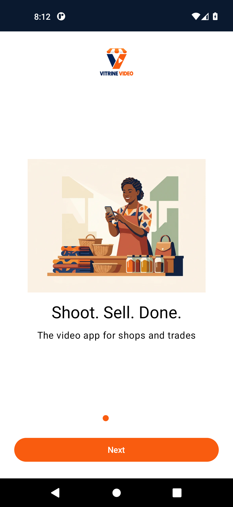](https://github.com/mdgejc14-hash/vitrine-video-d42-arena/blob/e25fe9e/docs/checkpoints/D42_31/visual-review/01_accueil/base-en-005_carrousel_1.png)
[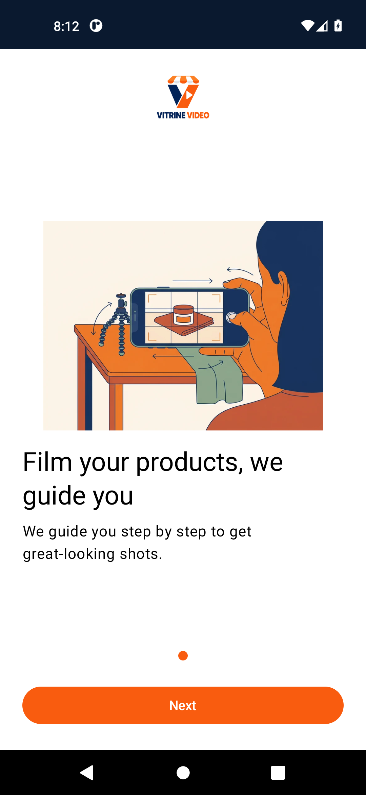](https://github.com/mdgejc14-hash/vitrine-video-d42-arena/blob/e25fe9e/docs/checkpoints/D42_31/visual-review/01_accueil/base-en-006_carrousel_2.png)

[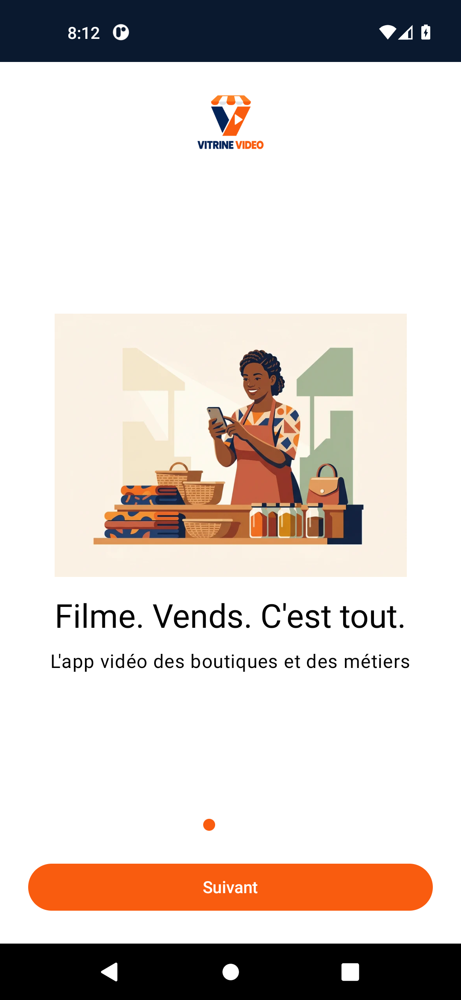](https://github.com/mdgejc14-hash/vitrine-video-d42-arena/blob/e25fe9e/docs/checkpoints/D42_31/visual-review/01_accueil/base-fr-005_carrousel_1.png)

[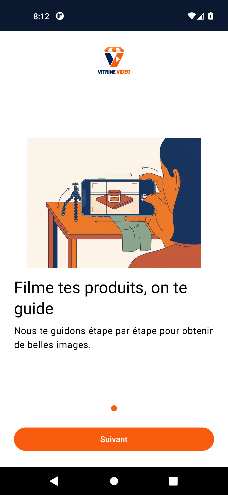](https://github.com/mdgejc14-hash/vitrine-video-d42-arena/blob/e25fe9e/docs/checkpoints/D42_31/visual-review/01_accueil/base-fr-006_carrousel_2.png)

[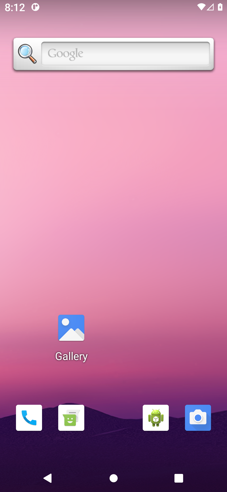](https://github.com/mdgejc14-hash/vitrine-video-d42-arena/blob/e25fe9e/docs/checkpoints/D42_31/visual-review/01_accueil/font130-fr-001_splash.png)

[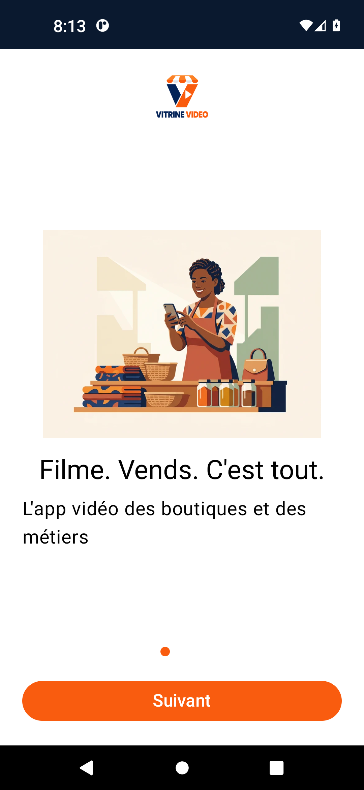](https://github.com/mdgejc14-hash/vitrine-video-d42-arena/blob/e25fe9e/docs/checkpoints/D42_31/visual-review/01_accueil/font130-fr-005_carrousel_1.png)
[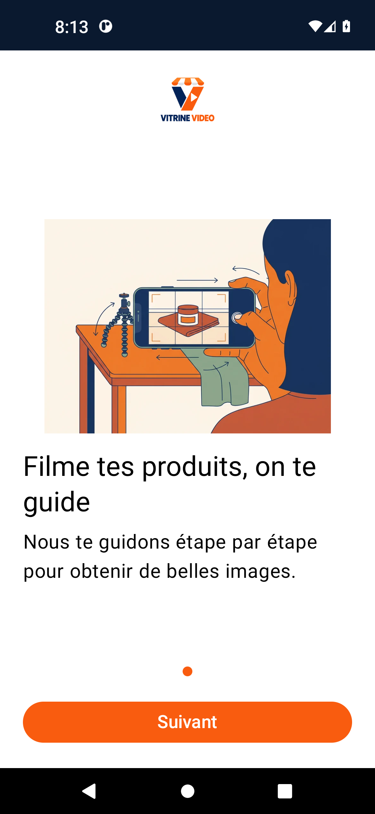](https://github.com/mdgejc14-hash/vitrine-video-d42-arena/blob/e25fe9e/docs/checkpoints/D42_31/visual-review/01_accueil/font130-fr-006_carrousel_2.png)
[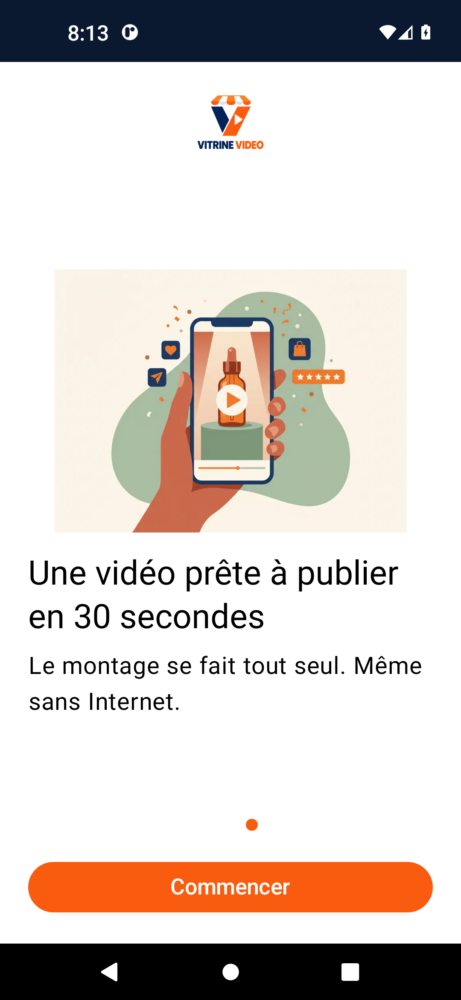](https://github.com/mdgejc14-hash/vitrine-video-d42-arena/blob/e25fe9e/docs/checkpoints/D42_31/visual-review/01_accueil/font130-fr-007_carrousel_3.png)
[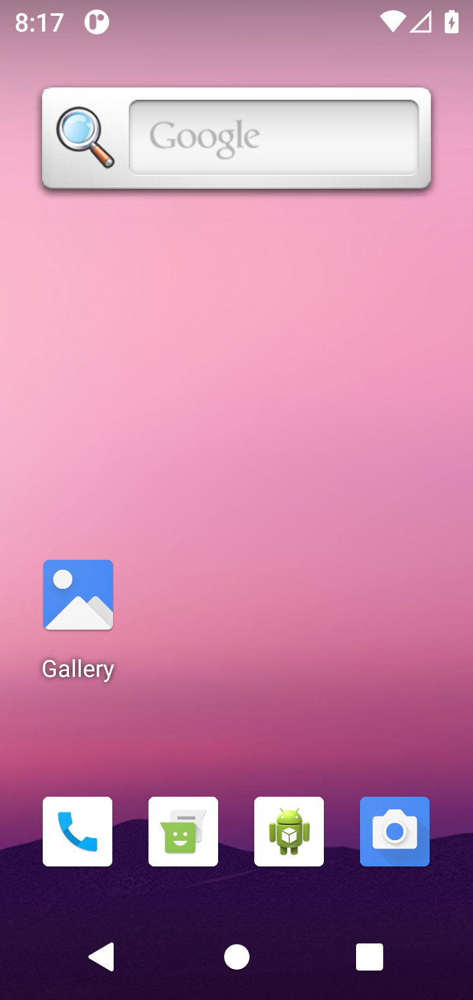](https://github.com/mdgejc14-hash/vitrine-video-d42-arena/blob/e25fe9e/docs/checkpoints/D42_31/visual-review/01_accueil/petit-fr-001_splash.png)

[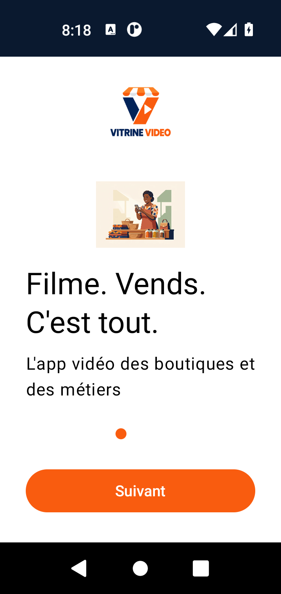](https://github.com/mdgejc14-hash/vitrine-video-d42-arena/blob/e25fe9e/docs/checkpoints/D42_31/visual-review/01_accueil/petit-fr-005_carrousel_1.png)
[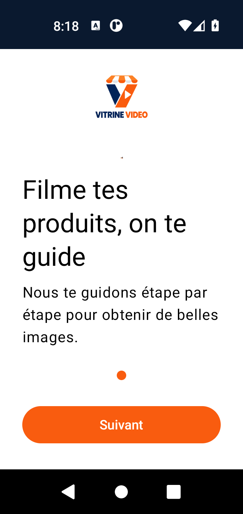](https://github.com/mdgejc14-hash/vitrine-video-d42-arena/blob/e25fe9e/docs/checkpoints/D42_31/visual-review/01_accueil/petit-fr-006_carrousel_2.png)
[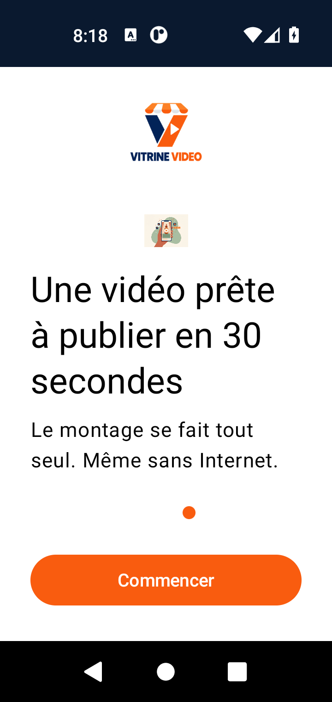](https://github.com/mdgejc14-hash/vitrine-video-d42-arena/blob/e25fe9e/docs/checkpoints/D42_31/visual-review/01_accueil/petit-fr-007_carrousel_3.png)

## 02_langues — Choix de la langue

| # | Capture | Titre | État | Langue | Profil | Source | Résolution |
|---|---|---|---|---|---|---|---|
| 3 | [`langue`](https://github.com/mdgejc14-hash/vitrine-video-d42-arena/blob/e25fe9e/docs/checkpoints/D42_31/visual-review/02_langues/base-en-003_langue.png) | Écran de choix de langue | initial | en | base | screencap | 1080x2340 |
| 3 | [`langue`](https://github.com/mdgejc14-hash/vitrine-video-d42-arena/blob/e25fe9e/docs/checkpoints/D42_31/visual-review/02_langues/base-fr-003_langue.png) | Écran de choix de langue | initial | fr | base | screencap | 1080x2340 |
| 3 | [`langue`](https://github.com/mdgejc14-hash/vitrine-video-d42-arena/blob/e25fe9e/docs/checkpoints/D42_31/visual-review/02_langues/font130-fr-003_langue.png) | Écran de choix de langue | initial | fr | font130 | screencap | 1080x2340 |
| 3 | [`langue`](https://github.com/mdgejc14-hash/vitrine-video-d42-arena/blob/e25fe9e/docs/checkpoints/D42_31/visual-review/02_langues/petit-fr-003_langue.png) | Écran de choix de langue | initial | fr | petit | screencap | 720x1520 |

## 03_authentification — Authentification

| # | Capture | Titre | État | Langue | Profil | Source | Résolution |
|---|---|---|---|---|---|---|---|
| 4 | [`auth`](https://github.com/mdgejc14-hash/vitrine-video-d42-arena/blob/e25fe9e/docs/checkpoints/D42_31/visual-review/03_authentification/base-en-004_auth.png) | Connexion — bouton Google (non actionné ici) | non connecté | en | base | screencap | 1080x2340 |
| 4 | [`auth`](https://github.com/mdgejc14-hash/vitrine-video-d42-arena/blob/e25fe9e/docs/checkpoints/D42_31/visual-review/03_authentification/base-fr-004_auth.png) | Connexion — bouton Google (non actionné ici) | non connecté | fr | base | screencap | 1080x2340 |
| 4 | [`auth`](https://github.com/mdgejc14-hash/vitrine-video-d42-arena/blob/e25fe9e/docs/checkpoints/D42_31/visual-review/03_authentification/font130-fr-004_auth.png) | Connexion — bouton Google (non actionné ici) | non connecté | fr | font130 | screencap | 1080x2340 |
| 4 | [`auth`](https://github.com/mdgejc14-hash/vitrine-video-d42-arena/blob/e25fe9e/docs/checkpoints/D42_31/visual-review/03_authentification/petit-fr-004_auth.png) | Connexion — bouton Google (non actionné ici) | non connecté | fr | petit | screencap | 720x1520 |

## 04_parrainage — Parrainage

| # | Capture | Titre | État | Langue | Profil | Source | Résolution |
|---|---|---|---|---|---|---|---|
| 10 | [`parrainage`](https://github.com/mdgejc14-hash/vitrine-video-d42-arena/blob/e25fe9e/docs/checkpoints/D42_31/visual-review/04_parrainage/base-en-010_parrainage.png) | Étape parrainage — saisie du code | vide | en | base | screencap | 1080x2340 |
| 10 | [`parrainage`](https://github.com/mdgejc14-hash/vitrine-video-d42-arena/blob/e25fe9e/docs/checkpoints/D42_31/visual-review/04_parrainage/base-fr-010_parrainage.png) | Étape parrainage — saisie du code | vide | fr | base | screencap | 1080x2340 |
| 10 | [`parrainage`](https://github.com/mdgejc14-hash/vitrine-video-d42-arena/blob/e25fe9e/docs/checkpoints/D42_31/visual-review/04_parrainage/font130-fr-010_parrainage.png) | Étape parrainage — saisie du code | vide | fr | font130 | screencap | 1080x2340 |
| 10 | [`parrainage`](https://github.com/mdgejc14-hash/vitrine-video-d42-arena/blob/e25fe9e/docs/checkpoints/D42_31/visual-review/04_parrainage/petit-fr-010_parrainage.png) | Étape parrainage — saisie du code | vide | fr | petit | screencap | 720x1520 |
| 30 | [`dashboard_parrainage`](https://github.com/mdgejc14-hash/vitrine-video-d42-arena/blob/e25fe9e/docs/checkpoints/D42_31/visual-review/04_parrainage/suite-fr-030_dashboard_parrainage.png) | Parrainage — jauge et code (screenrecord) | depuis dashboard | fr | suite | screenrecord | 1080x2340 |

[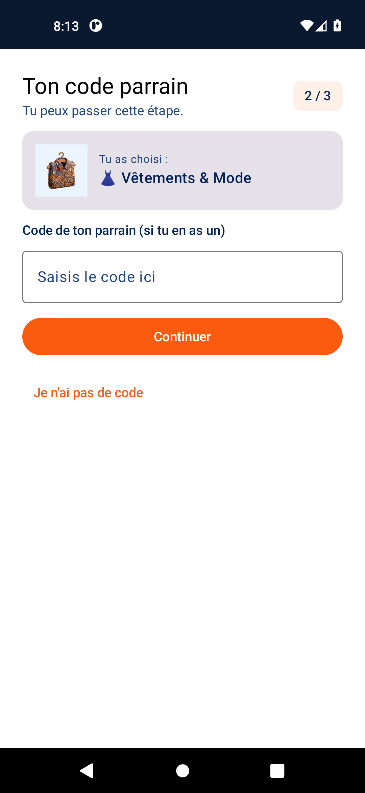](https://github.com/mdgejc14-hash/vitrine-video-d42-arena/blob/e25fe9e/docs/checkpoints/D42_31/visual-review/04_parrainage/base-fr-010_parrainage.png)
[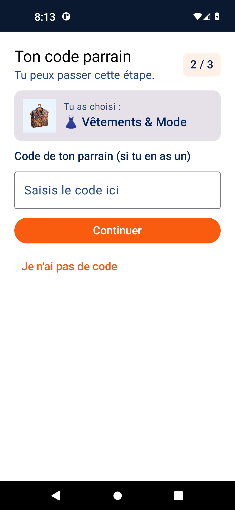](https://github.com/mdgejc14-hash/vitrine-video-d42-arena/blob/e25fe9e/docs/checkpoints/D42_31/visual-review/04_parrainage/font130-fr-010_parrainage.png)
[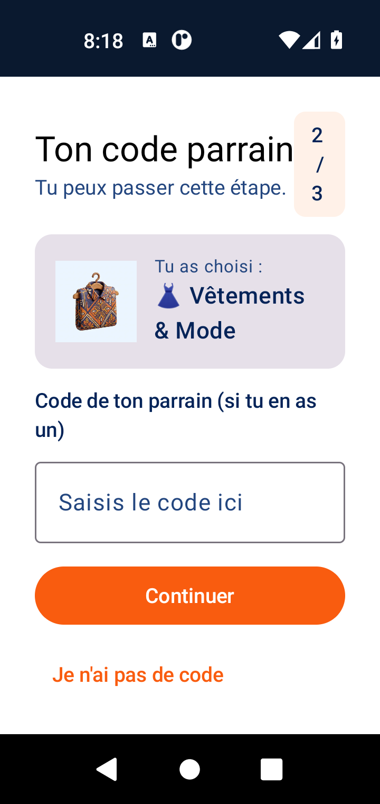](https://github.com/mdgejc14-hash/vitrine-video-d42-arena/blob/e25fe9e/docs/checkpoints/D42_31/visual-review/04_parrainage/petit-fr-010_parrainage.png)

[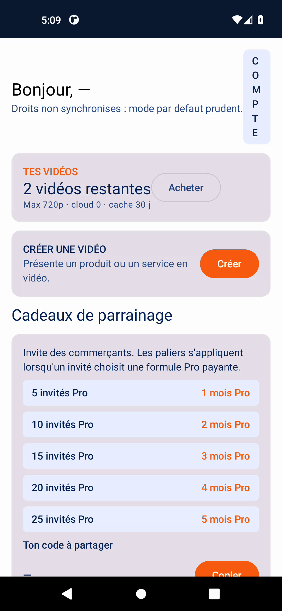](https://github.com/mdgejc14-hash/vitrine-video-d42-arena/blob/e25fe9e/docs/checkpoints/D42_31/visual-review/04_parrainage/suite-fr-030_dashboard_parrainage.png)

## 05_credits — Crédits & paywall

> Le paywall (« Crédits / formules ») est atteint depuis le tableau de bord (UI réelle) — capture screenrecord (run ciblé suite). L'écran de bienvenue crédits vient des parcours standard.

| # | Capture | Titre | État | Langue | Profil | Source | Résolution |
|---|---|---|---|---|---|---|---|
| 11 | [`credits_bienvenue`](https://github.com/mdgejc14-hash/vitrine-video-d42-arena/blob/e25fe9e/docs/checkpoints/D42_31/visual-review/05_credits/base-en-011_credits_bienvenue.png) | Bienvenue — confirmation des crédits | connecté-local | en | base | screencap | 1080x2340 |
| 11 | [`credits_bienvenue`](https://github.com/mdgejc14-hash/vitrine-video-d42-arena/blob/e25fe9e/docs/checkpoints/D42_31/visual-review/05_credits/base-fr-011_credits_bienvenue.png) | Bienvenue — confirmation des crédits | connecté-local | fr | base | screencap | 1080x2340 |
| 11 | [`credits_bienvenue`](https://github.com/mdgejc14-hash/vitrine-video-d42-arena/blob/e25fe9e/docs/checkpoints/D42_31/visual-review/05_credits/font130-fr-011_credits_bienvenue.png) | Bienvenue — confirmation des crédits | connecté-local | fr | font130 | screencap | 1080x2340 |
| 30 | [`paywall`](https://github.com/mdgejc14-hash/vitrine-video-d42-arena/blob/e25fe9e/docs/checkpoints/D42_31/visual-review/05_credits/suite-fr-030_paywall.png) | Crédits / formules — paywall (screenrecord) | offre | fr | suite | screenrecord | 1080x2340 |
| 31 | [`paywall_bas`](https://github.com/mdgejc14-hash/vitrine-video-d42-arena/blob/e25fe9e/docs/checkpoints/D42_31/visual-review/05_credits/suite-fr-031_paywall_bas.png) | Paywall — bas, formules (screenrecord) | défilé | fr | suite | screenrecord | 1080x2340 |

[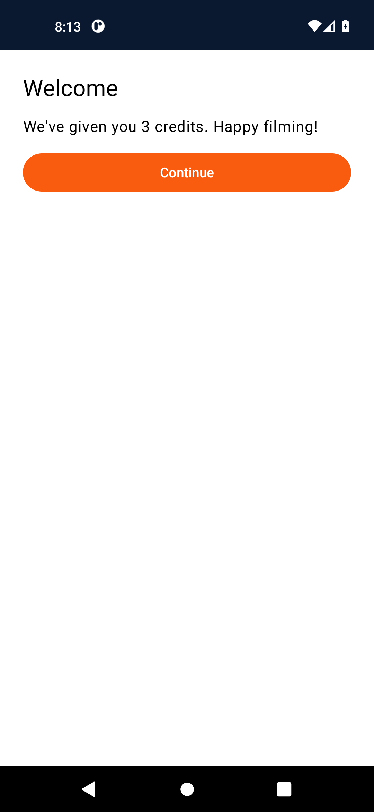](https://github.com/mdgejc14-hash/vitrine-video-d42-arena/blob/e25fe9e/docs/checkpoints/D42_31/visual-review/05_credits/base-en-011_credits_bienvenue.png)
[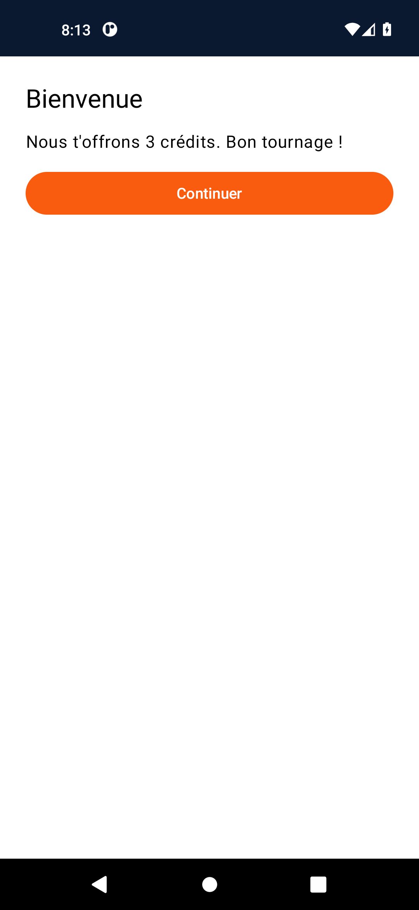](https://github.com/mdgejc14-hash/vitrine-video-d42-arena/blob/e25fe9e/docs/checkpoints/D42_31/visual-review/05_credits/base-fr-011_credits_bienvenue.png)
[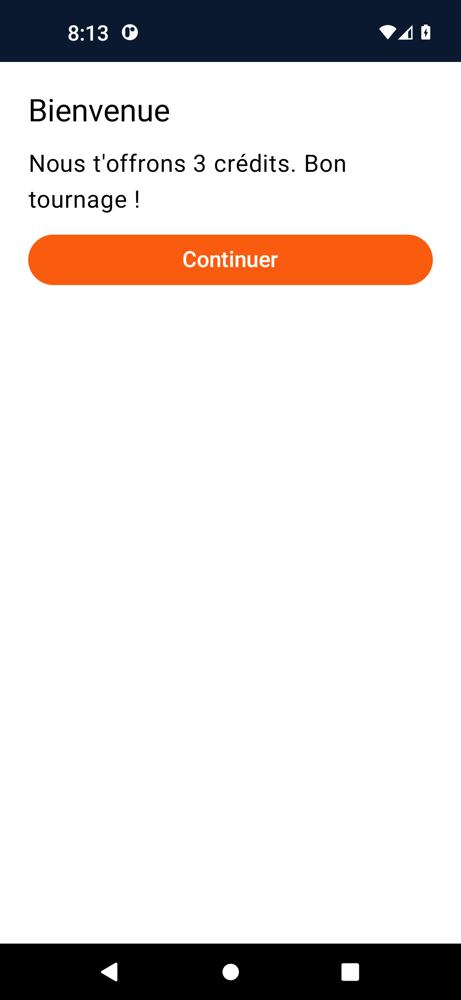](https://github.com/mdgejc14-hash/vitrine-video-d42-arena/blob/e25fe9e/docs/checkpoints/D42_31/visual-review/05_credits/font130-fr-011_credits_bienvenue.png)

## 06_secteurs — Secteurs (activité)

| # | Capture | Titre | État | Langue | Profil | Source | Résolution |
|---|---|---|---|---|---|---|---|
| 8 | [`secteurs`](https://github.com/mdgejc14-hash/vitrine-video-d42-arena/blob/e25fe9e/docs/checkpoints/D42_31/visual-review/06_secteurs/base-en-008_secteurs.png) | Choix du secteur (activité principale) | initial | en | base | screencap | 1080x2340 |
| 9 | [`secteurs_bas`](https://github.com/mdgejc14-hash/vitrine-video-d42-arena/blob/e25fe9e/docs/checkpoints/D42_31/visual-review/06_secteurs/base-en-009_secteurs_bas.png) | Choix du secteur — bas de liste | défilé | en | base | screencap | 1080x2340 |
| 8 | [`secteurs`](https://github.com/mdgejc14-hash/vitrine-video-d42-arena/blob/e25fe9e/docs/checkpoints/D42_31/visual-review/06_secteurs/base-fr-008_secteurs.png) | Choix du secteur (activité principale) | initial | fr | base | screencap | 1080x2340 |
| 9 | [`secteurs_bas`](https://github.com/mdgejc14-hash/vitrine-video-d42-arena/blob/e25fe9e/docs/checkpoints/D42_31/visual-review/06_secteurs/base-fr-009_secteurs_bas.png) | Choix du secteur — bas de liste | défilé | fr | base | screencap | 1080x2340 |
| 17 | [`secteur_change_1`](https://github.com/mdgejc14-hash/vitrine-video-d42-arena/blob/e25fe9e/docs/checkpoints/D42_31/visual-review/06_secteurs/base-fr-017_secteur_change_1.png) | Catalogue — filtres secteur dépliés (itération 1) | changement | fr | base | screencap | 1080x2340 |
| 21 | [`secteur_change_2`](https://github.com/mdgejc14-hash/vitrine-video-d42-arena/blob/e25fe9e/docs/checkpoints/D42_31/visual-review/06_secteurs/base-fr-021_secteur_change_2.png) | Catalogue — filtres secteur dépliés (itération 2) | changement | fr | base | screencap | 1080x2340 |
| 25 | [`secteur_change_3`](https://github.com/mdgejc14-hash/vitrine-video-d42-arena/blob/e25fe9e/docs/checkpoints/D42_31/visual-review/06_secteurs/base-fr-025_secteur_change_3.png) | Catalogue — filtres secteur dépliés (itération 3) | changement | fr | base | screencap | 1080x2340 |
| 29 | [`secteur_change_4`](https://github.com/mdgejc14-hash/vitrine-video-d42-arena/blob/e25fe9e/docs/checkpoints/D42_31/visual-review/06_secteurs/base-fr-029_secteur_change_4.png) | Catalogue — filtres secteur dépliés (itération 4) | changement | fr | base | screencap | 1080x2340 |
| 33 | [`secteur_change_5`](https://github.com/mdgejc14-hash/vitrine-video-d42-arena/blob/e25fe9e/docs/checkpoints/D42_31/visual-review/06_secteurs/base-fr-033_secteur_change_5.png) | Catalogue — filtres secteur dépliés (itération 5) | changement | fr | base | screencap | 1080x2340 |
| 37 | [`secteur_change_6`](https://github.com/mdgejc14-hash/vitrine-video-d42-arena/blob/e25fe9e/docs/checkpoints/D42_31/visual-review/06_secteurs/base-fr-037_secteur_change_6.png) | Catalogue — filtres secteur dépliés (itération 6) | changement | fr | base | screencap | 1080x2340 |
| 8 | [`secteurs`](https://github.com/mdgejc14-hash/vitrine-video-d42-arena/blob/e25fe9e/docs/checkpoints/D42_31/visual-review/06_secteurs/font130-fr-008_secteurs.png) | Choix du secteur (activité principale) | initial | fr | font130 | screencap | 1080x2340 |
| 9 | [`secteurs_bas`](https://github.com/mdgejc14-hash/vitrine-video-d42-arena/blob/e25fe9e/docs/checkpoints/D42_31/visual-review/06_secteurs/font130-fr-009_secteurs_bas.png) | Choix du secteur — bas de liste | défilé | fr | font130 | screencap | 1080x2340 |
| 8 | [`secteurs`](https://github.com/mdgejc14-hash/vitrine-video-d42-arena/blob/e25fe9e/docs/checkpoints/D42_31/visual-review/06_secteurs/petit-fr-008_secteurs.png) | Choix du secteur (activité principale) | initial | fr | petit | screencap | 720x1520 |
| 9 | [`secteurs_bas`](https://github.com/mdgejc14-hash/vitrine-video-d42-arena/blob/e25fe9e/docs/checkpoints/D42_31/visual-review/06_secteurs/petit-fr-009_secteurs_bas.png) | Choix du secteur — bas de liste | défilé | fr | petit | screencap | 720x1520 |

[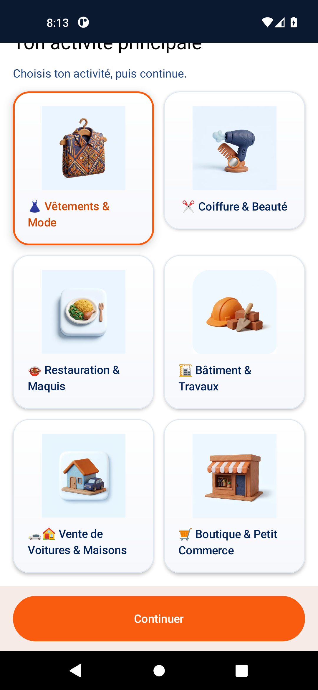](https://github.com/mdgejc14-hash/vitrine-video-d42-arena/blob/e25fe9e/docs/checkpoints/D42_31/visual-review/06_secteurs/base-fr-009_secteurs_bas.png)

[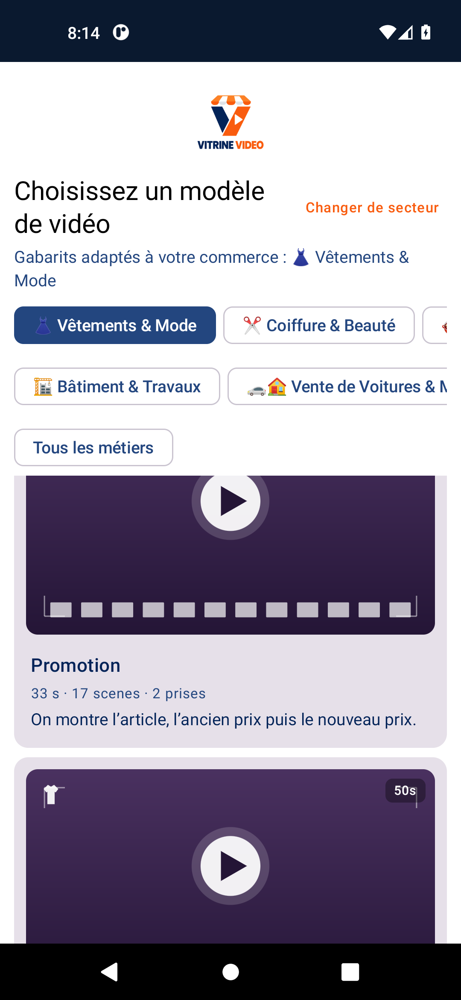](https://github.com/mdgejc14-hash/vitrine-video-d42-arena/blob/e25fe9e/docs/checkpoints/D42_31/visual-review/06_secteurs/base-fr-021_secteur_change_2.png)

[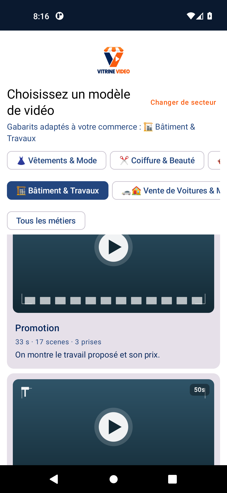](https://github.com/mdgejc14-hash/vitrine-video-d42-arena/blob/e25fe9e/docs/checkpoints/D42_31/visual-review/06_secteurs/base-fr-033_secteur_change_5.png)

[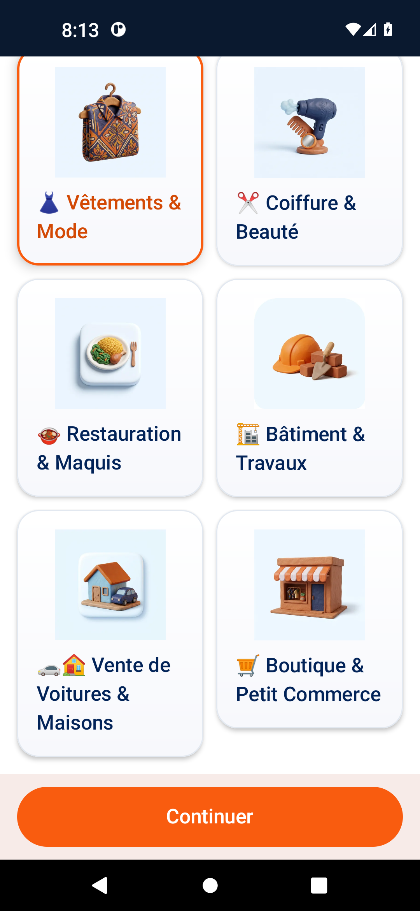](https://github.com/mdgejc14-hash/vitrine-video-d42-arena/blob/e25fe9e/docs/checkpoints/D42_31/visual-review/06_secteurs/font130-fr-009_secteurs_bas.png)

[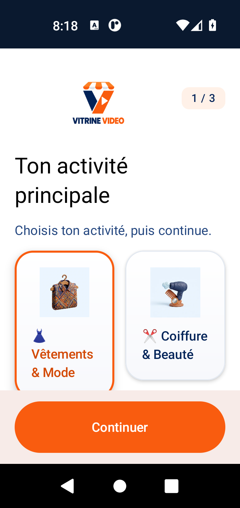](https://github.com/mdgejc14-hash/vitrine-video-d42-arena/blob/e25fe9e/docs/checkpoints/D42_31/visual-review/06_secteurs/petit-fr-008_secteurs.png)

## 07_catalogue — Catalogue

| # | Capture | Titre | État | Langue | Profil | Source | Résolution |
|---|---|---|---|---|---|---|---|
| 12 | [`catalogue_haut`](https://github.com/mdgejc14-hash/vitrine-video-d42-arena/blob/e25fe9e/docs/checkpoints/D42_31/visual-review/07_catalogue/base-en-012_catalogue_haut.png) | Catalogue — haut (secteur sélectionné) | initial | en | base | screencap | 1080x2340 |
| 13 | [`catalogue_scroll1`](https://github.com/mdgejc14-hash/vitrine-video-d42-arena/blob/e25fe9e/docs/checkpoints/D42_31/visual-review/07_catalogue/base-en-013_catalogue_scroll1.png) | Catalogue — position 1 | défilé | en | base | screencap | 1080x2340 |
| 14 | [`catalogue_scroll2`](https://github.com/mdgejc14-hash/vitrine-video-d42-arena/blob/e25fe9e/docs/checkpoints/D42_31/visual-review/07_catalogue/base-en-014_catalogue_scroll2.png) | Catalogue — position 2 | défilé | en | base | screencap | 1080x2340 |
| 15 | [`catalogue_scroll3`](https://github.com/mdgejc14-hash/vitrine-video-d42-arena/blob/e25fe9e/docs/checkpoints/D42_31/visual-review/07_catalogue/base-en-015_catalogue_scroll3.png) | Catalogue — position 3 | défilé | en | base | screencap | 1080x2340 |
| 16 | [`catalogue_scroll4`](https://github.com/mdgejc14-hash/vitrine-video-d42-arena/blob/e25fe9e/docs/checkpoints/D42_31/visual-review/07_catalogue/base-en-016_catalogue_scroll4.png) | Catalogue — position 4 | défilé | en | base | screencap | 1080x2340 |
| 12 | [`catalogue_haut`](https://github.com/mdgejc14-hash/vitrine-video-d42-arena/blob/e25fe9e/docs/checkpoints/D42_31/visual-review/07_catalogue/base-fr-012_catalogue_haut.png) | Catalogue — haut (secteur sélectionné) | initial | fr | base | screencap | 1080x2340 |
| 13 | [`catalogue_scroll1`](https://github.com/mdgejc14-hash/vitrine-video-d42-arena/blob/e25fe9e/docs/checkpoints/D42_31/visual-review/07_catalogue/base-fr-013_catalogue_scroll1.png) | Catalogue — position 1 | défilé | fr | base | screencap | 1080x2340 |
| 14 | [`catalogue_scroll2`](https://github.com/mdgejc14-hash/vitrine-video-d42-arena/blob/e25fe9e/docs/checkpoints/D42_31/visual-review/07_catalogue/base-fr-014_catalogue_scroll2.png) | Catalogue — position 2 | défilé | fr | base | screencap | 1080x2340 |
| 15 | [`catalogue_scroll3`](https://github.com/mdgejc14-hash/vitrine-video-d42-arena/blob/e25fe9e/docs/checkpoints/D42_31/visual-review/07_catalogue/base-fr-015_catalogue_scroll3.png) | Catalogue — position 3 | défilé | fr | base | screencap | 1080x2340 |
| 16 | [`catalogue_scroll4`](https://github.com/mdgejc14-hash/vitrine-video-d42-arena/blob/e25fe9e/docs/checkpoints/D42_31/visual-review/07_catalogue/base-fr-016_catalogue_scroll4.png) | Catalogue — position 4 | défilé | fr | base | screencap | 1080x2340 |
| 12 | [`catalogue_haut`](https://github.com/mdgejc14-hash/vitrine-video-d42-arena/blob/e25fe9e/docs/checkpoints/D42_31/visual-review/07_catalogue/font130-fr-012_catalogue_haut.png) | Catalogue — haut (secteur sélectionné) | initial | fr | font130 | screencap | 1080x2340 |
| 13 | [`catalogue_scroll1`](https://github.com/mdgejc14-hash/vitrine-video-d42-arena/blob/e25fe9e/docs/checkpoints/D42_31/visual-review/07_catalogue/font130-fr-013_catalogue_scroll1.png) | Catalogue — position 1 | défilé | fr | font130 | screencap | 1080x2340 |
| 14 | [`catalogue_scroll2`](https://github.com/mdgejc14-hash/vitrine-video-d42-arena/blob/e25fe9e/docs/checkpoints/D42_31/visual-review/07_catalogue/font130-fr-014_catalogue_scroll2.png) | Catalogue — position 2 | défilé | fr | font130 | screencap | 1080x2340 |
| 15 | [`catalogue_scroll3`](https://github.com/mdgejc14-hash/vitrine-video-d42-arena/blob/e25fe9e/docs/checkpoints/D42_31/visual-review/07_catalogue/font130-fr-015_catalogue_scroll3.png) | Catalogue — position 3 | défilé | fr | font130 | screencap | 1080x2340 |
| 16 | [`catalogue_scroll4`](https://github.com/mdgejc14-hash/vitrine-video-d42-arena/blob/e25fe9e/docs/checkpoints/D42_31/visual-review/07_catalogue/font130-fr-016_catalogue_scroll4.png) | Catalogue — position 4 | défilé | fr | font130 | screencap | 1080x2340 |
| 11 | [`catalogue_haut`](https://github.com/mdgejc14-hash/vitrine-video-d42-arena/blob/e25fe9e/docs/checkpoints/D42_31/visual-review/07_catalogue/petit-fr-011_catalogue_haut.png) | Catalogue — haut (secteur sélectionné) | initial | fr | petit | screencap | 720x1520 |
| 12 | [`catalogue_scroll1`](https://github.com/mdgejc14-hash/vitrine-video-d42-arena/blob/e25fe9e/docs/checkpoints/D42_31/visual-review/07_catalogue/petit-fr-012_catalogue_scroll1.png) | Catalogue — position 1 | défilé | fr | petit | screencap | 720x1520 |
| 13 | [`catalogue_scroll2`](https://github.com/mdgejc14-hash/vitrine-video-d42-arena/blob/e25fe9e/docs/checkpoints/D42_31/visual-review/07_catalogue/petit-fr-013_catalogue_scroll2.png) | Catalogue — position 2 | défilé | fr | petit | screencap | 720x1520 |
| 14 | [`catalogue_scroll3`](https://github.com/mdgejc14-hash/vitrine-video-d42-arena/blob/e25fe9e/docs/checkpoints/D42_31/visual-review/07_catalogue/petit-fr-014_catalogue_scroll3.png) | Catalogue — position 3 | défilé | fr | petit | screencap | 720x1520 |
| 15 | [`catalogue_scroll4`](https://github.com/mdgejc14-hash/vitrine-video-d42-arena/blob/e25fe9e/docs/checkpoints/D42_31/visual-review/07_catalogue/petit-fr-015_catalogue_scroll4.png) | Catalogue — position 4 | défilé | fr | petit | screencap | 720x1520 |
| 16 | [`catalogue_scroll5`](https://github.com/mdgejc14-hash/vitrine-video-d42-arena/blob/e25fe9e/docs/checkpoints/D42_31/visual-review/07_catalogue/petit-fr-016_catalogue_scroll5.png) | Catalogue — position 5 | défilé | fr | petit | screencap | 720x1520 |

[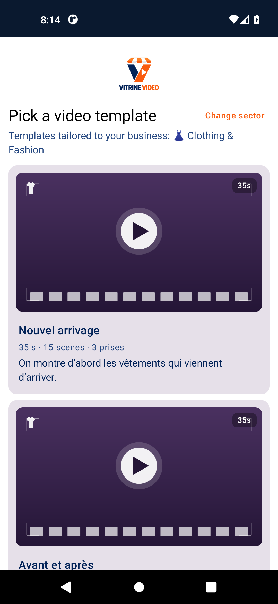](https://github.com/mdgejc14-hash/vitrine-video-d42-arena/blob/e25fe9e/docs/checkpoints/D42_31/visual-review/07_catalogue/base-en-012_catalogue_haut.png)
[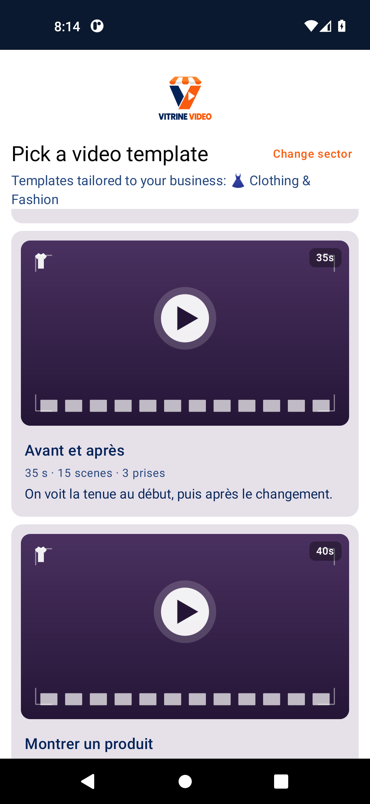](https://github.com/mdgejc14-hash/vitrine-video-d42-arena/blob/e25fe9e/docs/checkpoints/D42_31/visual-review/07_catalogue/base-en-013_catalogue_scroll1.png)

[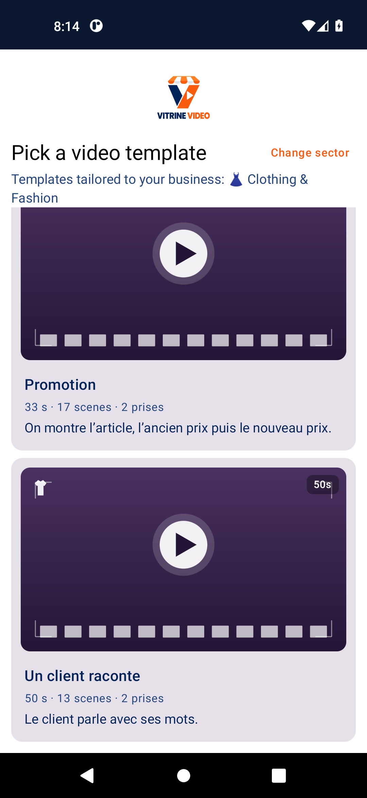](https://github.com/mdgejc14-hash/vitrine-video-d42-arena/blob/e25fe9e/docs/checkpoints/D42_31/visual-review/07_catalogue/base-en-016_catalogue_scroll4.png)
[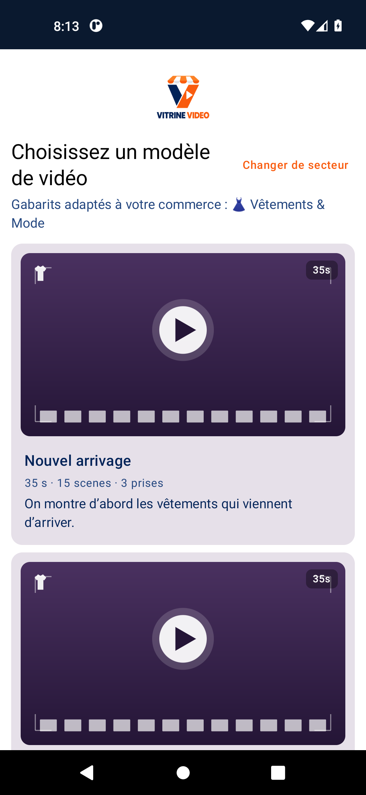](https://github.com/mdgejc14-hash/vitrine-video-d42-arena/blob/e25fe9e/docs/checkpoints/D42_31/visual-review/07_catalogue/base-fr-012_catalogue_haut.png)

[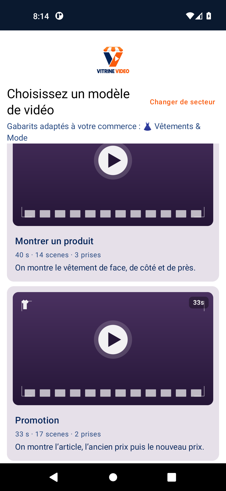](https://github.com/mdgejc14-hash/vitrine-video-d42-arena/blob/e25fe9e/docs/checkpoints/D42_31/visual-review/07_catalogue/base-fr-014_catalogue_scroll2.png)

[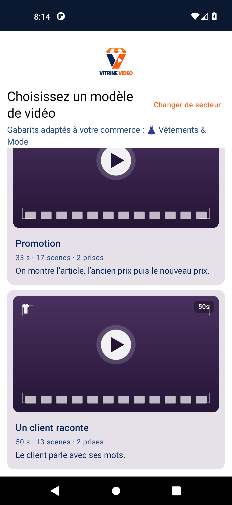](https://github.com/mdgejc14-hash/vitrine-video-d42-arena/blob/e25fe9e/docs/checkpoints/D42_31/visual-review/07_catalogue/base-fr-015_catalogue_scroll3.png)

[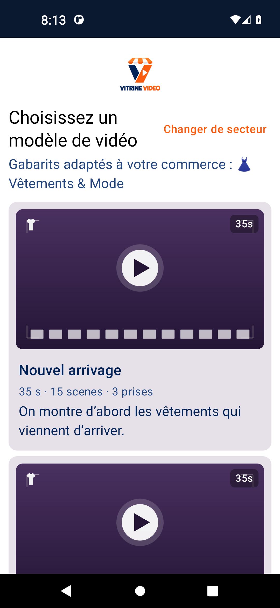](https://github.com/mdgejc14-hash/vitrine-video-d42-arena/blob/e25fe9e/docs/checkpoints/D42_31/visual-review/07_catalogue/font130-fr-012_catalogue_haut.png)
[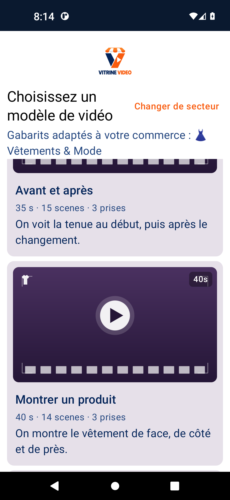](https://github.com/mdgejc14-hash/vitrine-video-d42-arena/blob/e25fe9e/docs/checkpoints/D42_31/visual-review/07_catalogue/font130-fr-013_catalogue_scroll1.png)

[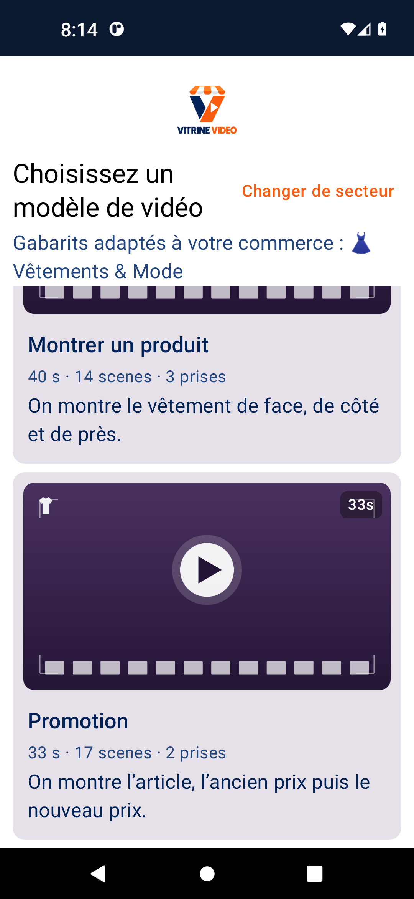](https://github.com/mdgejc14-hash/vitrine-video-d42-arena/blob/e25fe9e/docs/checkpoints/D42_31/visual-review/07_catalogue/font130-fr-014_catalogue_scroll2.png)
[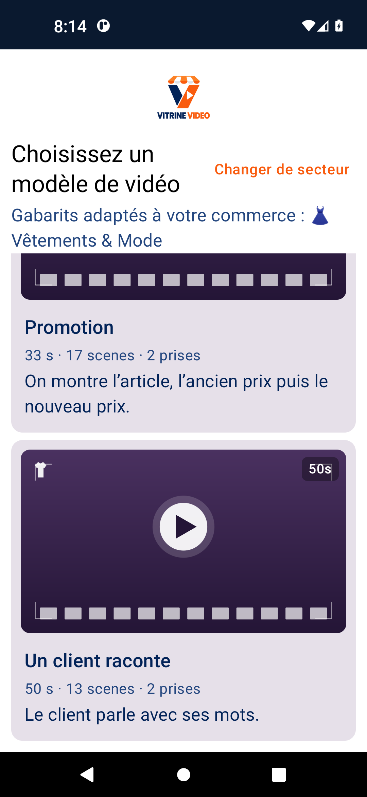](https://github.com/mdgejc14-hash/vitrine-video-d42-arena/blob/e25fe9e/docs/checkpoints/D42_31/visual-review/07_catalogue/font130-fr-015_catalogue_scroll3.png)

[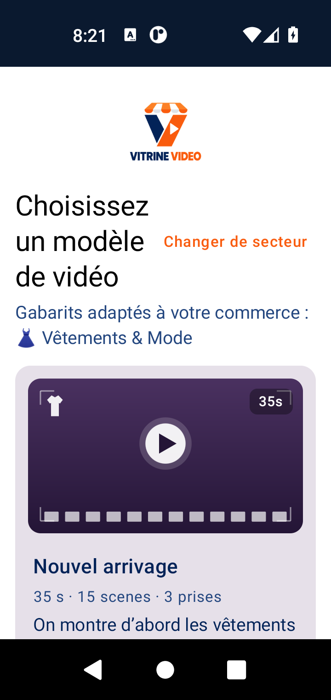](https://github.com/mdgejc14-hash/vitrine-video-d42-arena/blob/e25fe9e/docs/checkpoints/D42_31/visual-review/07_catalogue/petit-fr-011_catalogue_haut.png)

[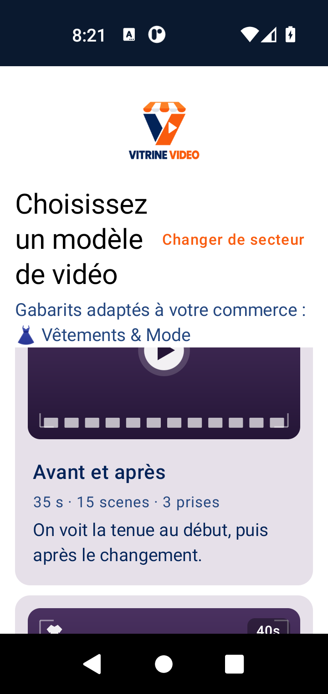](https://github.com/mdgejc14-hash/vitrine-video-d42-arena/blob/e25fe9e/docs/checkpoints/D42_31/visual-review/07_catalogue/petit-fr-012_catalogue_scroll1.png)
[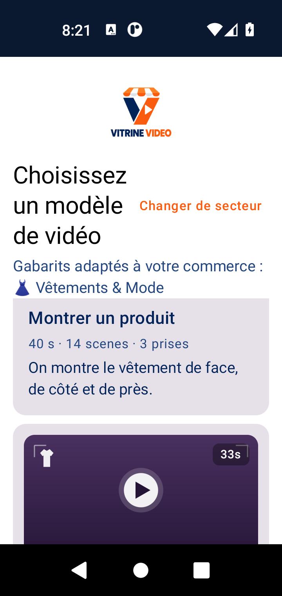](https://github.com/mdgejc14-hash/vitrine-video-d42-arena/blob/e25fe9e/docs/checkpoints/D42_31/visual-review/07_catalogue/petit-fr-013_catalogue_scroll2.png)

[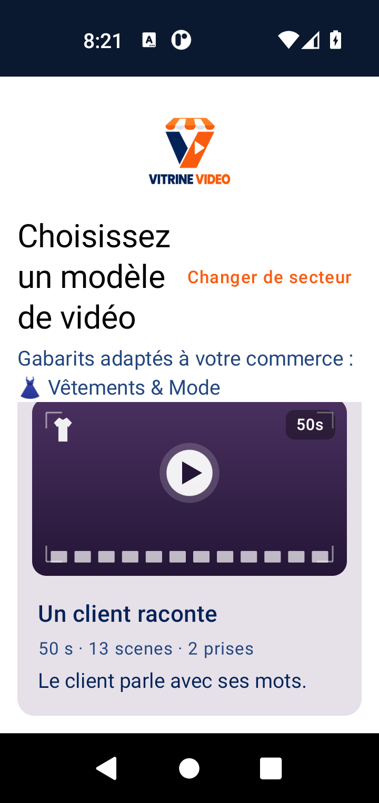](https://github.com/mdgejc14-hash/vitrine-video-d42-arena/blob/e25fe9e/docs/checkpoints/D42_31/visual-review/07_catalogue/petit-fr-016_catalogue_scroll5.png)

## 08_gabarits — Gabarits — les 30 modèles, par secteur

Les 30 gabarits (6 secteurs × 5 formats) vivent dans les catalogues sectoriels : Commerce = catalogue initial (`07_catalogue`) ; Mode/Coiffure/Restauration/Bâtiment/Immo-Auto = captures `catalogue_secteur1..5` ci-dessous. Détail : [GABARITS_INVENTAIRE.csv](GABARITS_INVENTAIRE.csv).

| # | Capture | Titre | État | Langue | Profil | Source | Résolution |
|---|---|---|---|---|---|---|---|
| 18 | [`catalogue_secteur1`](https://github.com/mdgejc14-hash/vitrine-video-d42-arena/blob/e25fe9e/docs/checkpoints/D42_31/visual-review/08_gabarits/base-fr-018_catalogue_secteur1.png) | Catalogue — secteur « Vêtements » (en-tête de focus) | secteur 1 | fr | base | screencap | 1080x2340 |
| 19 | [`catalogue_secteur1_scroll1`](https://github.com/mdgejc14-hash/vitrine-video-d42-arena/blob/e25fe9e/docs/checkpoints/D42_31/visual-review/08_gabarits/base-fr-019_catalogue_secteur1_scroll1.png) | Catalogue — secteur « Vêtements », position 1 | secteur 1, défilé | fr | base | screencap | 1080x2340 |
| 20 | [`catalogue_secteur1_scroll2`](https://github.com/mdgejc14-hash/vitrine-video-d42-arena/blob/e25fe9e/docs/checkpoints/D42_31/visual-review/08_gabarits/base-fr-020_catalogue_secteur1_scroll2.png) | Catalogue — secteur « Vêtements », position 2 | secteur 1, défilé | fr | base | screencap | 1080x2340 |
| 22 | [`catalogue_secteur2`](https://github.com/mdgejc14-hash/vitrine-video-d42-arena/blob/e25fe9e/docs/checkpoints/D42_31/visual-review/08_gabarits/base-fr-022_catalogue_secteur2.png) | Catalogue — secteur « Coiffure » (en-tête de focus) | secteur 2 | fr | base | screencap | 1080x2340 |
| 23 | [`catalogue_secteur2_scroll1`](https://github.com/mdgejc14-hash/vitrine-video-d42-arena/blob/e25fe9e/docs/checkpoints/D42_31/visual-review/08_gabarits/base-fr-023_catalogue_secteur2_scroll1.png) | Catalogue — secteur « Coiffure », position 1 | secteur 2, défilé | fr | base | screencap | 1080x2340 |
| 24 | [`catalogue_secteur2_scroll2`](https://github.com/mdgejc14-hash/vitrine-video-d42-arena/blob/e25fe9e/docs/checkpoints/D42_31/visual-review/08_gabarits/base-fr-024_catalogue_secteur2_scroll2.png) | Catalogue — secteur « Coiffure », position 2 | secteur 2, défilé | fr | base | screencap | 1080x2340 |
| 26 | [`catalogue_secteur3`](https://github.com/mdgejc14-hash/vitrine-video-d42-arena/blob/e25fe9e/docs/checkpoints/D42_31/visual-review/08_gabarits/base-fr-026_catalogue_secteur3.png) | Catalogue — secteur « Restauration » (en-tête de focus) | secteur 3 | fr | base | screencap | 1080x2340 |
| 27 | [`catalogue_secteur3_scroll1`](https://github.com/mdgejc14-hash/vitrine-video-d42-arena/blob/e25fe9e/docs/checkpoints/D42_31/visual-review/08_gabarits/base-fr-027_catalogue_secteur3_scroll1.png) | Catalogue — secteur « Restauration », position 1 | secteur 3, défilé | fr | base | screencap | 1080x2340 |
| 28 | [`catalogue_secteur3_scroll2`](https://github.com/mdgejc14-hash/vitrine-video-d42-arena/blob/e25fe9e/docs/checkpoints/D42_31/visual-review/08_gabarits/base-fr-028_catalogue_secteur3_scroll2.png) | Catalogue — secteur « Restauration », position 2 | secteur 3, défilé | fr | base | screencap | 1080x2340 |
| 30 | [`catalogue_secteur4`](https://github.com/mdgejc14-hash/vitrine-video-d42-arena/blob/e25fe9e/docs/checkpoints/D42_31/visual-review/08_gabarits/base-fr-030_catalogue_secteur4.png) | Catalogue — secteur « Bâtiment » (en-tête de focus) | secteur 4 | fr | base | screencap | 1080x2340 |
| 31 | [`catalogue_secteur4_scroll1`](https://github.com/mdgejc14-hash/vitrine-video-d42-arena/blob/e25fe9e/docs/checkpoints/D42_31/visual-review/08_gabarits/base-fr-031_catalogue_secteur4_scroll1.png) | Catalogue — secteur « Bâtiment », position 1 | secteur 4, défilé | fr | base | screencap | 1080x2340 |
| 32 | [`catalogue_secteur4_scroll2`](https://github.com/mdgejc14-hash/vitrine-video-d42-arena/blob/e25fe9e/docs/checkpoints/D42_31/visual-review/08_gabarits/base-fr-032_catalogue_secteur4_scroll2.png) | Catalogue — secteur « Bâtiment », position 2 | secteur 4, défilé | fr | base | screencap | 1080x2340 |
| 34 | [`catalogue_secteur5`](https://github.com/mdgejc14-hash/vitrine-video-d42-arena/blob/e25fe9e/docs/checkpoints/D42_31/visual-review/08_gabarits/base-fr-034_catalogue_secteur5.png) | Catalogue — secteur « Voitures » (en-tête de focus) | secteur 5 | fr | base | screencap | 1080x2340 |
| 35 | [`catalogue_secteur5_scroll1`](https://github.com/mdgejc14-hash/vitrine-video-d42-arena/blob/e25fe9e/docs/checkpoints/D42_31/visual-review/08_gabarits/base-fr-035_catalogue_secteur5_scroll1.png) | Catalogue — secteur « Voitures », position 1 | secteur 5, défilé | fr | base | screencap | 1080x2340 |
| 36 | [`catalogue_secteur5_scroll2`](https://github.com/mdgejc14-hash/vitrine-video-d42-arena/blob/e25fe9e/docs/checkpoints/D42_31/visual-review/08_gabarits/base-fr-036_catalogue_secteur5_scroll2.png) | Catalogue — secteur « Voitures », position 2 | secteur 5, défilé | fr | base | screencap | 1080x2340 |

[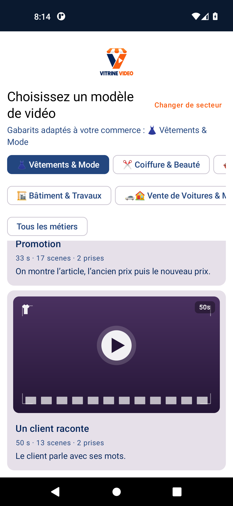](https://github.com/mdgejc14-hash/vitrine-video-d42-arena/blob/e25fe9e/docs/checkpoints/D42_31/visual-review/08_gabarits/base-fr-020_catalogue_secteur1_scroll2.png)

[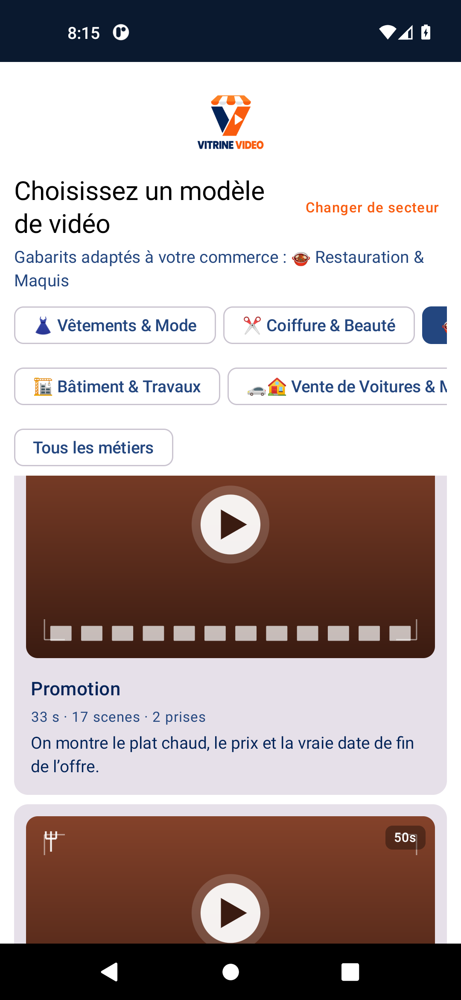](https://github.com/mdgejc14-hash/vitrine-video-d42-arena/blob/e25fe9e/docs/checkpoints/D42_31/visual-review/08_gabarits/base-fr-026_catalogue_secteur3.png)
[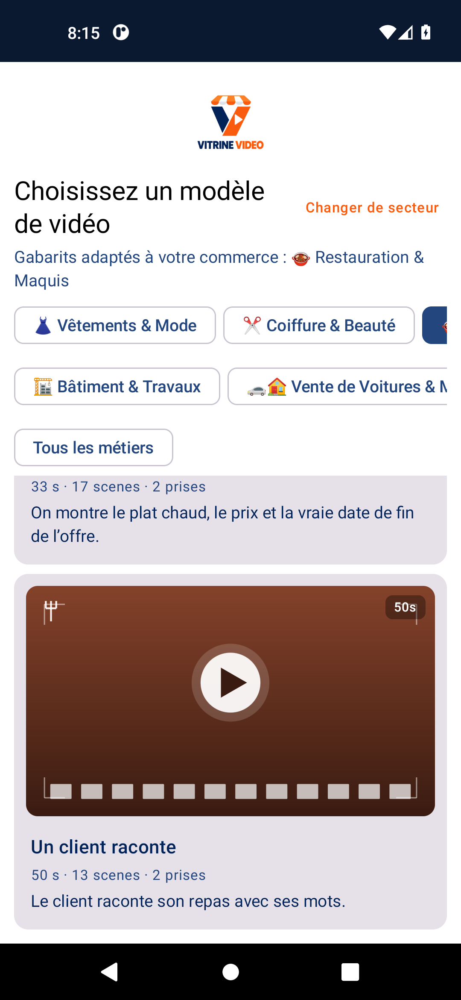](https://github.com/mdgejc14-hash/vitrine-video-d42-arena/blob/e25fe9e/docs/checkpoints/D42_31/visual-review/08_gabarits/base-fr-027_catalogue_secteur3_scroll1.png)

[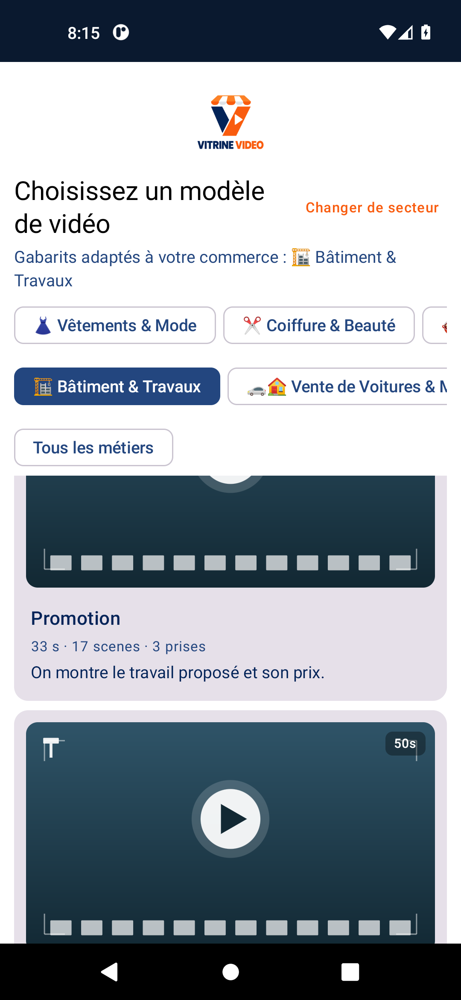](https://github.com/mdgejc14-hash/vitrine-video-d42-arena/blob/e25fe9e/docs/checkpoints/D42_31/visual-review/08_gabarits/base-fr-030_catalogue_secteur4.png)
[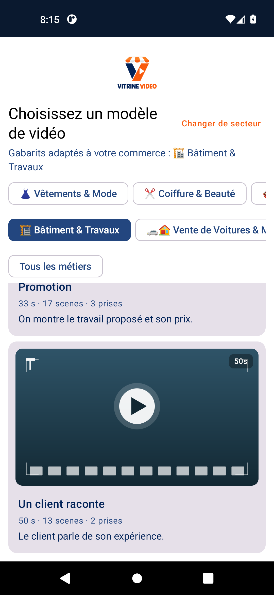](https://github.com/mdgejc14-hash/vitrine-video-d42-arena/blob/e25fe9e/docs/checkpoints/D42_31/visual-review/08_gabarits/base-fr-031_catalogue_secteur4_scroll1.png)

[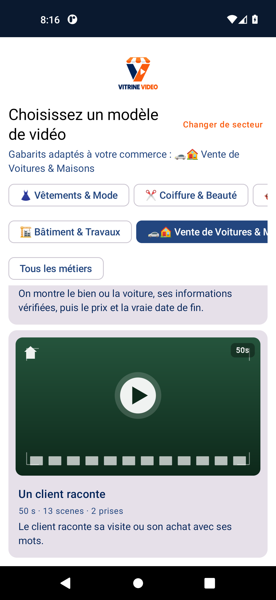](https://github.com/mdgejc14-hash/vitrine-video-d42-arena/blob/e25fe9e/docs/checkpoints/D42_31/visual-review/08_gabarits/base-fr-035_catalogue_secteur5_scroll1.png)

## 09_brief — Brief (fiche produit)

| # | Capture | Titre | État | Langue | Profil | Source | Résolution |
|---|---|---|---|---|---|---|---|
| 17 | [`brief_vide`](https://github.com/mdgejc14-hash/vitrine-video-d42-arena/blob/e25fe9e/docs/checkpoints/D42_31/visual-review/09_brief/base-en-017_brief_vide.png) | Formulaire de brief — vide (Continuer désactivé) | vide | en | base | screencap | 1080x2340 |
| 19 | [`brief_rempli`](https://github.com/mdgejc14-hash/vitrine-video-d42-arena/blob/e25fe9e/docs/checkpoints/D42_31/visual-review/09_brief/base-en-019_brief_rempli.png) | Formulaire de brief — rempli (valeurs fictives) | rempli | en | base | screencap | 1080x2340 |
| 20 | [`brief_final`](https://github.com/mdgejc14-hash/vitrine-video-d42-arena/blob/e25fe9e/docs/checkpoints/D42_31/visual-review/09_brief/base-en-020_brief_final.png) | Formulaire de brief — état final avant validation | prêt | en | base | screencap | 1080x2340 |
| 21 | [`brief_etape1`](https://github.com/mdgejc14-hash/vitrine-video-d42-arena/blob/e25fe9e/docs/checkpoints/D42_31/visual-review/09_brief/base-en-021_brief_etape1.png) | Brief — étape 1 (multi-étapes) | étape 1 | en | base | screencap | 1080x2340 |
| 38 | [`brief_vide`](https://github.com/mdgejc14-hash/vitrine-video-d42-arena/blob/e25fe9e/docs/checkpoints/D42_31/visual-review/09_brief/base-fr-038_brief_vide.png) | Formulaire de brief — vide (Continuer désactivé) | vide | fr | base | screencap | 1080x2340 |
| 40 | [`brief_rempli`](https://github.com/mdgejc14-hash/vitrine-video-d42-arena/blob/e25fe9e/docs/checkpoints/D42_31/visual-review/09_brief/base-fr-040_brief_rempli.png) | Formulaire de brief — rempli (valeurs fictives) | rempli | fr | base | screencap | 1080x2340 |
| 41 | [`brief_final`](https://github.com/mdgejc14-hash/vitrine-video-d42-arena/blob/e25fe9e/docs/checkpoints/D42_31/visual-review/09_brief/base-fr-041_brief_final.png) | Formulaire de brief — état final avant validation | prêt | fr | base | screencap | 1080x2340 |
| 17 | [`brief_vide`](https://github.com/mdgejc14-hash/vitrine-video-d42-arena/blob/e25fe9e/docs/checkpoints/D42_31/visual-review/09_brief/font130-fr-017_brief_vide.png) | Formulaire de brief — vide (Continuer désactivé) | vide | fr | font130 | screencap | 1080x2340 |
| 19 | [`brief_rempli`](https://github.com/mdgejc14-hash/vitrine-video-d42-arena/blob/e25fe9e/docs/checkpoints/D42_31/visual-review/09_brief/font130-fr-019_brief_rempli.png) | Formulaire de brief — rempli (valeurs fictives) | rempli | fr | font130 | screencap | 1080x2340 |
| 20 | [`brief_final`](https://github.com/mdgejc14-hash/vitrine-video-d42-arena/blob/e25fe9e/docs/checkpoints/D42_31/visual-review/09_brief/font130-fr-020_brief_final.png) | Formulaire de brief — état final avant validation | prêt | fr | font130 | screencap | 1080x2340 |
| 21 | [`variante_resume`](https://github.com/mdgejc14-hash/vitrine-video-d42-arena/blob/e25fe9e/docs/checkpoints/D42_31/visual-review/09_brief/font130-fr-021_variante_resume.png) | Variante font130 — brief rempli (état final) | variante font130 | fr | font130 | screencap | 1080x2340 |
| 17 | [`brief_vide`](https://github.com/mdgejc14-hash/vitrine-video-d42-arena/blob/e25fe9e/docs/checkpoints/D42_31/visual-review/09_brief/petit-fr-017_brief_vide.png) | Formulaire de brief — vide (Continuer désactivé) | vide | fr | petit | screencap | 720x1520 |
| 18 | [`brief_rempli`](https://github.com/mdgejc14-hash/vitrine-video-d42-arena/blob/e25fe9e/docs/checkpoints/D42_31/visual-review/09_brief/petit-fr-018_brief_rempli.png) | Formulaire de brief — rempli (valeurs fictives) | rempli | fr | petit | screencap | 720x1520 |
| 19 | [`brief_final`](https://github.com/mdgejc14-hash/vitrine-video-d42-arena/blob/e25fe9e/docs/checkpoints/D42_31/visual-review/09_brief/petit-fr-019_brief_final.png) | Formulaire de brief — état final avant validation | prêt | fr | petit | screencap | 720x1520 |
| 20 | [`variante_resume`](https://github.com/mdgejc14-hash/vitrine-video-d42-arena/blob/e25fe9e/docs/checkpoints/D42_31/visual-review/09_brief/petit-fr-020_variante_resume.png) | Variante petit — brief rempli (état final) | variante petit | fr | petit | screencap | 720x1520 |

[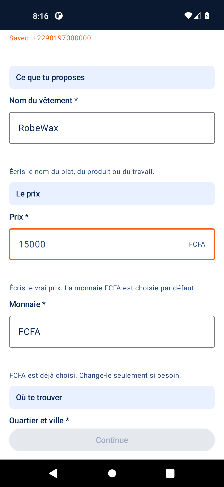](https://github.com/mdgejc14-hash/vitrine-video-d42-arena/blob/e25fe9e/docs/checkpoints/D42_31/visual-review/09_brief/base-en-020_brief_final.png)
[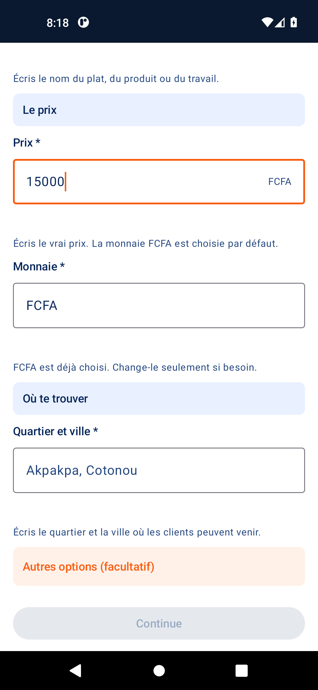](https://github.com/mdgejc14-hash/vitrine-video-d42-arena/blob/e25fe9e/docs/checkpoints/D42_31/visual-review/09_brief/base-en-021_brief_etape1.png)

[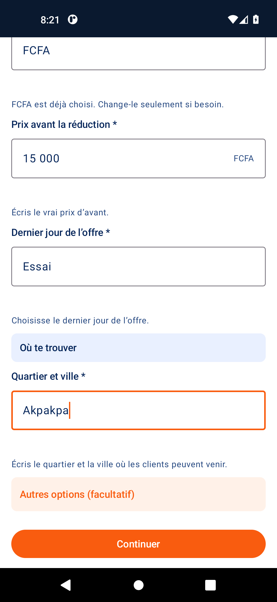](https://github.com/mdgejc14-hash/vitrine-video-d42-arena/blob/e25fe9e/docs/checkpoints/D42_31/visual-review/09_brief/base-fr-040_brief_rempli.png)
[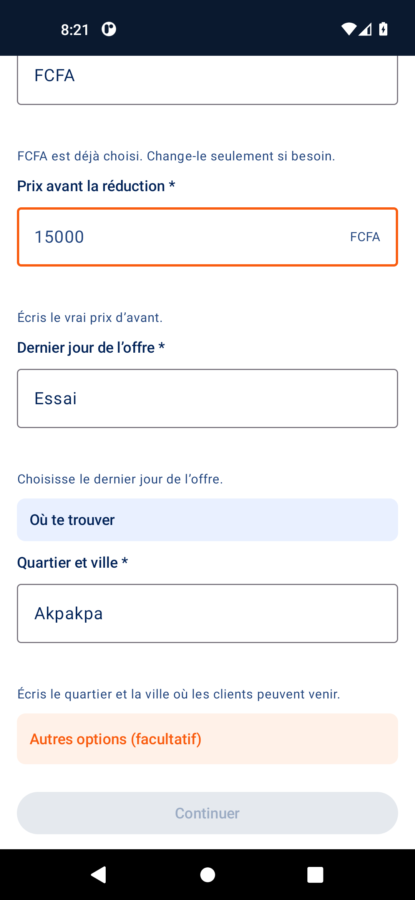](https://github.com/mdgejc14-hash/vitrine-video-d42-arena/blob/e25fe9e/docs/checkpoints/D42_31/visual-review/09_brief/base-fr-041_brief_final.png)

[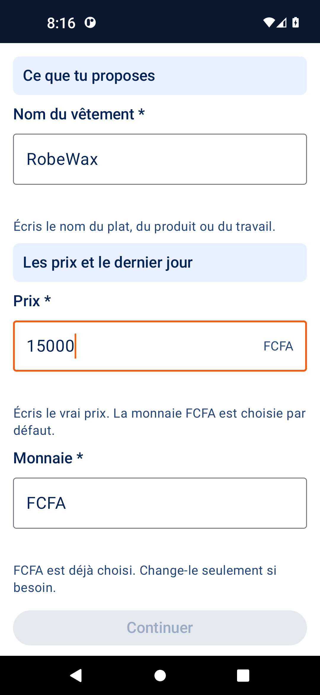](https://github.com/mdgejc14-hash/vitrine-video-d42-arena/blob/e25fe9e/docs/checkpoints/D42_31/visual-review/09_brief/font130-fr-019_brief_rempli.png)

[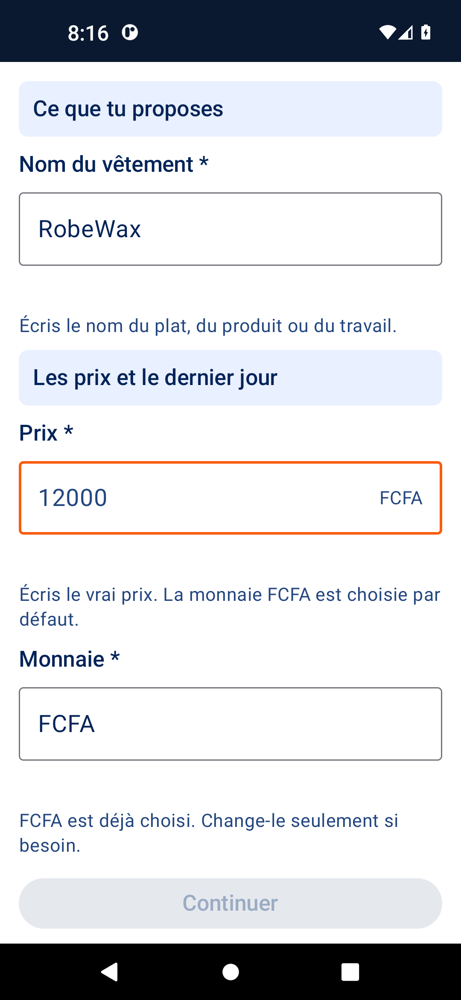](https://github.com/mdgejc14-hash/vitrine-video-d42-arena/blob/e25fe9e/docs/checkpoints/D42_31/visual-review/09_brief/font130-fr-021_variante_resume.png)

## 10_formulaires — Formulaires — clavier & erreurs

| # | Capture | Titre | État | Langue | Profil | Source | Résolution |
|---|---|---|---|---|---|---|---|
| 18 | [`brief_whatsapp_clavier`](https://github.com/mdgejc14-hash/vitrine-video-d42-arena/blob/e25fe9e/docs/checkpoints/D42_31/visual-review/10_formulaires/base-en-018_brief_whatsapp_clavier.png) | Champ WhatsApp — clavier ouvert | clavier ouvert | en | base | screencap | 1080x2340 |
| 19 | [`brief_erreur_whatsapp`](https://github.com/mdgejc14-hash/vitrine-video-d42-arena/blob/e25fe9e/docs/checkpoints/D42_31/visual-review/10_formulaires/base-en-019_brief_erreur_whatsapp.png) | Erreur de validation du numéro (9 chiffres) | erreur | en | base | screencap | 1080x2340 |
| 39 | [`brief_whatsapp_clavier`](https://github.com/mdgejc14-hash/vitrine-video-d42-arena/blob/e25fe9e/docs/checkpoints/D42_31/visual-review/10_formulaires/base-fr-039_brief_whatsapp_clavier.png) | Champ WhatsApp — clavier ouvert | clavier ouvert | fr | base | screencap | 1080x2340 |
| 41 | [`brief_erreur_whatsapp`](https://github.com/mdgejc14-hash/vitrine-video-d42-arena/blob/e25fe9e/docs/checkpoints/D42_31/visual-review/10_formulaires/base-fr-041_brief_erreur_whatsapp.png) | Erreur de validation du numéro (9 chiffres) | erreur | fr | base | screencap | 1080x2340 |
| 18 | [`brief_whatsapp_clavier`](https://github.com/mdgejc14-hash/vitrine-video-d42-arena/blob/e25fe9e/docs/checkpoints/D42_31/visual-review/10_formulaires/font130-fr-018_brief_whatsapp_clavier.png) | Champ WhatsApp — clavier ouvert | clavier ouvert | fr | font130 | screencap | 1080x2340 |

## 11_verification — Vérification (avant de commencer)

| # | Capture | Titre | État | Langue | Profil | Source | Résolution |
|---|---|---|---|---|---|---|---|
| 22 | [`verification`](https://github.com/mdgejc14-hash/vitrine-video-d42-arena/blob/e25fe9e/docs/checkpoints/D42_31/visual-review/11_verification/base-en-022_verification.png) | Écran de vérification (avant de commencer) | récapitulatif | en | base | screencap | 1080x2340 |
| 23 | [`verification_bas`](https://github.com/mdgejc14-hash/vitrine-video-d42-arena/blob/e25fe9e/docs/checkpoints/D42_31/visual-review/11_verification/base-en-023_verification_bas.png) | Vérification — bas de l'écran | défilé | en | base | screencap | 1080x2340 |
| 42 | [`verification`](https://github.com/mdgejc14-hash/vitrine-video-d42-arena/blob/e25fe9e/docs/checkpoints/D42_31/visual-review/11_verification/base-fr-042_verification.png) | Écran de vérification (avant de commencer) | récapitulatif | fr | base | screencap | 1080x2340 |
| 43 | [`verification_bas`](https://github.com/mdgejc14-hash/vitrine-video-d42-arena/blob/e25fe9e/docs/checkpoints/D42_31/visual-review/11_verification/base-fr-043_verification_bas.png) | Vérification — bas de l'écran | défilé | fr | base | screencap | 1080x2340 |

## 12_camera — Caméra — permission & viseur

> **Note viseur (IMAGE-FIX)** : l'artefact « mosaïque en bandes » constaté par le fondateur provient de la capture `screencap` du SurfaceView (PreviewView) sous swiftshader — le flux CameraX et l'enregistrement sont SAINS (preuve : frames du MP4 exporté, riches et détaillées). Les captures marquées **screenrecord** (profil `camerafix`, run 43395637118) proviennent de la sortie composée réelle ; les anciennes captures screencap du viseur sont archivées dans [`12_camera/archives-motif-screencap/`](12_camera/archives-motif-screencap/) à titre de diagnostic.

| # | Capture | Titre | État | Langue | Profil | Source | Résolution |
|---|---|---|---|---|---|---|---|
| 24 | [`camera_permission_dialogue`](https://github.com/mdgejc14-hash/vitrine-video-d42-arena/blob/e25fe9e/docs/checkpoints/D42_31/visual-review/12_camera/base-en-024_camera_permission_dialogue.png) | Dialogue système de permission caméra | permission demandée | en | base | screencap | 1080x2340 |
| 25 | [`camera_permission_refusee`](https://github.com/mdgejc14-hash/vitrine-video-d42-arena/blob/e25fe9e/docs/checkpoints/D42_31/visual-review/12_camera/base-en-025_camera_permission_refusee.png) | Caméra — permission refusée | permission refusée | en | base | screencap | 1080x2340 |
| 26 | [`camera_dialogue_produit`](https://github.com/mdgejc14-hash/vitrine-video-d42-arena/blob/e25fe9e/docs/checkpoints/D42_31/visual-review/12_camera/base-en-026_camera_dialogue_produit.png) | Dialogue produit « accès caméra nécessaire » | rationale | en | base | screencap | 1080x2340 |
| 27 | [`camera_guide`](https://github.com/mdgejc14-hash/vitrine-video-d42-arena/blob/e25fe9e/docs/checkpoints/D42_31/visual-review/12_camera/base-en-027_camera_guide.png) | Guide de tournage (consignes) | guide | en | base | screencap | 1080x2340 |
| 44 | [`camera_permission_dialogue`](https://github.com/mdgejc14-hash/vitrine-video-d42-arena/blob/e25fe9e/docs/checkpoints/D42_31/visual-review/12_camera/base-fr-044_camera_permission_dialogue.png) | Dialogue système de permission caméra | permission demandée | fr | base | screencap | 1080x2340 |
| 45 | [`camera_permission_refusee`](https://github.com/mdgejc14-hash/vitrine-video-d42-arena/blob/e25fe9e/docs/checkpoints/D42_31/visual-review/12_camera/base-fr-045_camera_permission_refusee.png) | Caméra — permission refusée | permission refusée | fr | base | screencap | 1080x2340 |
| 46 | [`camera_dialogue_produit`](https://github.com/mdgejc14-hash/vitrine-video-d42-arena/blob/e25fe9e/docs/checkpoints/D42_31/visual-review/12_camera/base-fr-046_camera_dialogue_produit.png) | Dialogue produit « accès caméra nécessaire » | rationale | fr | base | screencap | 1080x2340 |
| 47 | [`camera_guide`](https://github.com/mdgejc14-hash/vitrine-video-d42-arena/blob/e25fe9e/docs/checkpoints/D42_31/visual-review/12_camera/base-fr-047_camera_guide.png) | Guide de tournage (consignes) | guide | fr | base | screencap | 1080x2340 |
| 25 | [`camera_preview`](https://github.com/mdgejc14-hash/vitrine-video-d42-arena/blob/e25fe9e/docs/checkpoints/D42_31/visual-review/12_camera/camerafix-fr-025_camera_preview.png) | Viseur caméra — PreviewView (flux ÉMULÉ — capture screenrecord du contenu composé) | preview streaming | fr | camerafix | screenrecord | 1080x2340 |

## 13_prises — Prises — countdown, REC, bascules, reprise

> **Note viseur** : les captures `camera_countdown_a/b` (screencap) montrent l'UI du compte à rebours sur fond de viseur affecté par l'artefact documenté ; les états du viseur proprement dits sont capturés par screenrecord (cf. `12_camera`).

| # | Capture | Titre | État | Langue | Profil | Source | Résolution |
|---|---|---|---|---|---|---|---|
| 29 | [`camera_countdown_a`](https://github.com/mdgejc14-hash/vitrine-video-d42-arena/blob/e25fe9e/docs/checkpoints/D42_31/visual-review/13_prises/base-en-029_camera_countdown_a.png) | Compte à rebours (capture a) | countdown | en | base | screencap | 1080x2340 |
| 30 | [`camera_countdown_b`](https://github.com/mdgejc14-hash/vitrine-video-d42-arena/blob/e25fe9e/docs/checkpoints/D42_31/visual-review/13_prises/base-en-030_camera_countdown_b.png) | Compte à rebours (capture b) | countdown | en | base | screencap | 1080x2340 |
| 32 | [`camera_arret`](https://github.com/mdgejc14-hash/vitrine-video-d42-arena/blob/e25fe9e/docs/checkpoints/D42_31/visual-review/13_prises/base-en-032_camera_arret.png) | Arrêt de la prise — finalisation | arrêt | en | base | screencap | 1080x2340 |
| 49 | [`camera_countdown_a`](https://github.com/mdgejc14-hash/vitrine-video-d42-arena/blob/e25fe9e/docs/checkpoints/D42_31/visual-review/13_prises/base-fr-049_camera_countdown_a.png) | Compte à rebours (capture a) | countdown | fr | base | screencap | 1080x2340 |
| 50 | [`camera_countdown_b`](https://github.com/mdgejc14-hash/vitrine-video-d42-arena/blob/e25fe9e/docs/checkpoints/D42_31/visual-review/13_prises/base-fr-050_camera_countdown_b.png) | Compte à rebours (capture b) | countdown | fr | base | screencap | 1080x2340 |
| 52 | [`camera_arret`](https://github.com/mdgejc14-hash/vitrine-video-d42-arena/blob/e25fe9e/docs/checkpoints/D42_31/visual-review/13_prises/base-fr-052_camera_arret.png) | Arrêt de la prise — finalisation | arrêt | fr | base | screencap | 1080x2340 |
| 28 | [`camera_rec`](https://github.com/mdgejc14-hash/vitrine-video-d42-arena/blob/e25fe9e/docs/checkpoints/D42_31/visual-review/13_prises/camerafix-fr-028_camera_rec.png) | Enregistrement ACTIF — badge REC (capture screenrecord) | rec | fr | camerafix | screenrecord | 1080x2340 |
| 30 | [`camera_avant`](https://github.com/mdgejc14-hash/vitrine-video-d42-arena/blob/e25fe9e/docs/checkpoints/D42_31/visual-review/13_prises/camerafix-fr-030_camera_avant.png) | Caméra AVANT (flux émulé) après bascule (screenrecord) | bascule avant | fr | camerafix | screenrecord | 1080x2340 |
| 31 | [`camera_arriere`](https://github.com/mdgejc14-hash/vitrine-video-d42-arena/blob/e25fe9e/docs/checkpoints/D42_31/visual-review/13_prises/camerafix-fr-031_camera_arriere.png) | Retour caméra ARRIÈRE (flux émulé) (screenrecord) | bascule retour | fr | camerafix | screenrecord | 1080x2340 |
| 32 | [`camera_refaire`](https://github.com/mdgejc14-hash/vitrine-video-d42-arena/blob/e25fe9e/docs/checkpoints/D42_31/visual-review/13_prises/camerafix-fr-032_camera_refaire.png) | Reprise d'une prise (Refaire) (screenrecord) | reprise | fr | camerafix | screenrecord | 1080x2340 |

## 14_audio — Audio & typographie (mode automatique)

> **Réserve (IMAGE-FIX)** : l'écran d'aperçu E7 est hébergé par `ExportActivity`, protégée par **FLAG_SECURE** (protection produit : « Recents bloqués — limite assumée », `ExportActivity.kt`). `screencap` y renvoie un fichier **vide** (0 octet — runs v8/cible) et `screenrecord` un cadre **noir** : la capture pixel est impossible **par conception**. Aucune image n'est présentée pour cet écran ; la preuve du contenu passe par les **dumps uiautomator** (texte intégral lisible — FLAG_SECURE ne bloque pas l'accessibilité) — cf. `runs/` et `UX_AUDIT.md`.

**Aucune capture affichable pour cette section** — fichiers d'origine conservés (vides ou non retenus), listés ci-dessous et en annexe :

| Fichier | Capture | État | Profil | Statut |
|---|---|---|---|---|
| [`14_audio/base-en-038_apercu_bas.png`](https://github.com/mdgejc14-hash/vitrine-video-d42-arena/blob/e25fe9e/docs/checkpoints/D42_31/visual-review/14_audio/base-en-038_apercu_bas.png) | apercu_bas | détail | base | indisponible — fichier vide (artefact screencap / écran protégé) |
| [`14_audio/cible-fr-036_apercu_bas.png`](https://github.com/mdgejc14-hash/vitrine-video-d42-arena/blob/e25fe9e/docs/checkpoints/D42_31/visual-review/14_audio/cible-fr-036_apercu_bas.png) | apercu_bas | détail | cible | indisponible — fichier vide (artefact screencap / écran protégé) |

## 15_montage — Aperçu avant création (E7)

> **Réserve (IMAGE-FIX)** : même raison qu'en `14_audio` — l'aperçu E7 (« Aperçu de ta vidéo », « Vérifie ces informations », bouton « Créer ma vidéo ») vit sous **FLAG_SECURE** : capture pixel impossible par conception produit. Preuve par **dumps** (`runs/`) + comportement fonctionnel validé (export réel, MP4 35 s).

**Aucune capture affichable pour cette section** — fichiers d'origine conservés (vides ou non retenus), listés ci-dessous et en annexe :

| Fichier | Capture | État | Profil | Statut |
|---|---|---|---|---|
| [`15_montage/base-en-037_apercu.png`](https://github.com/mdgejc14-hash/vitrine-video-d42-arena/blob/e25fe9e/docs/checkpoints/D42_31/visual-review/15_montage/base-en-037_apercu.png) | apercu | aperçu | base | indisponible — fichier vide (artefact screencap / écran protégé) |
| [`15_montage/cible-fr-035_apercu.png`](https://github.com/mdgejc14-hash/vitrine-video-d42-arena/blob/e25fe9e/docs/checkpoints/D42_31/visual-review/15_montage/cible-fr-035_apercu.png) | apercu | aperçu | cible | indisponible — fichier vide (artefact screencap / écran protégé) |

## 16_export — Export local

> **Réserve (IMAGE-FIX)** : l'écran d'export (E8) et « **Vidéo prête !** » vivent sous **FLAG_SECURE** (`ExportActivity`) — la capture d'écran y est impossible **par conception produit** : `screencap` = fichier vide (0 octet, constaté sur 5 runs : v8 base-fr/en, p1-official, lab p1, lab offline-export), `screenrecord` = cadre noir (run exportfix 43412790349). **Aucune image de ces écrans n'est présentée.** Preuves réelles : **dumps uiautomator** (« Export local en cours… », « Vidéo prête ! Partage-la avec tes clients. » — l'accessibilité n'est pas bloquée par FLAG_SECURE), **MP4 exporté réel** (p1-official 43168986328 : export-0.mp4 5 565 078 o, h264 1920×1080, 35 s ; `P1_export_termine` PASS ×3), notification FGS (dumpsys `P1_notif_fgs` PASS ×3). La capture affichée ici est le **tiroir de notifications** (UI système, non protégée) ouvert pendant l'export — run exportfix, screenrecord.

| # | Capture | Titre | État | Langue | Profil | Source | Résolution |
|---|---|---|---|---|---|---|---|
| 38 | [`export_notification`](https://github.com/mdgejc14-hash/vitrine-video-d42-arena/blob/e25fe9e/docs/checkpoints/D42_31/visual-review/16_export/exportfix-fr-038_export_notification.png) | Tiroir de notifications — export FGS (screenrecord) | notification | fr | exportfix | screenrecord | 1080x2340 |
| 25 | [`export_notification`](https://github.com/mdgejc14-hash/vitrine-video-d42-arena/blob/e25fe9e/docs/checkpoints/D42_31/visual-review/16_export/suite-fr-025_export_notification.png) | Tiroir de notifications — export FGS (screenrecord) | notification | fr | suite | screenrecord | 1080x2340 |

## 17_historique — Mon espace (dashboard)

> **Méthode (IMAGE-FIX)** : `DashboardActivity` n'est pas exportée (`android:exported="false"`) — les intents shell des anciens runs étaient **refusés** (Permission Denial) et les `screencap` post-export renvoyaient des fichiers vides. Le tableau de bord est atteint par l'UI réelle (« Voir mon espace » sur l'écran « Vidéo prête ! ») et capturé par **screenrecord** (run ciblé suite).

| # | Capture | Titre | État | Langue | Profil | Source | Résolution |
|---|---|---|---|---|---|---|---|
| 27 | [`dashboard`](https://github.com/mdgejc14-hash/vitrine-video-d42-arena/blob/e25fe9e/docs/checkpoints/D42_31/visual-review/17_historique/suite-fr-027_dashboard.png) | Mon espace — tableau de bord (screenrecord) | connecté-local | fr | suite | screencap-repli | 1080x2340 |
| 29 | [`dashboard_bas`](https://github.com/mdgejc14-hash/vitrine-video-d42-arena/blob/e25fe9e/docs/checkpoints/D42_31/visual-review/17_historique/suite-fr-029_dashboard_bas.png) | Tableau de bord — bas de page (screenrecord) | défilé | fr | suite | screenrecord | 1080x2340 |

## 18_partage — Partage

> Feuille de partage Android (**UI système** — capturable, contrairement à l'écran protégé FLAG_SECURE) ouverte depuis « Vidéo prête ! » par le bouton « Partager la vidéo ». Capture **screenrecord** du run ciblé suite + preuve `dumpsys` (ResolverActivity/chooser) dans l'artefact. Corroboration : p1-official 43168986328 (`P1_partage` PASS — Share / export-0.mp4 / Bluetooth / Messaging).

| # | Capture | Titre | État | Langue | Profil | Source | Résolution |
|---|---|---|---|---|---|---|---|
| 26 | [`partage_feuille`](https://github.com/mdgejc14-hash/vitrine-video-d42-arena/blob/e25fe9e/docs/checkpoints/D42_31/visual-review/18_partage/suite-fr-026_partage_feuille.png) | Feuille de partage Android — export-0.mp4 (screenrecord) | feuille ouverte | fr | suite | screenrecord | 1080x2340 |

## 19_profil — Profil & réglages

> Réglages/profil atteints depuis le tableau de bord (UI réelle) — capture screenrecord (run ciblé suite).

| # | Capture | Titre | État | Langue | Profil | Source | Résolution |
|---|---|---|---|---|---|---|---|
| 28 | [`profil_dashboard`](https://github.com/mdgejc14-hash/vitrine-video-d42-arena/blob/e25fe9e/docs/checkpoints/D42_31/visual-review/19_profil/suite-fr-028_profil_dashboard.png) | Tableau de bord — en-tête et cartes (screenrecord) | vue complète | fr | suite | screenrecord | 1080x2340 |

## 20_hors_connexion — Hors connexion (parcours complet)

Profil `offline` : parcours complet (Wi-Fi et données désactivés).

> Profil `offline` : parcours complet hors connexion (Wi-Fi et données désactivés) jusqu'au brief multi-étapes. **Honnêteté** : les 6 lignes « dashboard/paywall » du run offline v8 ne sont PAS retenues — les intents shell étaient refusés (activité non exportée) et l'écran capturé n'était pas le dashboard ; l'erreur de validation WhatsApp (hors connexion) est conservée.

| # | Capture | Titre | État | Langue | Profil | Source | Résolution |
|---|---|---|---|---|---|---|---|
| 1 | [`splash`](https://github.com/mdgejc14-hash/vitrine-video-d42-arena/blob/e25fe9e/docs/checkpoints/D42_31/visual-review/20_hors_connexion/offline-fr-001_splash.png) | Splash (lancement) | lancement | fr | offline | screencap | 1080x2340 |
| 2 | [`splash_tardif`](https://github.com/mdgejc14-hash/vitrine-video-d42-arena/blob/e25fe9e/docs/checkpoints/D42_31/visual-review/20_hors_connexion/offline-fr-002_splash_tardif.png) | Splash (t) — premier plan | lancement | fr | offline | screencap | 1080x2340 |
| 3 | [`langue`](https://github.com/mdgejc14-hash/vitrine-video-d42-arena/blob/e25fe9e/docs/checkpoints/D42_31/visual-review/20_hors_connexion/offline-fr-003_langue.png) | Écran de choix de langue | initial | fr | offline | screencap | 1080x2340 |
| 4 | [`auth`](https://github.com/mdgejc14-hash/vitrine-video-d42-arena/blob/e25fe9e/docs/checkpoints/D42_31/visual-review/20_hors_connexion/offline-fr-004_auth.png) | Connexion — bouton Google (non actionné ici) | non connecté | fr | offline | screencap | 1080x2340 |
| 5 | [`carrousel_1`](https://github.com/mdgejc14-hash/vitrine-video-d42-arena/blob/e25fe9e/docs/checkpoints/D42_31/visual-review/20_hors_connexion/offline-fr-005_carrousel_1.png) | Carrousel — Filme. Vends. C'est tout. | repli sans compte | fr | offline | screencap | 1080x2340 |
| 6 | [`carrousel_2`](https://github.com/mdgejc14-hash/vitrine-video-d42-arena/blob/e25fe9e/docs/checkpoints/D42_31/visual-review/20_hors_connexion/offline-fr-006_carrousel_2.png) | Carrousel — Filme tes produits, on te guide | slide 2 | fr | offline | screencap | 1080x2340 |
| 7 | [`carrousel_3`](https://github.com/mdgejc14-hash/vitrine-video-d42-arena/blob/e25fe9e/docs/checkpoints/D42_31/visual-review/20_hors_connexion/offline-fr-007_carrousel_3.png) | Carrousel — Une vidéo prête à publier en 30 secondes | slide 3 | fr | offline | screencap | 1080x2340 |
| 8 | [`secteurs`](https://github.com/mdgejc14-hash/vitrine-video-d42-arena/blob/e25fe9e/docs/checkpoints/D42_31/visual-review/20_hors_connexion/offline-fr-008_secteurs.png) | Choix du secteur (activité principale) | initial | fr | offline | screencap | 1080x2340 |
| 9 | [`secteurs_bas`](https://github.com/mdgejc14-hash/vitrine-video-d42-arena/blob/e25fe9e/docs/checkpoints/D42_31/visual-review/20_hors_connexion/offline-fr-009_secteurs_bas.png) | Choix du secteur — bas de liste | défilé | fr | offline | screencap | 1080x2340 |
| 10 | [`parrainage`](https://github.com/mdgejc14-hash/vitrine-video-d42-arena/blob/e25fe9e/docs/checkpoints/D42_31/visual-review/20_hors_connexion/offline-fr-010_parrainage.png) | Étape parrainage — saisie du code | vide | fr | offline | screencap | 1080x2340 |
| 11 | [`credits_bienvenue`](https://github.com/mdgejc14-hash/vitrine-video-d42-arena/blob/e25fe9e/docs/checkpoints/D42_31/visual-review/20_hors_connexion/offline-fr-011_credits_bienvenue.png) | Bienvenue — confirmation des crédits | connecté-local | fr | offline | screencap | 1080x2340 |
| 12 | [`catalogue_haut`](https://github.com/mdgejc14-hash/vitrine-video-d42-arena/blob/e25fe9e/docs/checkpoints/D42_31/visual-review/20_hors_connexion/offline-fr-012_catalogue_haut.png) | Catalogue — haut (secteur sélectionné) | initial | fr | offline | screencap | 1080x2340 |
| 13 | [`catalogue_scroll1`](https://github.com/mdgejc14-hash/vitrine-video-d42-arena/blob/e25fe9e/docs/checkpoints/D42_31/visual-review/20_hors_connexion/offline-fr-013_catalogue_scroll1.png) | Catalogue — position 1 | défilé | fr | offline | screencap | 1080x2340 |
| 14 | [`catalogue_scroll2`](https://github.com/mdgejc14-hash/vitrine-video-d42-arena/blob/e25fe9e/docs/checkpoints/D42_31/visual-review/20_hors_connexion/offline-fr-014_catalogue_scroll2.png) | Catalogue — position 2 | défilé | fr | offline | screencap | 1080x2340 |
| 15 | [`catalogue_scroll3`](https://github.com/mdgejc14-hash/vitrine-video-d42-arena/blob/e25fe9e/docs/checkpoints/D42_31/visual-review/20_hors_connexion/offline-fr-015_catalogue_scroll3.png) | Catalogue — position 3 | défilé | fr | offline | screencap | 1080x2340 |
| 16 | [`catalogue_scroll4`](https://github.com/mdgejc14-hash/vitrine-video-d42-arena/blob/e25fe9e/docs/checkpoints/D42_31/visual-review/20_hors_connexion/offline-fr-016_catalogue_scroll4.png) | Catalogue — position 4 | défilé | fr | offline | screencap | 1080x2340 |
| 17 | [`catalogue_scroll5`](https://github.com/mdgejc14-hash/vitrine-video-d42-arena/blob/e25fe9e/docs/checkpoints/D42_31/visual-review/20_hors_connexion/offline-fr-017_catalogue_scroll5.png) | Catalogue — position 5 | défilé | fr | offline | screencap | 1080x2340 |
| 18 | [`brief_vide`](https://github.com/mdgejc14-hash/vitrine-video-d42-arena/blob/e25fe9e/docs/checkpoints/D42_31/visual-review/20_hors_connexion/offline-fr-018_brief_vide.png) | Formulaire de brief — vide (Continuer désactivé) | vide | fr | offline | screencap | 1080x2340 |
| 19 | [`brief_whatsapp_clavier`](https://github.com/mdgejc14-hash/vitrine-video-d42-arena/blob/e25fe9e/docs/checkpoints/D42_31/visual-review/20_hors_connexion/offline-fr-019_brief_whatsapp_clavier.png) | Champ WhatsApp — clavier ouvert | clavier ouvert | fr | offline | screencap | 1080x2340 |
| 20 | [`brief_erreur_whatsapp`](https://github.com/mdgejc14-hash/vitrine-video-d42-arena/blob/e25fe9e/docs/checkpoints/D42_31/visual-review/20_hors_connexion/offline-fr-020_brief_erreur_whatsapp.png) | Erreur de validation du numéro (9 chiffres) | erreur | fr | offline | screencap | 1080x2340 |
| 20 | [`brief_rempli`](https://github.com/mdgejc14-hash/vitrine-video-d42-arena/blob/e25fe9e/docs/checkpoints/D42_31/visual-review/20_hors_connexion/offline-fr-020_brief_rempli.png) | Formulaire de brief — rempli (valeurs fictives) | rempli | fr | offline | screencap | 1080x2340 |
| 21 | [`brief_final`](https://github.com/mdgejc14-hash/vitrine-video-d42-arena/blob/e25fe9e/docs/checkpoints/D42_31/visual-review/20_hors_connexion/offline-fr-021_brief_final.png) | Formulaire de brief — état final avant validation | prêt | fr | offline | screencap | 1080x2340 |
| 22 | [`brief_etape1`](https://github.com/mdgejc14-hash/vitrine-video-d42-arena/blob/e25fe9e/docs/checkpoints/D42_31/visual-review/20_hors_connexion/offline-fr-022_brief_etape1.png) | Brief — étape 1 (multi-étapes) | étape 1 | fr | offline | screencap | 1080x2340 |
| 23 | [`brief_etape2`](https://github.com/mdgejc14-hash/vitrine-video-d42-arena/blob/e25fe9e/docs/checkpoints/D42_31/visual-review/20_hors_connexion/offline-fr-023_brief_etape2.png) | Brief — étape 2 (multi-étapes) | étape 2 | fr | offline | screencap | 1080x2340 |
| 24 | [`brief_etape3`](https://github.com/mdgejc14-hash/vitrine-video-d42-arena/blob/e25fe9e/docs/checkpoints/D42_31/visual-review/20_hors_connexion/offline-fr-024_brief_etape3.png) | Brief — étape 3 (multi-étapes) | étape 3 | fr | offline | screencap | 1080x2340 |
| 25 | [`brief_etape4`](https://github.com/mdgejc14-hash/vitrine-video-d42-arena/blob/e25fe9e/docs/checkpoints/D42_31/visual-review/20_hors_connexion/offline-fr-025_brief_etape4.png) | Brief — étape 4 (multi-étapes) | étape 4 | fr | offline | screencap | 1080x2340 |
| 26 | [`brief_etape5`](https://github.com/mdgejc14-hash/vitrine-video-d42-arena/blob/e25fe9e/docs/checkpoints/D42_31/visual-review/20_hors_connexion/offline-fr-026_brief_etape5.png) | Brief — étape 5 (multi-étapes) | étape 5 | fr | offline | screencap | 1080x2340 |
| 27 | [`brief_etape6`](https://github.com/mdgejc14-hash/vitrine-video-d42-arena/blob/e25fe9e/docs/checkpoints/D42_31/visual-review/20_hors_connexion/offline-fr-027_brief_etape6.png) | Brief — étape 6 (multi-étapes) | étape 6 | fr | offline | screencap | 1080x2340 |
| 28 | [`brief_etape7`](https://github.com/mdgejc14-hash/vitrine-video-d42-arena/blob/e25fe9e/docs/checkpoints/D42_31/visual-review/20_hors_connexion/offline-fr-028_brief_etape7.png) | Brief — étape 7 (multi-étapes) | étape 7 | fr | offline | screencap | 1080x2340 |
| 29 | [`brief_etape8`](https://github.com/mdgejc14-hash/vitrine-video-d42-arena/blob/e25fe9e/docs/checkpoints/D42_31/visual-review/20_hors_connexion/offline-fr-029_brief_etape8.png) | Brief — étape 8 (multi-étapes) | étape 8 | fr | offline | screencap | 1080x2340 |
| 36 | [`offline_final`](https://github.com/mdgejc14-hash/vitrine-video-d42-arena/blob/e25fe9e/docs/checkpoints/D42_31/visual-review/20_hors_connexion/offline-fr-036_offline_final.png) | État final hors connexion | hors connexion | fr | offline | screencap | 1080x2340 |

---

## Annexe — captures indisponibles (originaux conservés, jamais présentés comme captures)

**27 fichiers vides** (0 octet — `screencap` renvoyait un fichier vide : charge swiftshader de l'export, surfaces vidéo (viseur, aperçu E7), ou écrans protégés **FLAG_SECURE** (E8, « Vidéo prête ! »)) et **6 captures non retenues** (intents shell refusés — `DashboardActivity` non exportée — l'écran capturé ne correspondait pas au libellé). Ces fichiers d'origine restent dans le dépôt, intacts ; les écrans concernés sont couverts par les runs ciblés **screenrecord** (`camerafix`, `exportfix`, `suite`) ou restent des gaps documentés (`UX_AUDIT.md`). Aucune image n'a été fabriquée pour les remplacer.

| Fichier | Capture | État | Profil | Statut |
|---|---|---|---|---|
| [`04_parrainage/base-en-046_dashboard_parrainage.png`](https://github.com/mdgejc14-hash/vitrine-video-d42-arena/blob/e25fe9e/docs/checkpoints/D42_31/visual-review/04_parrainage/base-en-046_dashboard_parrainage.png) | dashboard_parrainage | depuis dashboard | base | remplacé — run ciblé screenrecord |
| [`04_parrainage/base-fr-064_dashboard_parrainage.png`](https://github.com/mdgejc14-hash/vitrine-video-d42-arena/blob/e25fe9e/docs/checkpoints/D42_31/visual-review/04_parrainage/base-fr-064_dashboard_parrainage.png) | dashboard_parrainage | depuis dashboard | base | remplacé — run ciblé screenrecord |
| [`05_credits/base-en-048_paywall.png`](https://github.com/mdgejc14-hash/vitrine-video-d42-arena/blob/e25fe9e/docs/checkpoints/D42_31/visual-review/05_credits/base-en-048_paywall.png) | paywall | offre | base | remplacé — run ciblé screenrecord |
| [`05_credits/base-en-049_paywall_bas.png`](https://github.com/mdgejc14-hash/vitrine-video-d42-arena/blob/e25fe9e/docs/checkpoints/D42_31/visual-review/05_credits/base-en-049_paywall_bas.png) | paywall_bas | défilé | base | remplacé — run ciblé screenrecord |
| [`05_credits/base-fr-066_paywall.png`](https://github.com/mdgejc14-hash/vitrine-video-d42-arena/blob/e25fe9e/docs/checkpoints/D42_31/visual-review/05_credits/base-fr-066_paywall.png) | paywall | offre | base | remplacé — run ciblé screenrecord |
| [`05_credits/base-fr-067_paywall_bas.png`](https://github.com/mdgejc14-hash/vitrine-video-d42-arena/blob/e25fe9e/docs/checkpoints/D42_31/visual-review/05_credits/base-fr-067_paywall_bas.png) | paywall_bas | défilé | base | remplacé — run ciblé screenrecord |
| [`13_prises/archives-motif-screencap/base-fr-056_camera_scene2.png`](https://github.com/mdgejc14-hash/vitrine-video-d42-arena/blob/e25fe9e/docs/checkpoints/D42_31/visual-review/13_prises/archives-motif-screencap/base-fr-056_camera_scene2.png) | camera_scene2 | scène 2 | base | gap documenté — cf. UX_AUDIT.md |
| [`14_audio/base-en-038_apercu_bas.png`](https://github.com/mdgejc14-hash/vitrine-video-d42-arena/blob/e25fe9e/docs/checkpoints/D42_31/visual-review/14_audio/base-en-038_apercu_bas.png) | apercu_bas | détail | base | gap documenté — cf. UX_AUDIT.md |
| [`14_audio/cible-fr-036_apercu_bas.png`](https://github.com/mdgejc14-hash/vitrine-video-d42-arena/blob/e25fe9e/docs/checkpoints/D42_31/visual-review/14_audio/cible-fr-036_apercu_bas.png) | apercu_bas | détail | cible | gap documenté — cf. UX_AUDIT.md |
| [`15_montage/base-en-037_apercu.png`](https://github.com/mdgejc14-hash/vitrine-video-d42-arena/blob/e25fe9e/docs/checkpoints/D42_31/visual-review/15_montage/base-en-037_apercu.png) | apercu | aperçu | base | gap documenté — cf. UX_AUDIT.md |
| [`15_montage/cible-fr-035_apercu.png`](https://github.com/mdgejc14-hash/vitrine-video-d42-arena/blob/e25fe9e/docs/checkpoints/D42_31/visual-review/15_montage/cible-fr-035_apercu.png) | apercu | aperçu | cible | gap documenté — cf. UX_AUDIT.md |
| [`16_export/base-en-039_export_pret.png`](https://github.com/mdgejc14-hash/vitrine-video-d42-arena/blob/e25fe9e/docs/checkpoints/D42_31/visual-review/16_export/base-en-039_export_pret.png) | export_pret | prêt | base | gap documenté — cf. UX_AUDIT.md |
| [`16_export/base-en-040_export_en_cours.png`](https://github.com/mdgejc14-hash/vitrine-video-d42-arena/blob/e25fe9e/docs/checkpoints/D42_31/visual-review/16_export/base-en-040_export_en_cours.png) | export_en_cours | en cours | base | gap documenté — cf. UX_AUDIT.md |
| [`16_export/base-en-041_export_notification.png`](https://github.com/mdgejc14-hash/vitrine-video-d42-arena/blob/e25fe9e/docs/checkpoints/D42_31/visual-review/16_export/base-en-041_export_notification.png) | export_notification | notification | base | remplacé — run ciblé screenrecord |
| [`16_export/base-en-042_export_apres_ecran_etaint.png`](https://github.com/mdgejc14-hash/vitrine-video-d42-arena/blob/e25fe9e/docs/checkpoints/D42_31/visual-review/16_export/base-en-042_export_apres_ecran_etaint.png) | export_apres_ecran_etaint | écran éteint survécu | base | gap documenté — cf. UX_AUDIT.md |
| [`16_export/base-en-043_export_etat_final.png`](https://github.com/mdgejc14-hash/vitrine-video-d42-arena/blob/e25fe9e/docs/checkpoints/D42_31/visual-review/16_export/base-en-043_export_etat_final.png) | export_etat_final | délai dépassé | base | gap documenté — cf. UX_AUDIT.md |
| [`16_export/base-fr-057_export_pret.png`](https://github.com/mdgejc14-hash/vitrine-video-d42-arena/blob/e25fe9e/docs/checkpoints/D42_31/visual-review/16_export/base-fr-057_export_pret.png) | export_pret | prêt | base | gap documenté — cf. UX_AUDIT.md |
| [`16_export/base-fr-058_export_en_cours.png`](https://github.com/mdgejc14-hash/vitrine-video-d42-arena/blob/e25fe9e/docs/checkpoints/D42_31/visual-review/16_export/base-fr-058_export_en_cours.png) | export_en_cours | en cours | base | gap documenté — cf. UX_AUDIT.md |
| [`16_export/base-fr-059_export_notification.png`](https://github.com/mdgejc14-hash/vitrine-video-d42-arena/blob/e25fe9e/docs/checkpoints/D42_31/visual-review/16_export/base-fr-059_export_notification.png) | export_notification | notification | base | remplacé — run ciblé screenrecord |
| [`16_export/base-fr-060_export_apres_ecran_etaint.png`](https://github.com/mdgejc14-hash/vitrine-video-d42-arena/blob/e25fe9e/docs/checkpoints/D42_31/visual-review/16_export/base-fr-060_export_apres_ecran_etaint.png) | export_apres_ecran_etaint | écran éteint survécu | base | gap documenté — cf. UX_AUDIT.md |
| [`16_export/base-fr-061_export_etat_final.png`](https://github.com/mdgejc14-hash/vitrine-video-d42-arena/blob/e25fe9e/docs/checkpoints/D42_31/visual-review/16_export/base-fr-061_export_etat_final.png) | export_etat_final | délai dépassé | base | gap documenté — cf. UX_AUDIT.md |
| [`17_historique/base-en-044_dashboard.png`](https://github.com/mdgejc14-hash/vitrine-video-d42-arena/blob/e25fe9e/docs/checkpoints/D42_31/visual-review/17_historique/base-en-044_dashboard.png) | dashboard | connecté-local | base | gap documenté — cf. UX_AUDIT.md |
| [`17_historique/base-en-045_dashboard_bas.png`](https://github.com/mdgejc14-hash/vitrine-video-d42-arena/blob/e25fe9e/docs/checkpoints/D42_31/visual-review/17_historique/base-en-045_dashboard_bas.png) | dashboard_bas | défilé | base | remplacé — run ciblé screenrecord |
| [`17_historique/base-fr-062_dashboard.png`](https://github.com/mdgejc14-hash/vitrine-video-d42-arena/blob/e25fe9e/docs/checkpoints/D42_31/visual-review/17_historique/base-fr-062_dashboard.png) | dashboard | connecté-local | base | gap documenté — cf. UX_AUDIT.md |
| [`17_historique/base-fr-063_dashboard_bas.png`](https://github.com/mdgejc14-hash/vitrine-video-d42-arena/blob/e25fe9e/docs/checkpoints/D42_31/visual-review/17_historique/base-fr-063_dashboard_bas.png) | dashboard_bas | défilé | base | remplacé — run ciblé screenrecord |
| [`19_profil/base-en-047_profil_reglages.png`](https://github.com/mdgejc14-hash/vitrine-video-d42-arena/blob/e25fe9e/docs/checkpoints/D42_31/visual-review/19_profil/base-en-047_profil_reglages.png) | profil_reglages | ouvert | base | gap documenté — cf. UX_AUDIT.md |
| [`19_profil/base-fr-065_profil_reglages.png`](https://github.com/mdgejc14-hash/vitrine-video-d42-arena/blob/e25fe9e/docs/checkpoints/D42_31/visual-review/19_profil/base-fr-065_profil_reglages.png) | profil_reglages | ouvert | base | gap documenté — cf. UX_AUDIT.md |
| [`20_hors_connexion/offline-fr-030_dashboard.png`](https://github.com/mdgejc14-hash/vitrine-video-d42-arena/blob/e25fe9e/docs/checkpoints/D42_31/visual-review/20_hors_connexion/offline-fr-030_dashboard.png) | dashboard | connecté-local | offline | non retenue — intents refusés, mauvais écran |
| [`20_hors_connexion/offline-fr-031_dashboard_bas.png`](https://github.com/mdgejc14-hash/vitrine-video-d42-arena/blob/e25fe9e/docs/checkpoints/D42_31/visual-review/20_hors_connexion/offline-fr-031_dashboard_bas.png) | dashboard_bas | défilé | offline | non retenue — intents refusés, mauvais écran |
| [`20_hors_connexion/offline-fr-032_dashboard_parrainage.png`](https://github.com/mdgejc14-hash/vitrine-video-d42-arena/blob/e25fe9e/docs/checkpoints/D42_31/visual-review/20_hors_connexion/offline-fr-032_dashboard_parrainage.png) | dashboard_parrainage | depuis dashboard | offline | non retenue — intents refusés, mauvais écran |
| [`20_hors_connexion/offline-fr-033_profil_reglages.png`](https://github.com/mdgejc14-hash/vitrine-video-d42-arena/blob/e25fe9e/docs/checkpoints/D42_31/visual-review/20_hors_connexion/offline-fr-033_profil_reglages.png) | profil_reglages | ouvert | offline | non retenue — intents refusés, mauvais écran |
| [`20_hors_connexion/offline-fr-034_paywall.png`](https://github.com/mdgejc14-hash/vitrine-video-d42-arena/blob/e25fe9e/docs/checkpoints/D42_31/visual-review/20_hors_connexion/offline-fr-034_paywall.png) | paywall | offre | offline | non retenue — intents refusés, mauvais écran |
| [`20_hors_connexion/offline-fr-035_paywall_bas.png`](https://github.com/mdgejc14-hash/vitrine-video-d42-arena/blob/e25fe9e/docs/checkpoints/D42_31/visual-review/20_hors_connexion/offline-fr-035_paywall_bas.png) | paywall_bas | défilé | offline | non retenue — intents refusés, mauvais écran |

---

*Généré par D42.31 Phase A + IMAGE-FIX (harnais `tools/e2e/run_gallery.sh` v11, assembleur v2). Miniatures épinglées au commit `e25fe9e`. RC15 reste immuable ; la Phase B attend les observations du fondateur.*