# Galerie visuelle intégrale — VITRINE VIDÉO RC15 (`d42.30-rc15`)

**Phase A de D42.31 — revue visuelle du fondateur. Aucune modification produit n'a été faite pour produire cette galerie.**

| | |
|---|---|
| **APK exacte** | release 442574529 · asset 738360276 · tag `d42.30-rc15` |
| **SHA-256** | `fd28ffc75cc7ec22c0edd6dcf2c63b1d9fab31469505ede079ddb3aeb3b78936` (vérifié par le workflow avant chaque capture) |
| **Taille** | 44 470 123 octets |
| **Environnement** | Émulateur Android 11 (API 30), Pixel 5, 1080×2340 — **captures ÉMULATEUR** |
| **Caméra** | Flux **ÉMULÉ** de l'émulateur (scène virtuelle) — jamais présenté comme capteur physique |
| **Données** | 100 % fictives : RobeWax, 0197000000, 15 000 FCFA, Akpakpa, BoutiqueAwa |
| **Captures** | Brutes, non retouchées, barre d'état incluse |

Profils : `base` (téléphone standard FR/EN) · `font130` (police agrandie 130 %) · `petit` (720×1520) · `offline` (hors connexion) · `cible` (capture ciblée E7 FR).
Langues : `fr` / `en` (les deux langues commerciales).

**198 captures** réparties en 20 sections. Inventaire complet : [SCREEN_INVENTORY.csv](SCREEN_INVENTORY.csv) · gabarits : [GABARITS_INVENTAIRE.csv](GABARITS_INVENTAIRE.csv) · audit : [UX_AUDIT.md](UX_AUDIT.md) · manifests bruts : [runs/](runs/).

> ⚠️ **Écrans non capturés** (documentés honnêtement, cf. [runs/](runs/) gaps) : la feuille de partage Android et l'état « Vidéo prête ! » de l'export — l'export sur émulateur swiftshader dépasse 95 minutes (rendu logiciel 1080p) ; ces deux états sont à vérifier sur appareil réel. Le profil offline ne valide pas le gabarit témoignage multi-champs via le harnais (limite harnais, pas produit) — les mêmes écrans existent dans les captures base.

## Sommaire

- [01_accueil — Accueil & carrousel](#01-accueil) — 20 captures
- [02_langues — Choix de la langue](#02-langues) — 4 captures
- [03_authentification — Authentification](#03-authentification) — 4 captures
- [04_parrainage — Parrainage](#04-parrainage) — 6 captures
- [05_credits — Crédits & paywall](#05-credits) — 7 captures
- [06_secteurs — Secteurs (activité)](#06-secteurs) — 14 captures
- [07_catalogue — Catalogue](#07-catalogue) — 21 captures
- [08_gabarits — Gabarits — les 30 modèles, par secteur](#08-gabarits) — 15 captures
- [09_brief — Brief (fiche produit)](#09-brief) — 15 captures
- [10_formulaires — Formulaires — clavier & erreurs](#10-formulaires) — 5 captures
- [11_verification — Vérification (avant de commencer)](#11-verification) — 4 captures
- [12_camera — Caméra — permission & viseur](#12-camera) — 10 captures
- [13_prises — Prises — countdown, REC, bascules, reprise](#13-prises) — 16 captures
- [14_audio — Audio & typographie (mode automatique)](#14-audio) — 2 captures
- [15_montage — Aperçu avant création (E7)](#15-montage) — 2 captures
- [16_export — Export local](#16-export) — 10 captures
- [17_historique — Mon espace (dashboard)](#17-historique) — 4 captures
- [19_profil — Profil & réglages](#19-profil) — 2 captures
- [20_hors_connexion — Hors connexion (parcours complet)](#20-hors-connexion) — 37 captures

## 01_accueil — Accueil & carrousel

| # | Capture | Titre | État | Langue | Profil | Résolution |
|---|---|---|---|---|---|---|
| 1 | [`splash`](01_accueil/base-en-001_splash.png) | Splash (lancement) | lancement | en | base | 1080x2340 |
| 2 | [`splash_tardif`](01_accueil/base-en-002_splash_tardif.png) | Splash (t) — premier plan | lancement | en | base | 1080x2340 |
| 5 | [`carrousel_1`](01_accueil/base-en-005_carrousel_1.png) | Carrousel — Shoot. Sell. Done. | repli sans compte | en | base | 1080x2340 |
| 6 | [`carrousel_2`](01_accueil/base-en-006_carrousel_2.png) | Carrousel — Film your products, we guide you | slide 2 | en | base | 1080x2340 |
| 7 | [`carrousel_3`](01_accueil/base-en-007_carrousel_3.png) | Carrousel — A video ready to post in 30 seconds | slide 3 | en | base | 1080x2340 |
| 1 | [`splash`](01_accueil/base-fr-001_splash.png) | Splash (lancement) | lancement | fr | base | 1080x2340 |
| 2 | [`splash_tardif`](01_accueil/base-fr-002_splash_tardif.png) | Splash (t) — premier plan | lancement | fr | base | 1080x2340 |
| 5 | [`carrousel_1`](01_accueil/base-fr-005_carrousel_1.png) | Carrousel — Filme. Vends. C'est tout. | repli sans compte | fr | base | 1080x2340 |
| 6 | [`carrousel_2`](01_accueil/base-fr-006_carrousel_2.png) | Carrousel — Filme tes produits, on te guide | slide 2 | fr | base | 1080x2340 |
| 7 | [`carrousel_3`](01_accueil/base-fr-007_carrousel_3.png) | Carrousel — Une vidéo prête à publier en 30 secondes | slide 3 | fr | base | 1080x2340 |
| 1 | [`splash`](01_accueil/font130-fr-001_splash.png) | Splash (lancement) | lancement | fr | font130 | 1080x2340 |
| 2 | [`splash_tardif`](01_accueil/font130-fr-002_splash_tardif.png) | Splash (t) — premier plan | lancement | fr | font130 | 1080x2340 |
| 5 | [`carrousel_1`](01_accueil/font130-fr-005_carrousel_1.png) | Carrousel — Filme. Vends. C'est tout. | repli sans compte | fr | font130 | 1080x2340 |
| 6 | [`carrousel_2`](01_accueil/font130-fr-006_carrousel_2.png) | Carrousel — Filme tes produits, on te guide | slide 2 | fr | font130 | 1080x2340 |
| 7 | [`carrousel_3`](01_accueil/font130-fr-007_carrousel_3.png) | Carrousel — Une vidéo prête à publier en 30 secondes | slide 3 | fr | font130 | 1080x2340 |
| 1 | [`splash`](01_accueil/petit-fr-001_splash.png) | Splash (lancement) | lancement | fr | petit | 720x1520 |
| 2 | [`splash_tardif`](01_accueil/petit-fr-002_splash_tardif.png) | Splash (t) — premier plan | lancement | fr | petit | 720x1520 |
| 5 | [`carrousel_1`](01_accueil/petit-fr-005_carrousel_1.png) | Carrousel — Filme. Vends. C'est tout. | repli sans compte | fr | petit | 720x1520 |
| 6 | [`carrousel_2`](01_accueil/petit-fr-006_carrousel_2.png) | Carrousel — Filme tes produits, on te guide | slide 2 | fr | petit | 720x1520 |
| 7 | [`carrousel_3`](01_accueil/petit-fr-007_carrousel_3.png) | Carrousel — Une vidéo prête à publier en 30 secondes | slide 3 | fr | petit | 720x1520 |

## 02_langues — Choix de la langue

| # | Capture | Titre | État | Langue | Profil | Résolution |
|---|---|---|---|---|---|---|
| 3 | [`langue`](02_langues/base-en-003_langue.png) | Écran de choix de langue | initial | en | base | 1080x2340 |
| 3 | [`langue`](02_langues/base-fr-003_langue.png) | Écran de choix de langue | initial | fr | base | 1080x2340 |
| 3 | [`langue`](02_langues/font130-fr-003_langue.png) | Écran de choix de langue | initial | fr | font130 | 1080x2340 |
| 3 | [`langue`](02_langues/petit-fr-003_langue.png) | Écran de choix de langue | initial | fr | petit | 720x1520 |

## 03_authentification — Authentification

| # | Capture | Titre | État | Langue | Profil | Résolution |
|---|---|---|---|---|---|---|
| 4 | [`auth`](03_authentification/base-en-004_auth.png) | Connexion — bouton Google (non actionné ici) | non connecté | en | base | 1080x2340 |
| 4 | [`auth`](03_authentification/base-fr-004_auth.png) | Connexion — bouton Google (non actionné ici) | non connecté | fr | base | 1080x2340 |
| 4 | [`auth`](03_authentification/font130-fr-004_auth.png) | Connexion — bouton Google (non actionné ici) | non connecté | fr | font130 | 1080x2340 |
| 4 | [`auth`](03_authentification/petit-fr-004_auth.png) | Connexion — bouton Google (non actionné ici) | non connecté | fr | petit | 720x1520 |

## 04_parrainage — Parrainage

| # | Capture | Titre | État | Langue | Profil | Résolution |
|---|---|---|---|---|---|---|
| 10 | [`parrainage`](04_parrainage/base-en-010_parrainage.png) | Étape parrainage — saisie du code | vide | en | base | 1080x2340 |
| 46 | [`dashboard_parrainage`](04_parrainage/base-en-046_dashboard_parrainage.png) | Parrainage — jauge et code (vue intents) | depuis dashboard | en | base | 1080x2340 |
| 10 | [`parrainage`](04_parrainage/base-fr-010_parrainage.png) | Étape parrainage — saisie du code | vide | fr | base | 1080x2340 |
| 64 | [`dashboard_parrainage`](04_parrainage/base-fr-064_dashboard_parrainage.png) | Parrainage — jauge et code (vue intents) | depuis dashboard | fr | base | 1080x2340 |
| 10 | [`parrainage`](04_parrainage/font130-fr-010_parrainage.png) | Étape parrainage — saisie du code | vide | fr | font130 | 1080x2340 |
| 10 | [`parrainage`](04_parrainage/petit-fr-010_parrainage.png) | Étape parrainage — saisie du code | vide | fr | petit | 720x1520 |

## 05_credits — Crédits & paywall

| # | Capture | Titre | État | Langue | Profil | Résolution |
|---|---|---|---|---|---|---|
| 11 | [`credits_bienvenue`](05_credits/base-en-011_credits_bienvenue.png) | Bienvenue — confirmation des crédits | connecté-local | en | base | 1080x2340 |
| 48 | [`paywall`](05_credits/base-en-048_paywall.png) | Crédits / formules — paywall (vue intents) | offre | en | base | 1080x2340 |
| 49 | [`paywall_bas`](05_credits/base-en-049_paywall_bas.png) | Paywall — bas (formules) | défilé | en | base | 1080x2340 |
| 11 | [`credits_bienvenue`](05_credits/base-fr-011_credits_bienvenue.png) | Bienvenue — confirmation des crédits | connecté-local | fr | base | 1080x2340 |
| 66 | [`paywall`](05_credits/base-fr-066_paywall.png) | Crédits / formules — paywall (vue intents) | offre | fr | base | 1080x2340 |
| 67 | [`paywall_bas`](05_credits/base-fr-067_paywall_bas.png) | Paywall — bas (formules) | défilé | fr | base | 1080x2340 |
| 11 | [`credits_bienvenue`](05_credits/font130-fr-011_credits_bienvenue.png) | Bienvenue — confirmation des crédits | connecté-local | fr | font130 | 1080x2340 |

## 06_secteurs — Secteurs (activité)

| # | Capture | Titre | État | Langue | Profil | Résolution |
|---|---|---|---|---|---|---|
| 8 | [`secteurs`](06_secteurs/base-en-008_secteurs.png) | Choix du secteur (activité principale) | initial | en | base | 1080x2340 |
| 9 | [`secteurs_bas`](06_secteurs/base-en-009_secteurs_bas.png) | Choix du secteur — bas de liste | défilé | en | base | 1080x2340 |
| 8 | [`secteurs`](06_secteurs/base-fr-008_secteurs.png) | Choix du secteur (activité principale) | initial | fr | base | 1080x2340 |
| 9 | [`secteurs_bas`](06_secteurs/base-fr-009_secteurs_bas.png) | Choix du secteur — bas de liste | défilé | fr | base | 1080x2340 |
| 17 | [`secteur_change_1`](06_secteurs/base-fr-017_secteur_change_1.png) | Catalogue — filtres secteur dépliés (itération 1) | changement | fr | base | 1080x2340 |
| 21 | [`secteur_change_2`](06_secteurs/base-fr-021_secteur_change_2.png) | Catalogue — filtres secteur dépliés (itération 2) | changement | fr | base | 1080x2340 |
| 25 | [`secteur_change_3`](06_secteurs/base-fr-025_secteur_change_3.png) | Catalogue — filtres secteur dépliés (itération 3) | changement | fr | base | 1080x2340 |
| 29 | [`secteur_change_4`](06_secteurs/base-fr-029_secteur_change_4.png) | Catalogue — filtres secteur dépliés (itération 4) | changement | fr | base | 1080x2340 |
| 33 | [`secteur_change_5`](06_secteurs/base-fr-033_secteur_change_5.png) | Catalogue — filtres secteur dépliés (itération 5) | changement | fr | base | 1080x2340 |
| 37 | [`secteur_change_6`](06_secteurs/base-fr-037_secteur_change_6.png) | Catalogue — filtres secteur dépliés (itération 6) | changement | fr | base | 1080x2340 |
| 8 | [`secteurs`](06_secteurs/font130-fr-008_secteurs.png) | Choix du secteur (activité principale) | initial | fr | font130 | 1080x2340 |
| 9 | [`secteurs_bas`](06_secteurs/font130-fr-009_secteurs_bas.png) | Choix du secteur — bas de liste | défilé | fr | font130 | 1080x2340 |
| 8 | [`secteurs`](06_secteurs/petit-fr-008_secteurs.png) | Choix du secteur (activité principale) | initial | fr | petit | 720x1520 |
| 9 | [`secteurs_bas`](06_secteurs/petit-fr-009_secteurs_bas.png) | Choix du secteur — bas de liste | défilé | fr | petit | 720x1520 |

## 07_catalogue — Catalogue

| # | Capture | Titre | État | Langue | Profil | Résolution |
|---|---|---|---|---|---|---|
| 12 | [`catalogue_haut`](07_catalogue/base-en-012_catalogue_haut.png) | Catalogue — haut (secteur sélectionné) | initial | en | base | 1080x2340 |
| 13 | [`catalogue_scroll1`](07_catalogue/base-en-013_catalogue_scroll1.png) | Catalogue — position 1 | défilé | en | base | 1080x2340 |
| 14 | [`catalogue_scroll2`](07_catalogue/base-en-014_catalogue_scroll2.png) | Catalogue — position 2 | défilé | en | base | 1080x2340 |
| 15 | [`catalogue_scroll3`](07_catalogue/base-en-015_catalogue_scroll3.png) | Catalogue — position 3 | défilé | en | base | 1080x2340 |
| 16 | [`catalogue_scroll4`](07_catalogue/base-en-016_catalogue_scroll4.png) | Catalogue — position 4 | défilé | en | base | 1080x2340 |
| 12 | [`catalogue_haut`](07_catalogue/base-fr-012_catalogue_haut.png) | Catalogue — haut (secteur sélectionné) | initial | fr | base | 1080x2340 |
| 13 | [`catalogue_scroll1`](07_catalogue/base-fr-013_catalogue_scroll1.png) | Catalogue — position 1 | défilé | fr | base | 1080x2340 |
| 14 | [`catalogue_scroll2`](07_catalogue/base-fr-014_catalogue_scroll2.png) | Catalogue — position 2 | défilé | fr | base | 1080x2340 |
| 15 | [`catalogue_scroll3`](07_catalogue/base-fr-015_catalogue_scroll3.png) | Catalogue — position 3 | défilé | fr | base | 1080x2340 |
| 16 | [`catalogue_scroll4`](07_catalogue/base-fr-016_catalogue_scroll4.png) | Catalogue — position 4 | défilé | fr | base | 1080x2340 |
| 12 | [`catalogue_haut`](07_catalogue/font130-fr-012_catalogue_haut.png) | Catalogue — haut (secteur sélectionné) | initial | fr | font130 | 1080x2340 |
| 13 | [`catalogue_scroll1`](07_catalogue/font130-fr-013_catalogue_scroll1.png) | Catalogue — position 1 | défilé | fr | font130 | 1080x2340 |
| 14 | [`catalogue_scroll2`](07_catalogue/font130-fr-014_catalogue_scroll2.png) | Catalogue — position 2 | défilé | fr | font130 | 1080x2340 |
| 15 | [`catalogue_scroll3`](07_catalogue/font130-fr-015_catalogue_scroll3.png) | Catalogue — position 3 | défilé | fr | font130 | 1080x2340 |
| 16 | [`catalogue_scroll4`](07_catalogue/font130-fr-016_catalogue_scroll4.png) | Catalogue — position 4 | défilé | fr | font130 | 1080x2340 |
| 11 | [`catalogue_haut`](07_catalogue/petit-fr-011_catalogue_haut.png) | Catalogue — haut (secteur sélectionné) | initial | fr | petit | 720x1520 |
| 12 | [`catalogue_scroll1`](07_catalogue/petit-fr-012_catalogue_scroll1.png) | Catalogue — position 1 | défilé | fr | petit | 720x1520 |
| 13 | [`catalogue_scroll2`](07_catalogue/petit-fr-013_catalogue_scroll2.png) | Catalogue — position 2 | défilé | fr | petit | 720x1520 |
| 14 | [`catalogue_scroll3`](07_catalogue/petit-fr-014_catalogue_scroll3.png) | Catalogue — position 3 | défilé | fr | petit | 720x1520 |
| 15 | [`catalogue_scroll4`](07_catalogue/petit-fr-015_catalogue_scroll4.png) | Catalogue — position 4 | défilé | fr | petit | 720x1520 |
| 16 | [`catalogue_scroll5`](07_catalogue/petit-fr-016_catalogue_scroll5.png) | Catalogue — position 5 | défilé | fr | petit | 720x1520 |

## 08_gabarits — Gabarits — les 30 modèles, par secteur

Les 30 gabarits (6 secteurs × 5 formats) vivent dans les catalogues sectoriels :
Commerce = catalogue initial (`07_catalogue`) ; Mode/Coiffure/Restauration/Bâtiment/Immo-Auto = captures `catalogue_secteur1..5` ci-dessous.
Détail par gabarit (titre, secteur, durée, scènes, captures) : [GABARITS_INVENTAIRE.csv](GABARITS_INVENTAIRE.csv).

| # | Capture | Titre | État | Langue | Profil | Résolution |
|---|---|---|---|---|---|---|
| 18 | [`catalogue_secteur1`](08_gabarits/base-fr-018_catalogue_secteur1.png) | Catalogue — secteur « Vêtements » (en-tête de focus) | secteur 1 | fr | base | 1080x2340 |
| 19 | [`catalogue_secteur1_scroll1`](08_gabarits/base-fr-019_catalogue_secteur1_scroll1.png) | Catalogue — secteur « Vêtements », position 1 | secteur 1, défilé | fr | base | 1080x2340 |
| 20 | [`catalogue_secteur1_scroll2`](08_gabarits/base-fr-020_catalogue_secteur1_scroll2.png) | Catalogue — secteur « Vêtements », position 2 | secteur 1, défilé | fr | base | 1080x2340 |
| 22 | [`catalogue_secteur2`](08_gabarits/base-fr-022_catalogue_secteur2.png) | Catalogue — secteur « Coiffure » (en-tête de focus) | secteur 2 | fr | base | 1080x2340 |
| 23 | [`catalogue_secteur2_scroll1`](08_gabarits/base-fr-023_catalogue_secteur2_scroll1.png) | Catalogue — secteur « Coiffure », position 1 | secteur 2, défilé | fr | base | 1080x2340 |
| 24 | [`catalogue_secteur2_scroll2`](08_gabarits/base-fr-024_catalogue_secteur2_scroll2.png) | Catalogue — secteur « Coiffure », position 2 | secteur 2, défilé | fr | base | 1080x2340 |
| 26 | [`catalogue_secteur3`](08_gabarits/base-fr-026_catalogue_secteur3.png) | Catalogue — secteur « Restauration » (en-tête de focus) | secteur 3 | fr | base | 1080x2340 |
| 27 | [`catalogue_secteur3_scroll1`](08_gabarits/base-fr-027_catalogue_secteur3_scroll1.png) | Catalogue — secteur « Restauration », position 1 | secteur 3, défilé | fr | base | 1080x2340 |
| 28 | [`catalogue_secteur3_scroll2`](08_gabarits/base-fr-028_catalogue_secteur3_scroll2.png) | Catalogue — secteur « Restauration », position 2 | secteur 3, défilé | fr | base | 1080x2340 |
| 30 | [`catalogue_secteur4`](08_gabarits/base-fr-030_catalogue_secteur4.png) | Catalogue — secteur « Bâtiment » (en-tête de focus) | secteur 4 | fr | base | 1080x2340 |
| 31 | [`catalogue_secteur4_scroll1`](08_gabarits/base-fr-031_catalogue_secteur4_scroll1.png) | Catalogue — secteur « Bâtiment », position 1 | secteur 4, défilé | fr | base | 1080x2340 |
| 32 | [`catalogue_secteur4_scroll2`](08_gabarits/base-fr-032_catalogue_secteur4_scroll2.png) | Catalogue — secteur « Bâtiment », position 2 | secteur 4, défilé | fr | base | 1080x2340 |
| 34 | [`catalogue_secteur5`](08_gabarits/base-fr-034_catalogue_secteur5.png) | Catalogue — secteur « Voitures » (en-tête de focus) | secteur 5 | fr | base | 1080x2340 |
| 35 | [`catalogue_secteur5_scroll1`](08_gabarits/base-fr-035_catalogue_secteur5_scroll1.png) | Catalogue — secteur « Voitures », position 1 | secteur 5, défilé | fr | base | 1080x2340 |
| 36 | [`catalogue_secteur5_scroll2`](08_gabarits/base-fr-036_catalogue_secteur5_scroll2.png) | Catalogue — secteur « Voitures », position 2 | secteur 5, défilé | fr | base | 1080x2340 |

## 09_brief — Brief (fiche produit)

| # | Capture | Titre | État | Langue | Profil | Résolution |
|---|---|---|---|---|---|---|
| 17 | [`brief_vide`](09_brief/base-en-017_brief_vide.png) | Formulaire de brief — vide (Continuer désactivé) | vide | en | base | 1080x2340 |
| 19 | [`brief_rempli`](09_brief/base-en-019_brief_rempli.png) | Formulaire de brief — rempli (valeurs fictives) | rempli | en | base | 1080x2340 |
| 20 | [`brief_final`](09_brief/base-en-020_brief_final.png) | Formulaire de brief — état final avant validation | prêt | en | base | 1080x2340 |
| 21 | [`brief_etape1`](09_brief/base-en-021_brief_etape1.png) | Brief — étape 1 (multi-étapes) | étape 1 | en | base | 1080x2340 |
| 38 | [`brief_vide`](09_brief/base-fr-038_brief_vide.png) | Formulaire de brief — vide (Continuer désactivé) | vide | fr | base | 1080x2340 |
| 40 | [`brief_rempli`](09_brief/base-fr-040_brief_rempli.png) | Formulaire de brief — rempli (valeurs fictives) | rempli | fr | base | 1080x2340 |
| 41 | [`brief_final`](09_brief/base-fr-041_brief_final.png) | Formulaire de brief — état final avant validation | prêt | fr | base | 1080x2340 |
| 17 | [`brief_vide`](09_brief/font130-fr-017_brief_vide.png) | Formulaire de brief — vide (Continuer désactivé) | vide | fr | font130 | 1080x2340 |
| 19 | [`brief_rempli`](09_brief/font130-fr-019_brief_rempli.png) | Formulaire de brief — rempli (valeurs fictives) | rempli | fr | font130 | 1080x2340 |
| 20 | [`brief_final`](09_brief/font130-fr-020_brief_final.png) | Formulaire de brief — état final avant validation | prêt | fr | font130 | 1080x2340 |
| 21 | [`variante_resume`](09_brief/font130-fr-021_variante_resume.png) | Variante font130 — brief rempli (état final) | variante font130 | fr | font130 | 1080x2340 |
| 17 | [`brief_vide`](09_brief/petit-fr-017_brief_vide.png) | Formulaire de brief — vide (Continuer désactivé) | vide | fr | petit | 720x1520 |
| 18 | [`brief_rempli`](09_brief/petit-fr-018_brief_rempli.png) | Formulaire de brief — rempli (valeurs fictives) | rempli | fr | petit | 720x1520 |
| 19 | [`brief_final`](09_brief/petit-fr-019_brief_final.png) | Formulaire de brief — état final avant validation | prêt | fr | petit | 720x1520 |
| 20 | [`variante_resume`](09_brief/petit-fr-020_variante_resume.png) | Variante petit — brief rempli (état final) | variante petit | fr | petit | 720x1520 |

## 10_formulaires — Formulaires — clavier & erreurs

| # | Capture | Titre | État | Langue | Profil | Résolution |
|---|---|---|---|---|---|---|
| 18 | [`brief_whatsapp_clavier`](10_formulaires/base-en-018_brief_whatsapp_clavier.png) | Champ WhatsApp — clavier ouvert | clavier ouvert | en | base | 1080x2340 |
| 19 | [`brief_erreur_whatsapp`](10_formulaires/base-en-019_brief_erreur_whatsapp.png) | Erreur de validation du numéro (9 chiffres) | erreur | en | base | 1080x2340 |
| 39 | [`brief_whatsapp_clavier`](10_formulaires/base-fr-039_brief_whatsapp_clavier.png) | Champ WhatsApp — clavier ouvert | clavier ouvert | fr | base | 1080x2340 |
| 41 | [`brief_erreur_whatsapp`](10_formulaires/base-fr-041_brief_erreur_whatsapp.png) | Erreur de validation du numéro (9 chiffres) | erreur | fr | base | 1080x2340 |
| 18 | [`brief_whatsapp_clavier`](10_formulaires/font130-fr-018_brief_whatsapp_clavier.png) | Champ WhatsApp — clavier ouvert | clavier ouvert | fr | font130 | 1080x2340 |

## 11_verification — Vérification (avant de commencer)

| # | Capture | Titre | État | Langue | Profil | Résolution |
|---|---|---|---|---|---|---|
| 22 | [`verification`](11_verification/base-en-022_verification.png) | Écran de vérification (avant de commencer) | récapitulatif | en | base | 1080x2340 |
| 23 | [`verification_bas`](11_verification/base-en-023_verification_bas.png) | Vérification — bas de l'écran | défilé | en | base | 1080x2340 |
| 42 | [`verification`](11_verification/base-fr-042_verification.png) | Écran de vérification (avant de commencer) | récapitulatif | fr | base | 1080x2340 |
| 43 | [`verification_bas`](11_verification/base-fr-043_verification_bas.png) | Vérification — bas de l'écran | défilé | fr | base | 1080x2340 |

## 12_camera — Caméra — permission & viseur

| # | Capture | Titre | État | Langue | Profil | Résolution |
|---|---|---|---|---|---|---|
| 24 | [`camera_permission_dialogue`](12_camera/base-en-024_camera_permission_dialogue.png) | Dialogue système de permission caméra | permission demandée | en | base | 1080x2340 |
| 25 | [`camera_permission_refusee`](12_camera/base-en-025_camera_permission_refusee.png) | Caméra — permission refusée | permission refusée | en | base | 1080x2340 |
| 26 | [`camera_dialogue_produit`](12_camera/base-en-026_camera_dialogue_produit.png) | Dialogue produit « accès caméra nécessaire » | rationale | en | base | 1080x2340 |
| 27 | [`camera_guide`](12_camera/base-en-027_camera_guide.png) | Guide de tournage (consignes) | guide | en | base | 1080x2340 |
| 28 | [`camera_preview`](12_camera/base-en-028_camera_preview.png) | Viseur caméra — PreviewView (flux ÉMULÉ de l'émulateur) | preview streaming | en | base | 1080x2340 |
| 44 | [`camera_permission_dialogue`](12_camera/base-fr-044_camera_permission_dialogue.png) | Dialogue système de permission caméra | permission demandée | fr | base | 1080x2340 |
| 45 | [`camera_permission_refusee`](12_camera/base-fr-045_camera_permission_refusee.png) | Caméra — permission refusée | permission refusée | fr | base | 1080x2340 |
| 46 | [`camera_dialogue_produit`](12_camera/base-fr-046_camera_dialogue_produit.png) | Dialogue produit « accès caméra nécessaire » | rationale | fr | base | 1080x2340 |
| 47 | [`camera_guide`](12_camera/base-fr-047_camera_guide.png) | Guide de tournage (consignes) | guide | fr | base | 1080x2340 |
| 48 | [`camera_preview`](12_camera/base-fr-048_camera_preview.png) | Viseur caméra — PreviewView (flux ÉMULÉ de l'émulateur) | preview streaming | fr | base | 1080x2340 |

## 13_prises — Prises — countdown, REC, bascules, reprise

| # | Capture | Titre | État | Langue | Profil | Résolution |
|---|---|---|---|---|---|---|
| 29 | [`camera_countdown_a`](13_prises/base-en-029_camera_countdown_a.png) | Compte à rebours (capture a) | countdown | en | base | 1080x2340 |
| 30 | [`camera_countdown_b`](13_prises/base-en-030_camera_countdown_b.png) | Compte à rebours (capture b) | countdown | en | base | 1080x2340 |
| 31 | [`camera_rec`](13_prises/base-en-031_camera_rec.png) | Enregistrement ACTIF — badge REC | rec | en | base | 1080x2340 |
| 32 | [`camera_arret`](13_prises/base-en-032_camera_arret.png) | Arrêt de la prise — finalisation | arrêt | en | base | 1080x2340 |
| 33 | [`camera_avant`](13_prises/base-en-033_camera_avant.png) | Caméra AVANT (flux émulé) après bascule | bascule avant | en | base | 1080x2340 |
| 34 | [`camera_arriere`](13_prises/base-en-034_camera_arriere.png) | Retour caméra ARRIÈRE (flux émulé) | bascule retour | en | base | 1080x2340 |
| 35 | [`camera_refaire`](13_prises/base-en-035_camera_refaire.png) | Reprise d'une prise (Refaire) | reprise | en | base | 1080x2340 |
| 36 | [`camera_scene2`](13_prises/base-en-036_camera_scene2.png) | Scène 2 du guide | scène 2 | en | base | 1080x2340 |
| 49 | [`camera_countdown_a`](13_prises/base-fr-049_camera_countdown_a.png) | Compte à rebours (capture a) | countdown | fr | base | 1080x2340 |
| 50 | [`camera_countdown_b`](13_prises/base-fr-050_camera_countdown_b.png) | Compte à rebours (capture b) | countdown | fr | base | 1080x2340 |
| 51 | [`camera_rec`](13_prises/base-fr-051_camera_rec.png) | Enregistrement ACTIF — badge REC | rec | fr | base | 1080x2340 |
| 52 | [`camera_arret`](13_prises/base-fr-052_camera_arret.png) | Arrêt de la prise — finalisation | arrêt | fr | base | 1080x2340 |
| 53 | [`camera_avant`](13_prises/base-fr-053_camera_avant.png) | Caméra AVANT (flux émulé) après bascule | bascule avant | fr | base | 1080x2340 |
| 54 | [`camera_arriere`](13_prises/base-fr-054_camera_arriere.png) | Retour caméra ARRIÈRE (flux émulé) | bascule retour | fr | base | 1080x2340 |
| 55 | [`camera_refaire`](13_prises/base-fr-055_camera_refaire.png) | Reprise d'une prise (Refaire) | reprise | fr | base | 1080x2340 |
| 56 | [`camera_scene2`](13_prises/base-fr-056_camera_scene2.png) | Scène 2 du guide | scène 2 | fr | base | 1080x2340 |

<a href="13_prises/base-en-031_camera_rec.png" title="camera_rec — Enregistrement ACTIF — badge REC (en/base)">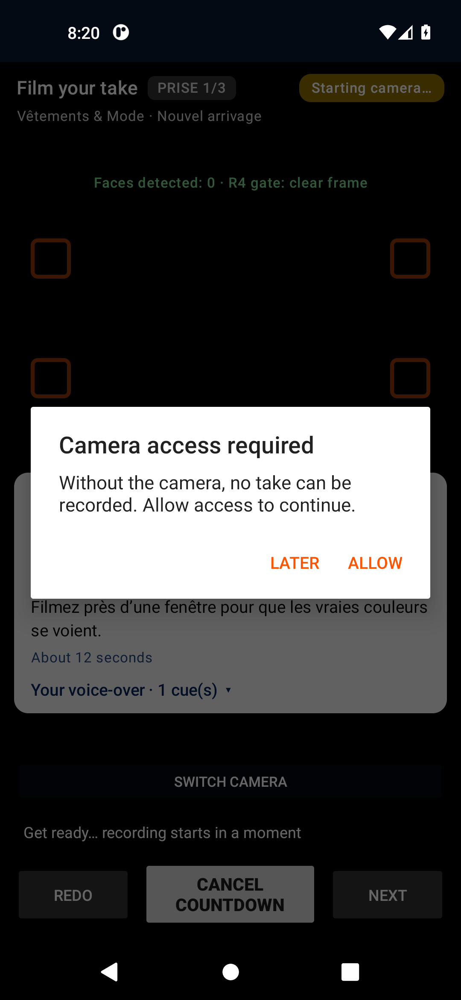</a>

<a href="13_prises/base-en-033_camera_avant.png" title="camera_avant — Caméra AVANT (flux émulé) après bascule (en/base)">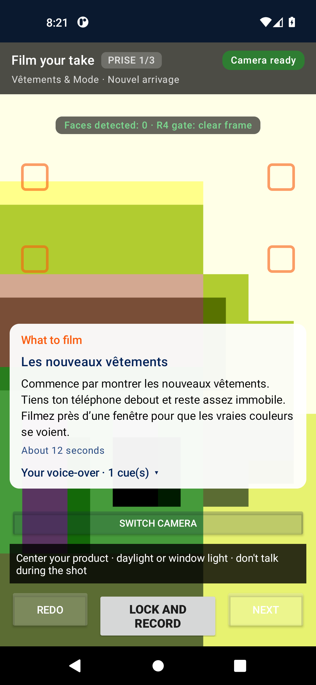</a>
<a href="13_prises/base-en-034_camera_arriere.png" title="camera_arriere — Retour caméra ARRIÈRE (flux émulé) (en/base)">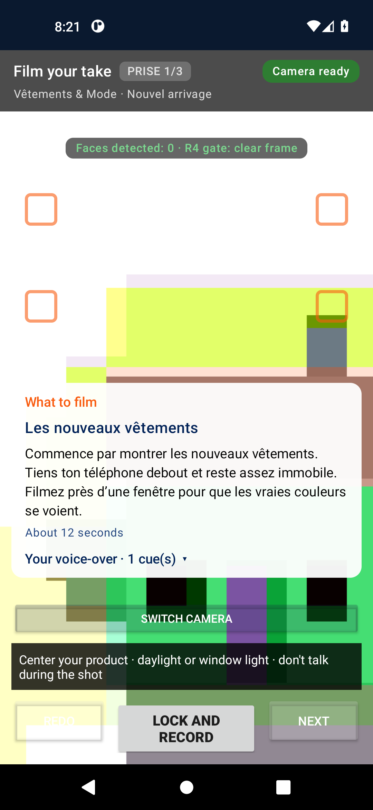</a>
<a href="13_prises/base-en-035_camera_refaire.png" title="camera_refaire — Reprise d'une prise (Refaire) (en/base)">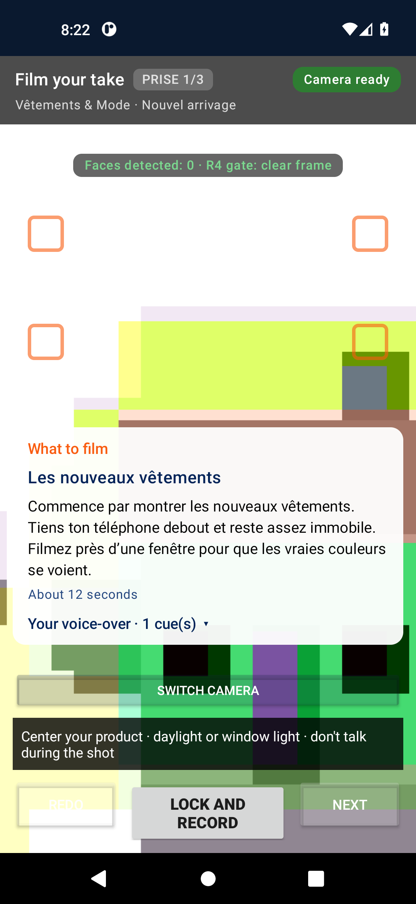</a>
<a href="13_prises/base-en-036_camera_scene2.png" title="camera_scene2 — Scène 2 du guide (en/base)">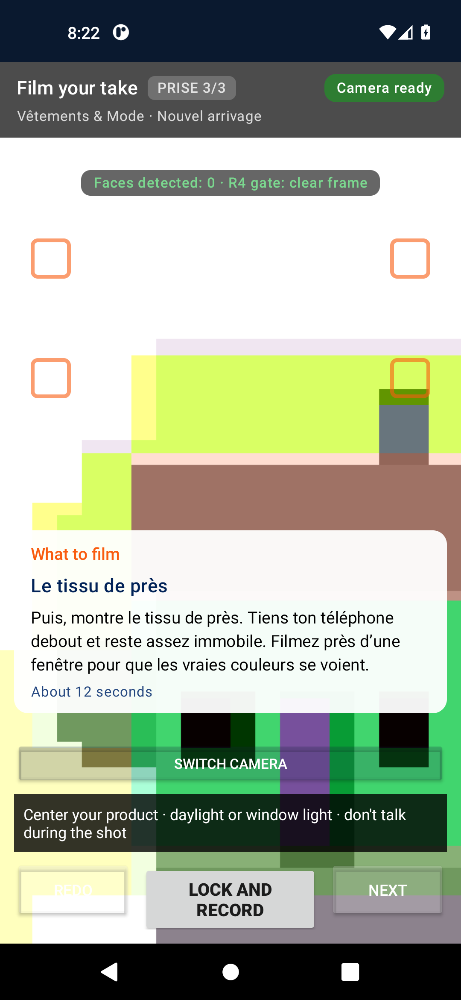</a>

<a href="13_prises/base-fr-051_camera_rec.png" title="camera_rec — Enregistrement ACTIF — badge REC (fr/base)">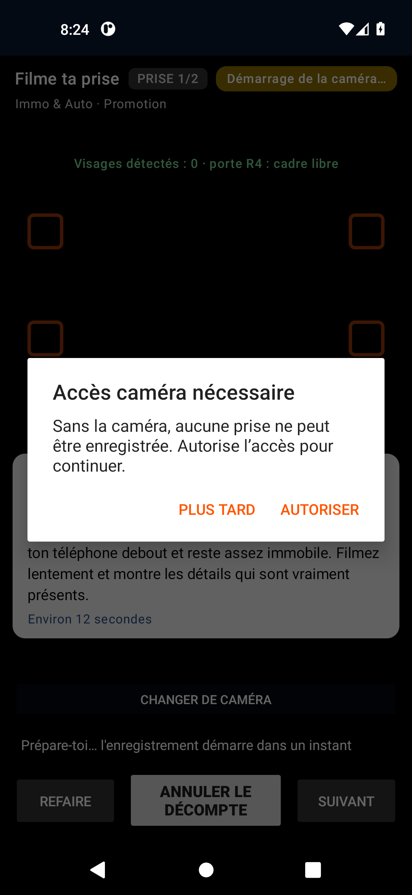</a>

<a href="13_prises/base-fr-053_camera_avant.png" title="camera_avant — Caméra AVANT (flux émulé) après bascule (fr/base)">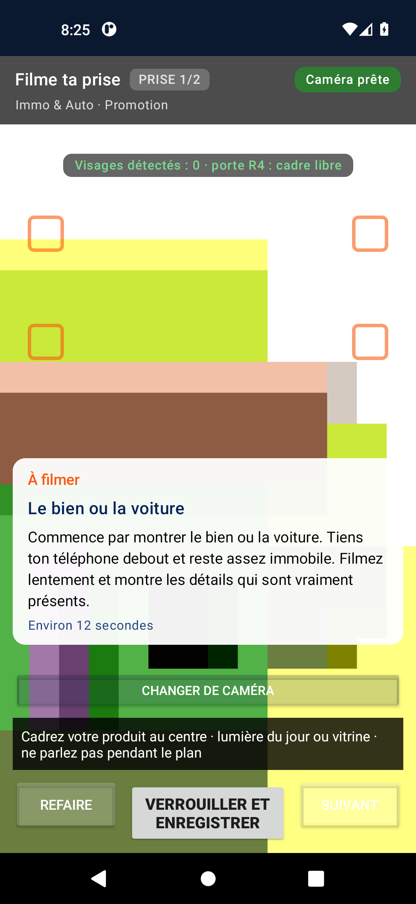</a>
<a href="13_prises/base-fr-054_camera_arriere.png" title="camera_arriere — Retour caméra ARRIÈRE (flux émulé) (fr/base)">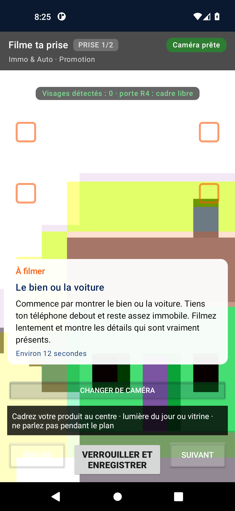</a>
<a href="13_prises/base-fr-055_camera_refaire.png" title="camera_refaire — Reprise d'une prise (Refaire) (fr/base)">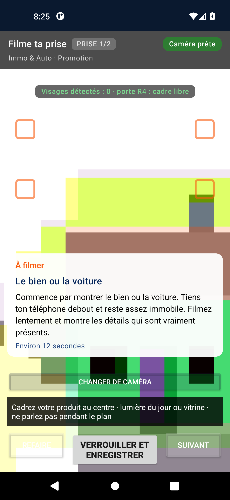</a>

## 14_audio — Audio & typographie (mode automatique)

| # | Capture | Titre | État | Langue | Profil | Résolution |
|---|---|---|---|---|---|---|
| 38 | [`apercu_bas`](14_audio/base-en-038_apercu_bas.png) | Aperçu — bas (typographie, voix) | détail | en | base | 1080x2340 |
| 36 | [`apercu_bas`](14_audio/cible-fr-036_apercu_bas.png) | Aperçu — bas (typographie, voix) | détail | fr | cible | 1080x2340 |

## 15_montage — Aperçu avant création (E7)

| # | Capture | Titre | État | Langue | Profil | Résolution |
|---|---|---|---|---|---|---|
| 37 | [`apercu`](15_montage/base-en-037_apercu.png) | Aperçu de la vidéo (E7) — mode audio automatique | aperçu | en | base | 1080x2340 |
| 35 | [`apercu`](15_montage/cible-fr-035_apercu.png) | Aperçu de la vidéo (E7) — mode audio automatique | aperçu | fr | cible | 1080x2340 |

## 16_export — Export local

| # | Capture | Titre | État | Langue | Profil | Résolution |
|---|---|---|---|---|---|---|
| 39 | [`export_pret`](16_export/base-en-039_export_pret.png) | Écran d'export (E8) — avant lancement | prêt | en | base | 1080x2340 |
| 40 | [`export_en_cours`](16_export/base-en-040_export_en_cours.png) | Export local en cours | en cours | en | base | 1080x2340 |
| 41 | [`export_notification`](16_export/base-en-041_export_notification.png) | Tiroir de notifications — export (FGS) | notification | en | base | 1080x2340 |
| 42 | [`export_apres_ecran_etaint`](16_export/base-en-042_export_apres_ecran_etaint.png) | Export après écran éteint (réveil) | écran éteint survécu | en | base | 1080x2340 |
| 43 | [`export_etat_final`](16_export/base-en-043_export_etat_final.png) | Export — état final après fenêtre de 95 min | délai dépassé | en | base | 1080x2340 |
| 57 | [`export_pret`](16_export/base-fr-057_export_pret.png) | Écran d'export (E8) — avant lancement | prêt | fr | base | 1080x2340 |
| 58 | [`export_en_cours`](16_export/base-fr-058_export_en_cours.png) | Export local en cours | en cours | fr | base | 1080x2340 |
| 59 | [`export_notification`](16_export/base-fr-059_export_notification.png) | Tiroir de notifications — export (FGS) | notification | fr | base | 1080x2340 |
| 60 | [`export_apres_ecran_etaint`](16_export/base-fr-060_export_apres_ecran_etaint.png) | Export après écran éteint (réveil) | écran éteint survécu | fr | base | 1080x2340 |
| 61 | [`export_etat_final`](16_export/base-fr-061_export_etat_final.png) | Export — état final après fenêtre de 95 min | délai dépassé | fr | base | 1080x2340 |

## 17_historique — Mon espace (dashboard)

| # | Capture | Titre | État | Langue | Profil | Résolution |
|---|---|---|---|---|---|---|
| 44 | [`dashboard`](17_historique/base-en-044_dashboard.png) | Mon espace — tableau de bord (vue intents) | connecté-local | en | base | 1080x2340 |
| 45 | [`dashboard_bas`](17_historique/base-en-045_dashboard_bas.png) | Tableau de bord — bas de page | défilé | en | base | 1080x2340 |
| 62 | [`dashboard`](17_historique/base-fr-062_dashboard.png) | Mon espace — tableau de bord (vue intents) | connecté-local | fr | base | 1080x2340 |
| 63 | [`dashboard_bas`](17_historique/base-fr-063_dashboard_bas.png) | Tableau de bord — bas de page | défilé | fr | base | 1080x2340 |

## 19_profil — Profil & réglages

| # | Capture | Titre | État | Langue | Profil | Résolution |
|---|---|---|---|---|---|---|
| 47 | [`profil_reglages`](19_profil/base-en-047_profil_reglages.png) | Réglages / profil (vue intents) | ouvert | en | base | 1080x2340 |
| 65 | [`profil_reglages`](19_profil/base-fr-065_profil_reglages.png) | Réglages / profil (vue intents) | ouvert | fr | base | 1080x2340 |

## 20_hors_connexion — Hors connexion (parcours complet)

Profil `offline` : parcours complet (Wi-Fi et données désactivés) — bandeau hors connexion du catalogue, états locaux.

| # | Capture | Titre | État | Langue | Profil | Résolution |
|---|---|---|---|---|---|---|
| 1 | [`splash`](20_hors_connexion/offline-fr-001_splash.png) | Splash (lancement) | lancement | fr | offline | 1080x2340 |
| 2 | [`splash_tardif`](20_hors_connexion/offline-fr-002_splash_tardif.png) | Splash (t) — premier plan | lancement | fr | offline | 1080x2340 |
| 3 | [`langue`](20_hors_connexion/offline-fr-003_langue.png) | Écran de choix de langue | initial | fr | offline | 1080x2340 |
| 4 | [`auth`](20_hors_connexion/offline-fr-004_auth.png) | Connexion — bouton Google (non actionné ici) | non connecté | fr | offline | 1080x2340 |
| 5 | [`carrousel_1`](20_hors_connexion/offline-fr-005_carrousel_1.png) | Carrousel — Filme. Vends. C'est tout. | repli sans compte | fr | offline | 1080x2340 |
| 6 | [`carrousel_2`](20_hors_connexion/offline-fr-006_carrousel_2.png) | Carrousel — Filme tes produits, on te guide | slide 2 | fr | offline | 1080x2340 |
| 7 | [`carrousel_3`](20_hors_connexion/offline-fr-007_carrousel_3.png) | Carrousel — Une vidéo prête à publier en 30 secondes | slide 3 | fr | offline | 1080x2340 |
| 8 | [`secteurs`](20_hors_connexion/offline-fr-008_secteurs.png) | Choix du secteur (activité principale) | initial | fr | offline | 1080x2340 |
| 9 | [`secteurs_bas`](20_hors_connexion/offline-fr-009_secteurs_bas.png) | Choix du secteur — bas de liste | défilé | fr | offline | 1080x2340 |
| 10 | [`parrainage`](20_hors_connexion/offline-fr-010_parrainage.png) | Étape parrainage — saisie du code | vide | fr | offline | 1080x2340 |
| 11 | [`credits_bienvenue`](20_hors_connexion/offline-fr-011_credits_bienvenue.png) | Bienvenue — confirmation des crédits | connecté-local | fr | offline | 1080x2340 |
| 12 | [`catalogue_haut`](20_hors_connexion/offline-fr-012_catalogue_haut.png) | Catalogue — haut (secteur sélectionné) | initial | fr | offline | 1080x2340 |
| 13 | [`catalogue_scroll1`](20_hors_connexion/offline-fr-013_catalogue_scroll1.png) | Catalogue — position 1 | défilé | fr | offline | 1080x2340 |
| 14 | [`catalogue_scroll2`](20_hors_connexion/offline-fr-014_catalogue_scroll2.png) | Catalogue — position 2 | défilé | fr | offline | 1080x2340 |
| 15 | [`catalogue_scroll3`](20_hors_connexion/offline-fr-015_catalogue_scroll3.png) | Catalogue — position 3 | défilé | fr | offline | 1080x2340 |
| 16 | [`catalogue_scroll4`](20_hors_connexion/offline-fr-016_catalogue_scroll4.png) | Catalogue — position 4 | défilé | fr | offline | 1080x2340 |
| 17 | [`catalogue_scroll5`](20_hors_connexion/offline-fr-017_catalogue_scroll5.png) | Catalogue — position 5 | défilé | fr | offline | 1080x2340 |
| 18 | [`brief_vide`](20_hors_connexion/offline-fr-018_brief_vide.png) | Formulaire de brief — vide (Continuer désactivé) | vide | fr | offline | 1080x2340 |
| 19 | [`brief_whatsapp_clavier`](20_hors_connexion/offline-fr-019_brief_whatsapp_clavier.png) | Champ WhatsApp — clavier ouvert | clavier ouvert | fr | offline | 1080x2340 |
| 20 | [`brief_rempli`](20_hors_connexion/offline-fr-020_brief_rempli.png) | Formulaire de brief — rempli (valeurs fictives) | rempli | fr | offline | 1080x2340 |
| 20 | [`brief_erreur_whatsapp`](20_hors_connexion/offline-fr-020_brief_erreur_whatsapp.png) | Erreur de validation du numéro (9 chiffres) | erreur | fr | offline | 1080x2340 |
| 21 | [`brief_final`](20_hors_connexion/offline-fr-021_brief_final.png) | Formulaire de brief — état final avant validation | prêt | fr | offline | 1080x2340 |
| 22 | [`brief_etape1`](20_hors_connexion/offline-fr-022_brief_etape1.png) | Brief — étape 1 (multi-étapes) | étape 1 | fr | offline | 1080x2340 |
| 23 | [`brief_etape2`](20_hors_connexion/offline-fr-023_brief_etape2.png) | Brief — étape 2 (multi-étapes) | étape 2 | fr | offline | 1080x2340 |
| 24 | [`brief_etape3`](20_hors_connexion/offline-fr-024_brief_etape3.png) | Brief — étape 3 (multi-étapes) | étape 3 | fr | offline | 1080x2340 |
| 25 | [`brief_etape4`](20_hors_connexion/offline-fr-025_brief_etape4.png) | Brief — étape 4 (multi-étapes) | étape 4 | fr | offline | 1080x2340 |
| 26 | [`brief_etape5`](20_hors_connexion/offline-fr-026_brief_etape5.png) | Brief — étape 5 (multi-étapes) | étape 5 | fr | offline | 1080x2340 |
| 27 | [`brief_etape6`](20_hors_connexion/offline-fr-027_brief_etape6.png) | Brief — étape 6 (multi-étapes) | étape 6 | fr | offline | 1080x2340 |
| 28 | [`brief_etape7`](20_hors_connexion/offline-fr-028_brief_etape7.png) | Brief — étape 7 (multi-étapes) | étape 7 | fr | offline | 1080x2340 |
| 29 | [`brief_etape8`](20_hors_connexion/offline-fr-029_brief_etape8.png) | Brief — étape 8 (multi-étapes) | étape 8 | fr | offline | 1080x2340 |
| 30 | [`dashboard`](20_hors_connexion/offline-fr-030_dashboard.png) | Mon espace — tableau de bord (vue intents) | connecté-local | fr | offline | 1080x2340 |
| 31 | [`dashboard_bas`](20_hors_connexion/offline-fr-031_dashboard_bas.png) | Tableau de bord — bas de page | défilé | fr | offline | 1080x2340 |
| 32 | [`dashboard_parrainage`](20_hors_connexion/offline-fr-032_dashboard_parrainage.png) | Parrainage — jauge et code (vue intents) | depuis dashboard | fr | offline | 1080x2340 |
| 33 | [`profil_reglages`](20_hors_connexion/offline-fr-033_profil_reglages.png) | Réglages / profil (vue intents) | ouvert | fr | offline | 1080x2340 |
| 34 | [`paywall`](20_hors_connexion/offline-fr-034_paywall.png) | Crédits / formules — paywall (vue intents) | offre | fr | offline | 1080x2340 |
| 35 | [`paywall_bas`](20_hors_connexion/offline-fr-035_paywall_bas.png) | Paywall — bas (formules) | défilé | fr | offline | 1080x2340 |
| 36 | [`offline_final`](20_hors_connexion/offline-fr-036_offline_final.png) | État final hors connexion | hors connexion | fr | offline | 1080x2340 |

<a href="20_hors_connexion/offline-fr-033_profil_reglages.png" title="profil_reglages — Réglages / profil (vue intents) (fr/offline)">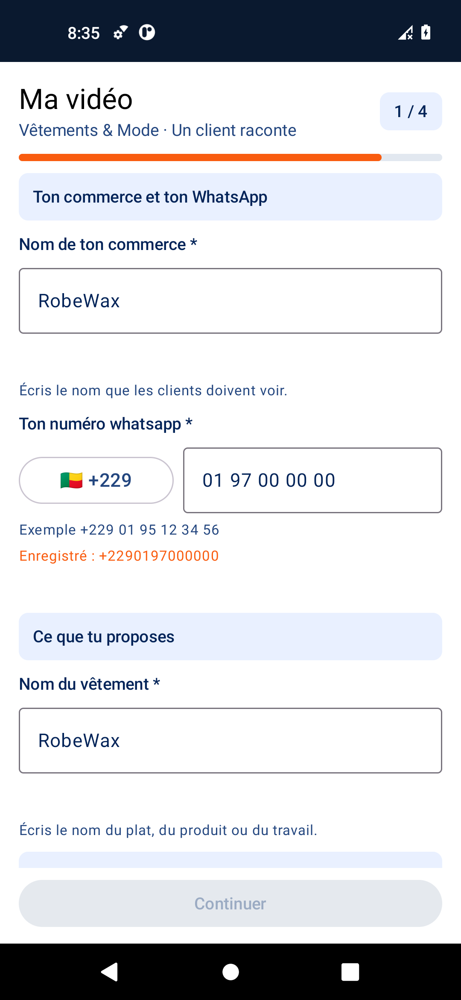</a>

<a href="20_hors_connexion/offline-fr-035_paywall_bas.png" title="paywall_bas — Paywall — bas (formules) (fr/offline)">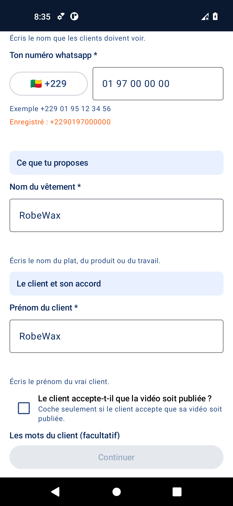</a>

---

*Généré par la Phase A de D42.31 — harnais `tools/e2e/run_gallery.sh` (v9), runs `visual-gallery` v8 (43297663610) + capture ciblée. RC15 reste immuable ; la Phase B (corrections) attend les observations du fondateur.*