# Galerie visuelle D42.33 v2 — les 12 parcours, avant/après

**90 états inventoriés** · 12 captures AVANT (D42.32) · **74 captures APRÈS (D42.33)** — toutes des rendus Android **réels** (Robolectric `GraphicsMode NATIVE`, pipeline Skia ; AVANT d'émulateur 1080×2340 pour la campagne D42.32). Aucune maquette, aucune preuve fabriquée.

Sources : [`SCREEN_INVENTORY.csv`](../SCREEN_INVENTORY.csv) · [`MANIFEST.tsv`](MANIFEST.tsv) · [`BEFORE_AFTER.csv`](BEFORE_AFTER.csv) · généré par [`tools/build_gallery.py`](tools/build_gallery.py) (idempotent).

## Synthèse des statuts

| Statut | États |
|---|---|
| CONFORME (capture) | 50 |
| CONFORME | 21 |
| ÉCART ASSUMÉ | 6 |
| NON PROUVÉ (capture) | 3 |
| DOCUMENTÉ (aucun rendu distinct) | 2 |
| CONFORME (partiel) | 1 |
| DOCUMENTÉ | 1 |
| DOCUMENTÉ (aucun visuel distinct) | 1 |
| DOCUMENTÉ (pas de débordement) | 1 |
| DOCUMENTÉ (rendu identique) | 1 |
| DOCUMENTÉ (repli structurel) | 1 |
| NON APPLICABLE | 1 |
| ÉCART ASSUMÉ (design §9.5) | 1 |
| **Total** | **90** |

Correspondances AVANT↔APRÈS complètes : **59** paires d'images (sur 90 états — les autres n'ont pas d'AVANT exploitable ou pas d'APRÈS rendable honnêtement ; chaque cas est explicité ci-dessous).

---

## Parcours P01 — Ouverture et accès

### P01-01 · Ouverture (splash) — temps de marque 1,2 s max

**NON PROUVÉ (capture)** · langue **fr** · résolution **1080x2340 (émul.)**

> Splash API 12+ non rendu par Robolectric ; barre de chargement §9.1 non rendue par l'API — écart documenté au checkpoint 00 ; code conforme (fond navy + tuile). Capture APRÈS impossible sans contournement : statut honnête. Lot 2 : maintenu NON PROUVÉ — capture impossible honnêtement sous Robolectric (splash API / dialogue système).

| AVANT (D42.32) | APRÈS (D42.33) |
|---|---|
| 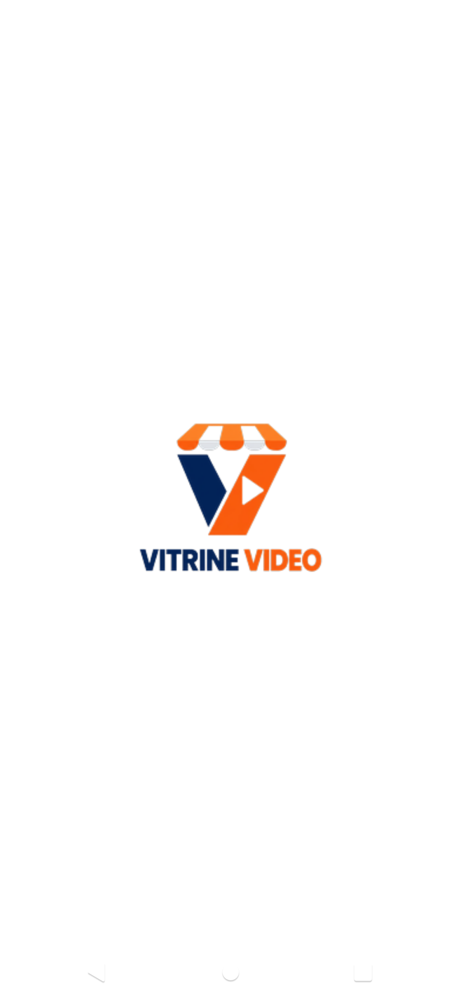 | _pas de capture APRÈS (voir statut ci-dessus)_ |

### P01-02 · Ouverture (splash) — temps de marque

**NON PROUVÉ (capture)** · langue **en** · résolution **1080x2340 (émul.)**

> Idem P01-01 (thème identique FR/EN). Lot 2 : maintenu NON PROUVÉ — capture impossible honnêtement sous Robolectric (splash API / dialogue système).

| AVANT (D42.32) | APRÈS (D42.33) |
|---|---|
|  | _pas de capture APRÈS (voir statut ci-dessus)_ |

### P01-03 · Sélection de la langue — écran de choix

**CONFORME** · langue **fr** · résolution **w360dp-h820dp**

> Robolectric run 43610784376 (0a114ce) ; 98,6 % des pixels sur tokens spec §3. ÉCART CORRIGÉ Lot 2 : la capture v1 était un rendu EN (harnais sans qualifier de locale, défaut Robolectric) — fichier remplacé par le rendu FR authentique du même état (test correction_galerie_langue_fr).

| AVANT (D42.32) | APRÈS (D42.33) |
|---|---|
| 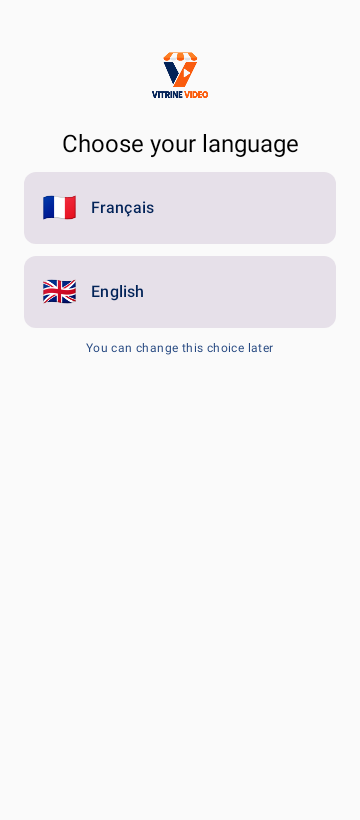 | 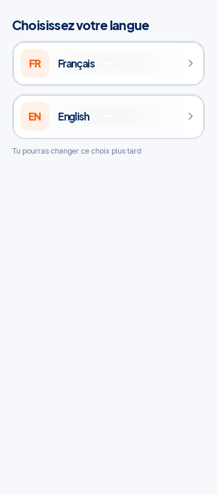 |

### P01-04 · Sélection de la langue — écran de choix

**CONFORME (capture)** · langue **en** · résolution **w360dp-h820dp**

> Lot 2 : capture Robolectric authentique (sdk34, GraphicsMode NATIVE, vrais composants/états/données) — qualifier en ; libellés EN réels.

| AVANT (D42.32) | APRÈS (D42.33) |
|---|---|
| 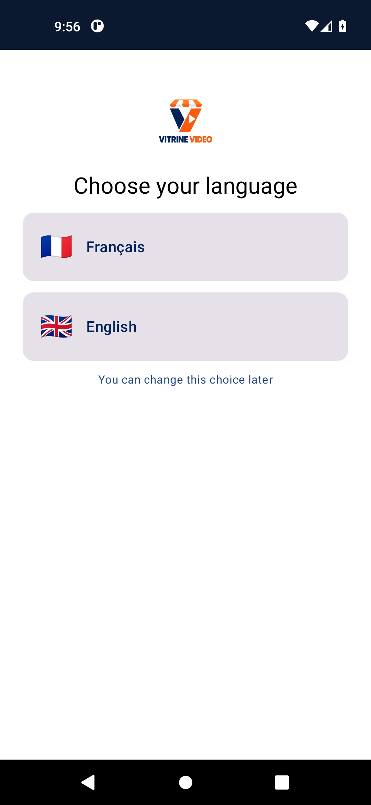 | 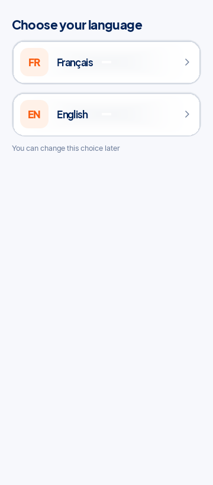 |

### P01-05 · Connexion Google — écran d'authentification

**CONFORME (capture)** · langue **fr** · résolution **1080x2340 (émul.)**

> Lot 2 : capture Robolectric authentique (sdk34, GraphicsMode NATIVE, vrais composants/états/données) — ActivityScenario + décor XML réel (measure/layout/draw) ; statut auth non vide.

| AVANT (D42.32) | APRÈS (D42.33) |
|---|---|
| 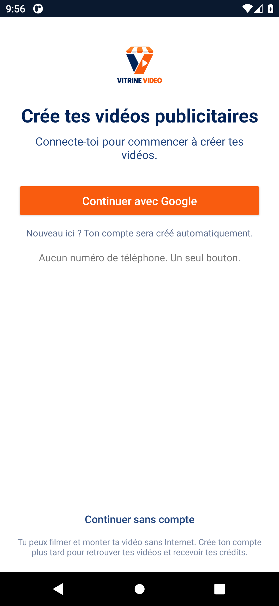 | 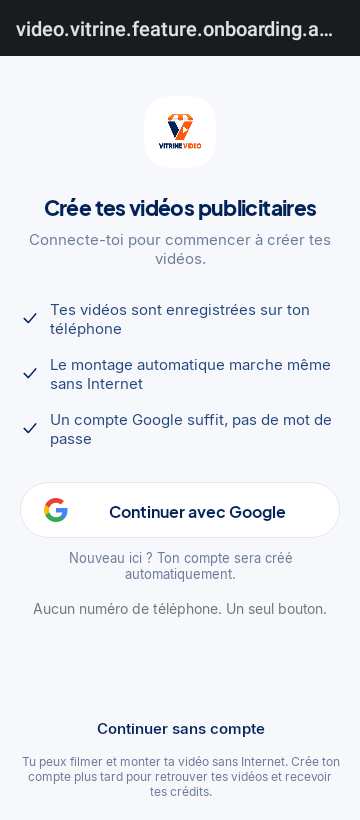 |

### P01-06 · Connexion Google — écran d'authentification

**CONFORME (capture)** · langue **en** · résolution **1080x2340 (émul.)**

> Lot 2 : capture Robolectric authentique (sdk34, GraphicsMode NATIVE, vrais composants/états/données) — idem P01-05 en anglais (qualifier en).

| AVANT (D42.32) | APRÈS (D42.33) |
|---|---|
| 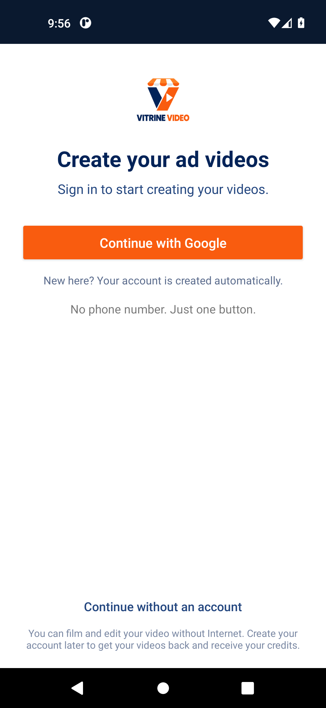 | 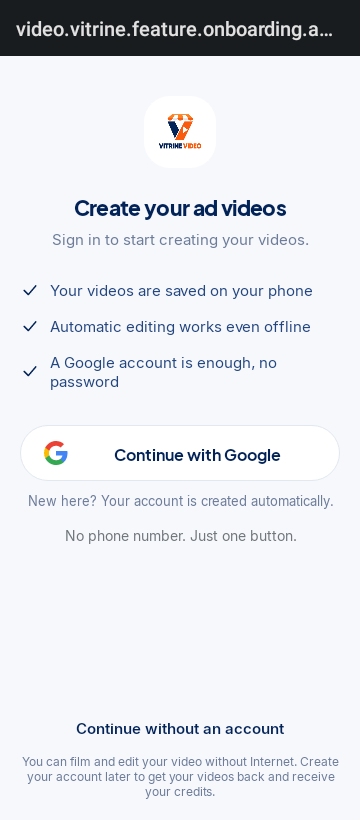 |

### P01-07 · Connexion — hors connexion (repli session locale)

**DOCUMENTÉ (repli structurel)** · langue **fr** · résolution **1080x2340 (émul.)**

> Lot 2 : le repli session locale (D19, bouton « Continuer sans connexion ») est structurellement présent et ACTIF sur l'écran de connexion capturé en P01-05 — l'écran n'a AUCUNE variante visuelle hors-ligne (aucun appel réseau avant interaction, constat code AuthActivity). L'échec SSO (écran « Réessayer ») n'est pas déclenchable sous Robolectric (CredentialManager en attente indéfinie). Capture dédiée = doublon de P01-05, non produite.

| AVANT (D42.32) | APRÈS (D42.33) |
|---|---|
| 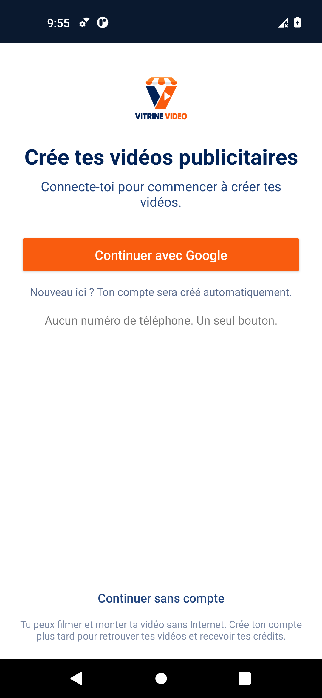 | _pas de capture APRÈS (voir statut ci-dessus)_ |

### P01-08 · Étape code parrain — code détecté (deep-link /r/CODE)

**CONFORME (capture)** · langue **fr** · résolution **1080x2340 (émul.)**

> Lot 2 : capture Robolectric authentique (sdk34, GraphicsMode NATIVE, vrais composants/états/données) — Intent extra ref_code SHALOM-842 — saisie manuelle et détection couvertes par les 2 captures sœurs (même écran, états de remplissage distincts).

| AVANT (D42.32) | APRÈS (D42.33) |
|---|---|
| 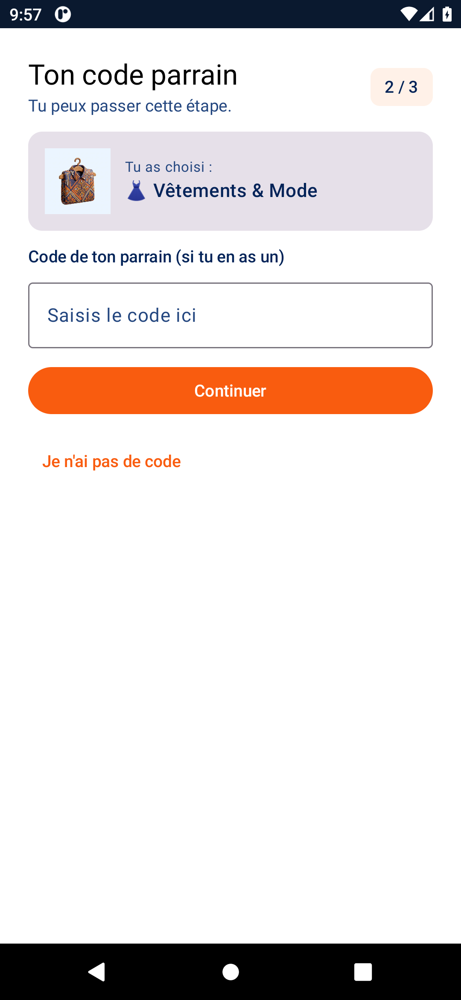 | 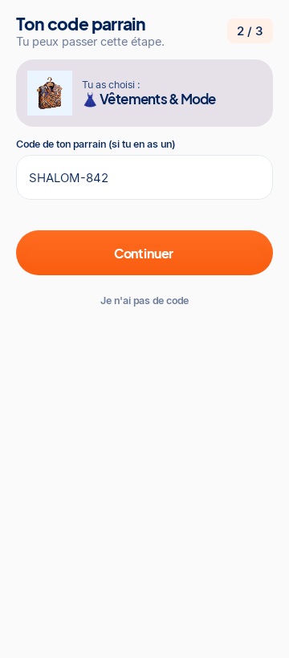 |

Variante réelle complémentaire — `P01-08_code-parrain-saisie-manuelle_APRES.png` :

| |
|---|
|  |

Variante réelle complémentaire — `P01-08_connexion-code-parrain-detected_APRES.png` :

| |
|---|
|  |

### P01-09 · Bienvenue / crédits offerts — compte créé + 3 crédits

**CONFORME (capture)** · langue **fr** · résolution **1080x2340 (émul.)**

> Lot 2 : capture Robolectric authentique (sdk34, GraphicsMode NATIVE, vrais composants/états/données) — statut welcome ok.

| AVANT (D42.32) | APRÈS (D42.33) |
|---|---|
| 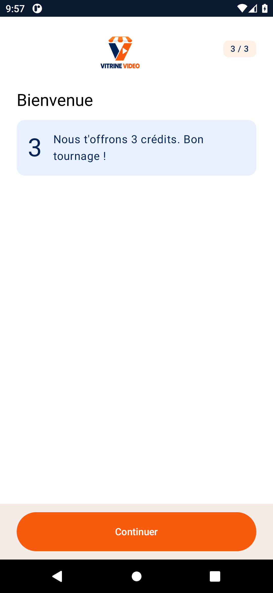 | 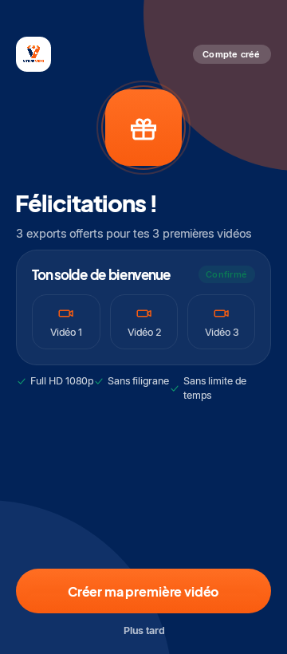 |

### P01-10 · Bienvenue / crédits offerts — solde en attente de synchronisation

**CONFORME (capture)** · langue **fr** · résolution **w360dp-h820dp**

> Lot 2 : capture Robolectric authentique (sdk34, GraphicsMode NATIVE, vrais composants/états/données) — statut welcome_credits_pending.

| AVANT (D42.32) | APRÈS (D42.33) |
|---|---|
| _aucune capture AVANT_ | 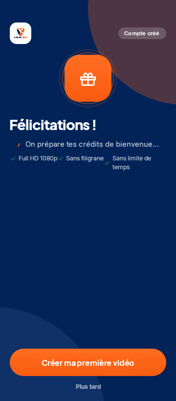 |

---

## Parcours P02 — Découverte

### P02-01 · Carrousel onboarding — slide 1 — ce que l'app fait

**CONFORME (capture)** · langue **fr** · résolution **defaut (320x470)**

> Lot 2 : REFAITE en w360dp-h820dp fr (résolution de conception) — carrousel slide 1 réel. L'ancienne capture v1 (320x470, rendue en EN par défaut Robolectric — écart corrigé) est supprimée de la galerie.

| AVANT (D42.32) | APRÈS (D42.33) |
|---|---|
| 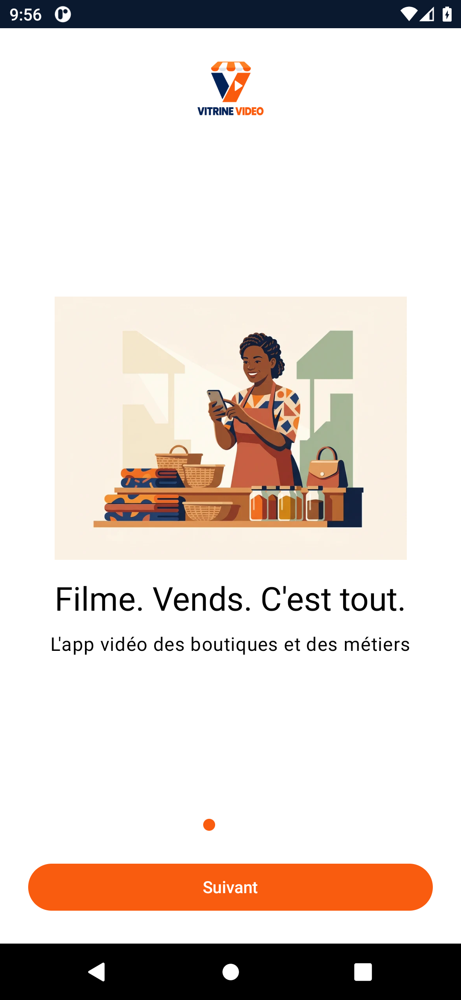 | 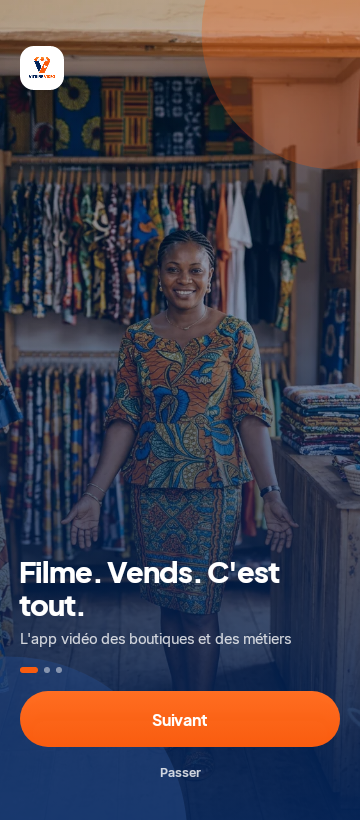 |

### P02-02 · Carrousel onboarding — slide 2 — combien de temps

**CONFORME (capture)** · langue **fr** · résolution **1080x2340 (émul.)**

> Lot 2 : capture Robolectric authentique (sdk34, GraphicsMode NATIVE, vrais composants/états/données) — avancement réel via CTA carousel_next + waitUntil.

| AVANT (D42.32) | APRÈS (D42.33) |
|---|---|
| 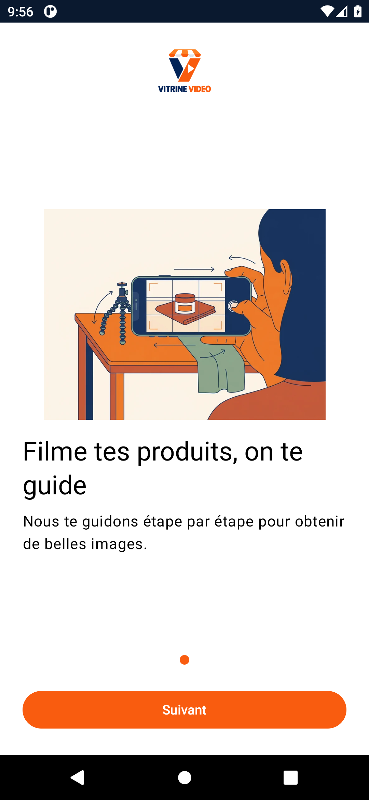 | 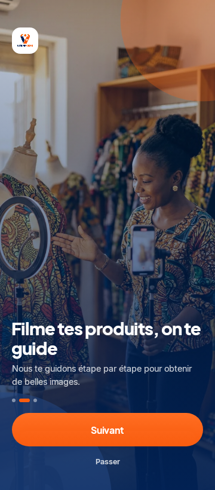 |

### P02-03 · Carrousel onboarding — slide 3 — combien ça rapporte (CTA d'entrée)

**CONFORME (capture)** · langue **fr** · résolution **1080x2340 (émul.)**

> Lot 2 : capture Robolectric authentique (sdk34, GraphicsMode NATIVE, vrais composants/états/données) — idem, slide 3.

| AVANT (D42.32) | APRÈS (D42.33) |
|---|---|
| 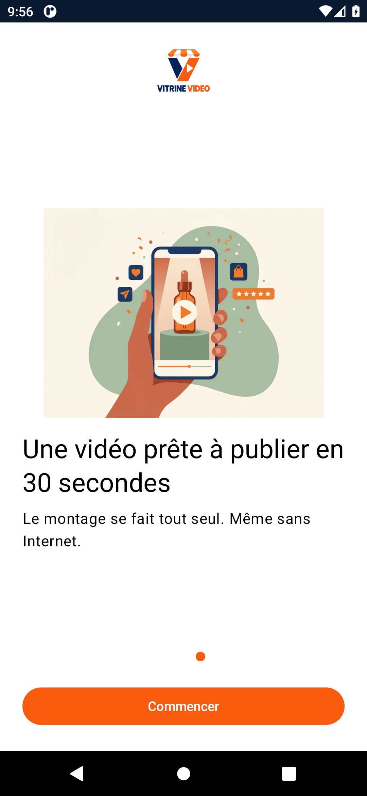 | 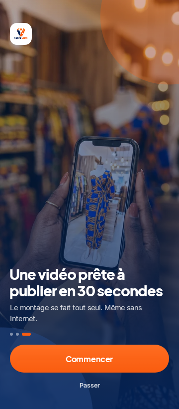 |

### P02-04 · Carrousel onboarding — slide 1

**CONFORME (capture)** · langue **en** · résolution **1080x2340 (émul.)**

> Lot 2 : capture Robolectric authentique (sdk34, GraphicsMode NATIVE, vrais composants/états/données) — qualifier en.

| AVANT (D42.32) | APRÈS (D42.33) |
|---|---|
| 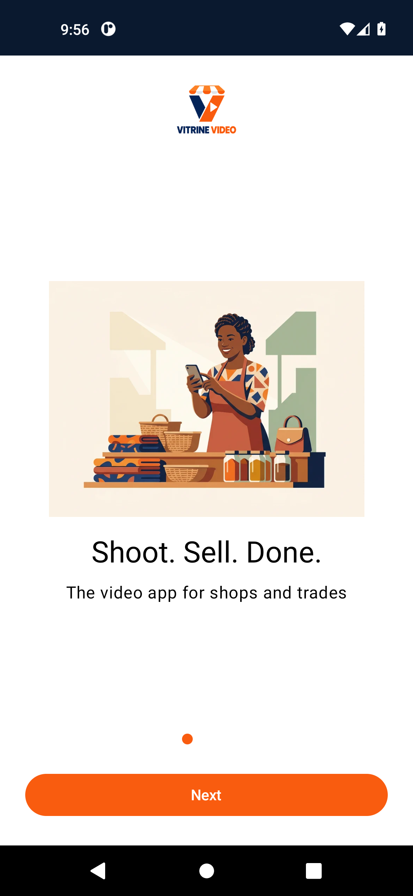 | 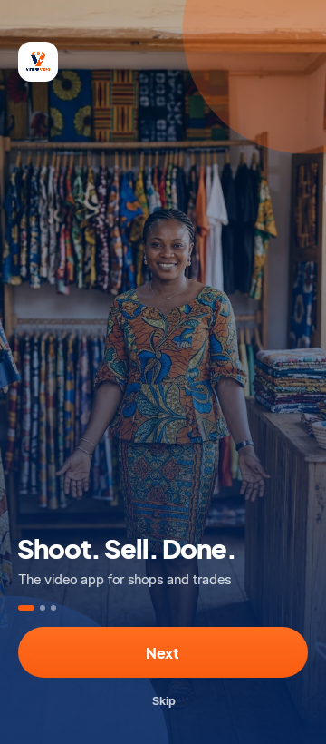 |

### P02-05 · Carrousel onboarding — hors connexion

**DOCUMENTÉ (aucun rendu distinct)** · langue **fr** · résolution **1080x2340 (émul.)**

> Lot 2 : CarouselScreen n'a AUCUNE dépendance réseau (constat code) — l'état hors connexion rend exactement les mêmes slides que P02-01/P02-02/P02-03. Une capture dédiée serait un doublon byte-identique, non produite.

| AVANT (D42.32) | APRÈS (D42.33) |
|---|---|
| 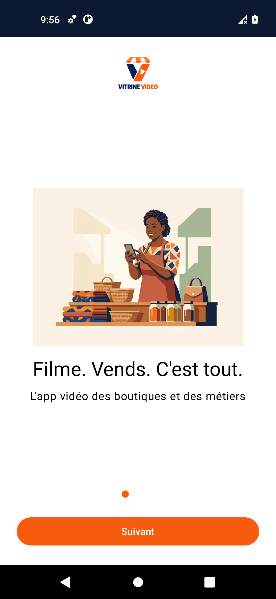 | _pas de capture APRÈS (voir statut ci-dessus)_ |

### P02-06 · Choix du secteur — 6 cartes-options

**CONFORME** · langue **fr** · résolution **w360dp-h820dp**

> 92,8 % pixels sur tokens. ÉCART CORRIGÉ Lot 2 : la capture v1 était un rendu EN (harnais sans qualifier de locale) — fichier remplacé par le rendu FR authentique du même état (test correction_galerie_secteurs_fr).

| AVANT (D42.32) | APRÈS (D42.33) |
|---|---|
| 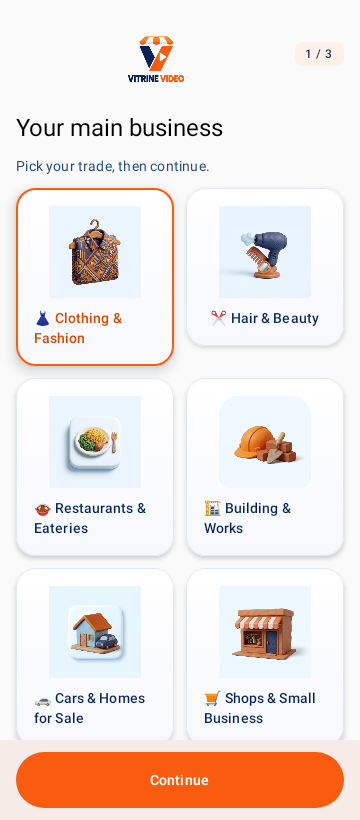 | 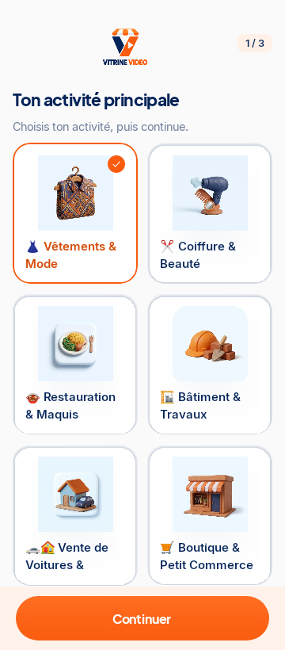 |

Variante réelle complémentaire — `10_marque_fr_defaut_APRES_header-logo-officiel.png` :

| |
|---|
| 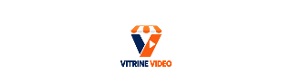 |

### P02-07 · Choix du secteur — bas de l'écran (scroll)

**DOCUMENTÉ (pas de débordement)** · langue **fr** · résolution **1080x2340 (émul.)**

> Lot 2 : l'écran secteurs tient ENTIÈREMENT dans le viewport w360dp-h820dp (et à 780dp émulateur) — aucun débordement scrollable ; performScrollTo(secteur Commerce) aboutit au rendu identique au haut (constat). La dernière rangée + le CTA épinglé sont intégralement visibles dans la capture par défaut (P02-06, corrigée FR). Pas de second état visuel à capturer.

| AVANT (D42.32) | APRÈS (D42.33) |
|---|---|
| 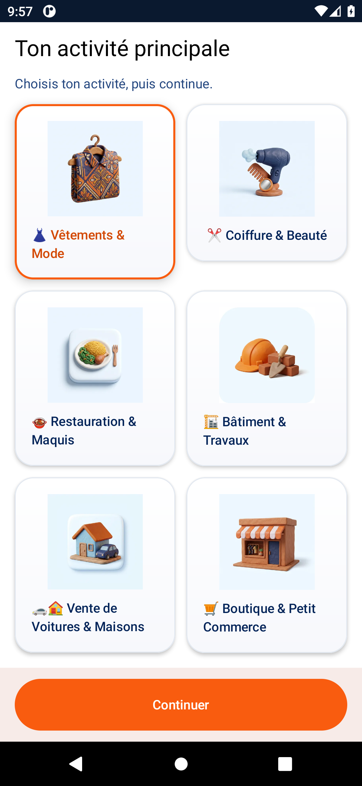 | _pas de capture APRÈS (voir statut ci-dessus)_ |

### P02-08 · Choix du secteur — 6 cartes-options

**CONFORME (capture)** · langue **en** · résolution **1080x2340 (émul.)**

> Lot 2 : capture Robolectric authentique (sdk34, GraphicsMode NATIVE, vrais composants/états/données) — qualifier en, libellés secteurs EN (values-en/strings_sectors.xml).

| AVANT (D42.32) | APRÈS (D42.33) |
|---|---|
| 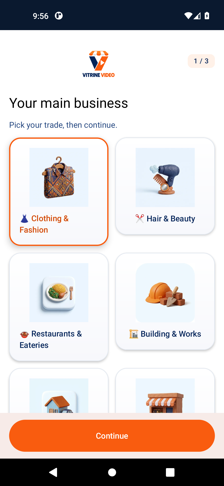 | 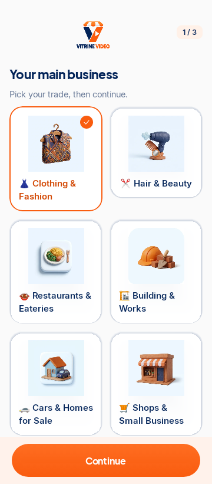 |

---

## Parcours P03 — Choix du gabarit

### P03-01 · Catalogue — secteur choisi — sans filtres

**CONFORME** · langue **fr** · résolution **w360dp-h820dp**

> Filtrage par secteur prouvé sémantiquement (test). Vignettes = photos placeholders (hors tokens ; contenu).

| AVANT (D42.32) | APRÈS (D42.33) |
|---|---|
| 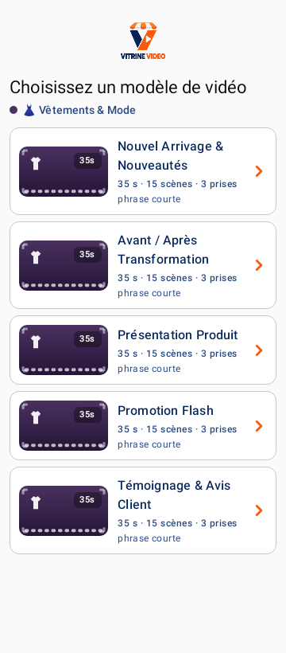 | 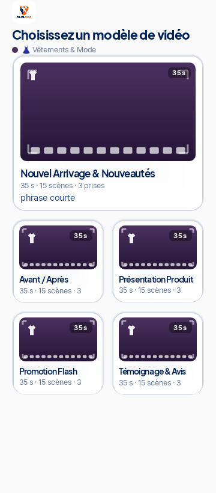 |

Variante réelle complémentaire — `04_catalogue_fr_w360_APRES_filtre-Mode-actif.png` :

| |
|---|
| 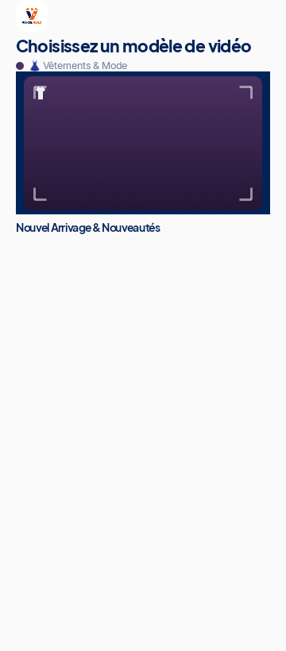 |

### P03-02 · Catalogue — tuiles de gabarits peuplées

**CONFORME (capture)** · langue **fr** · résolution **1080x2340 (émul.)**

> Lot 2 : capture Robolectric authentique (sdk34, GraphicsMode NATIVE, vrais composants/états/données) — vrais résumés parsés des JSON vetements_mode (5 formats).

| AVANT (D42.32) | APRÈS (D42.33) |
|---|---|
| 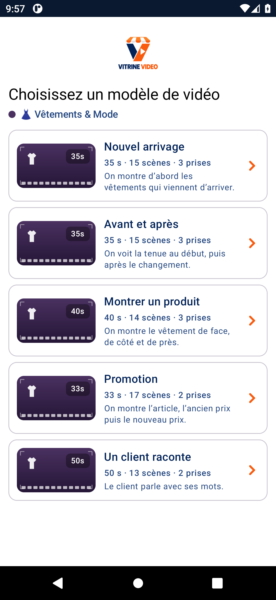 | 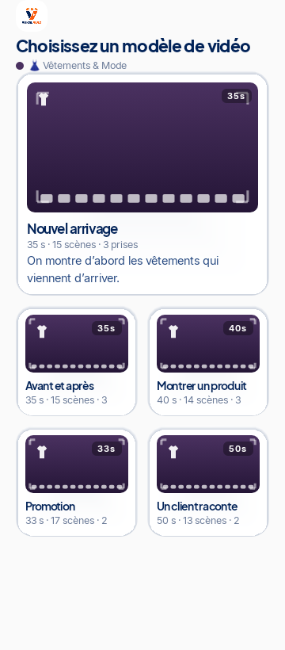 |

### P03-03 · Catalogue — scroll (bas)

**CONFORME (capture)** · langue **fr** · résolution **1080x2340 (émul.)**

> Lot 2 : capture Robolectric authentique (sdk34, GraphicsMode NATIVE, vrais composants/états/données) — 30 formats universels réels (6 secteurs × 5) — repli documenté ; performScrollTo + assertIsDisplayed du dernier.

| AVANT (D42.32) | APRÈS (D42.33) |
|---|---|
|  | 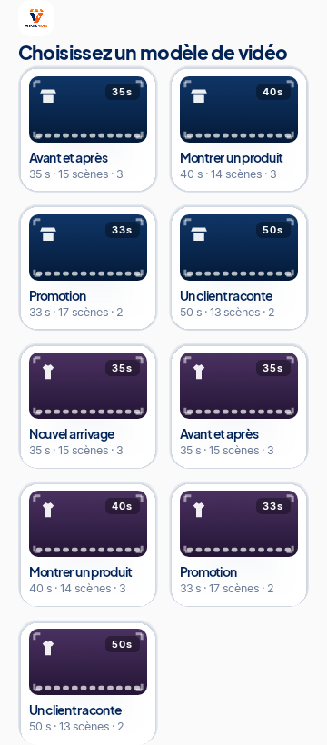 |

### P03-04 · Catalogue — en

**CONFORME (capture)** · langue **fr→en** · résolution **1080x2340 (émul.)**

> Lot 2 : capture Robolectric authentique (sdk34, GraphicsMode NATIVE, vrais composants/états/données) — qualifier en.

| AVANT (D42.32) | APRÈS (D42.33) |
|---|---|
| 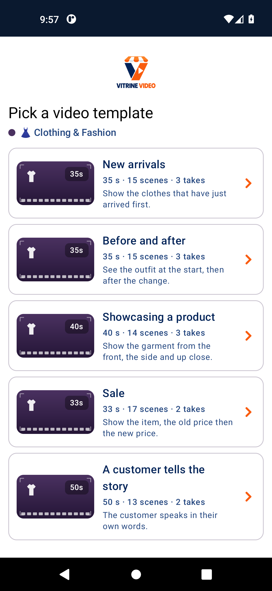 | 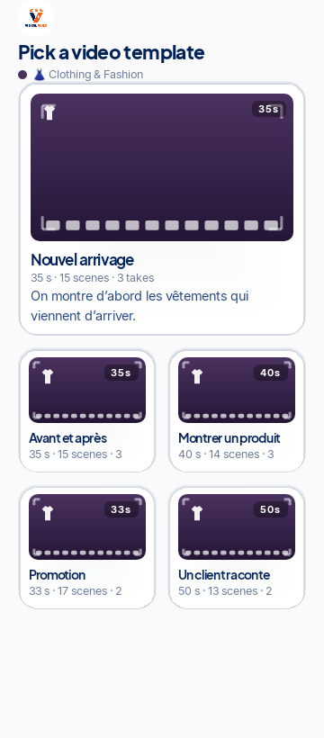 |

### P03-05 · Catalogue — hors connexion

**CONFORME (capture)** · langue **fr** · résolution **1080x2340 (émul.)**

> Lot 2 : capture Robolectric authentique (sdk34, GraphicsMode NATIVE, vrais composants/états/données) — bandeau §7.14 + repli 30 formats.

| AVANT (D42.32) | APRÈS (D42.33) |
|---|---|
| 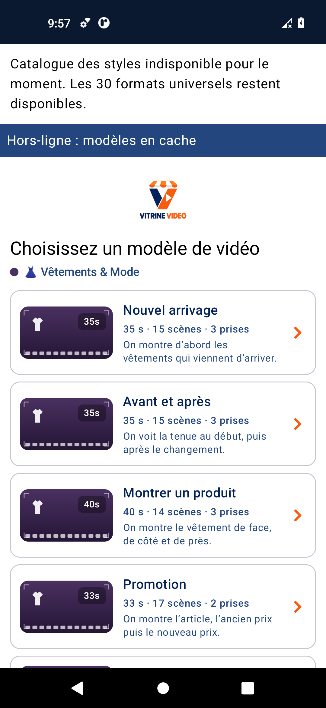 | 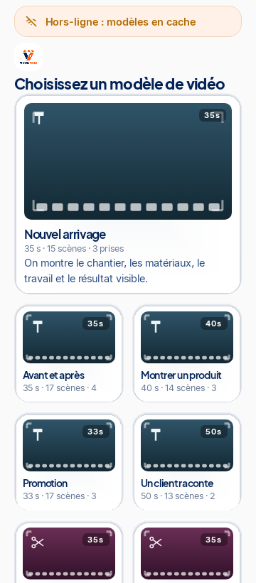 |

### P03-06 · Détail du gabarit — écran dédié

**ÉCART ASSUMÉ** · langue **—** · résolution **—**

> AUCUN écran « détail du gabarit » dans le parcours réel : la tuile mène DIRECTEMENT au brief (D42.32 P0-1 ; interdit de changer le parcours). L'information de détail est portée par la tuile + le header du brief + l'aperçu E7. Le fondateur tranche.

| AVANT (D42.32) | APRÈS (D42.33) |
|---|---|
| 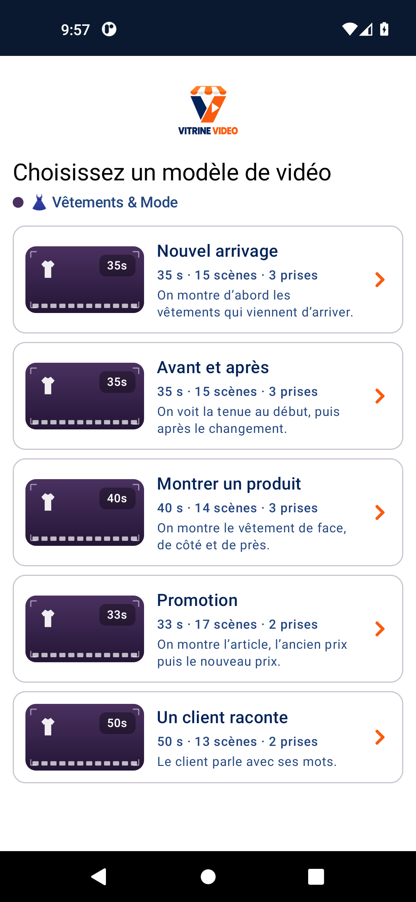 | _pas de capture APRÈS (voir statut ci-dessus)_ |

---

## Parcours P04 — Brief et préparation

### P04-01 · Brief multi-étapes — étape 1 sur 8

**CONFORME (capture)** · langue **fr** · résolution **w360dp-h820dp**

> Lot 2 : capture Robolectric authentique (sdk34, GraphicsMode NATIVE, vrais composants/états/données) — gabarit T1 réel (GabaritJson.parseBrief) ; CTA brief_continue bloqué asserté.

| AVANT (D42.32) | APRÈS (D42.33) |
|---|---|
|  | 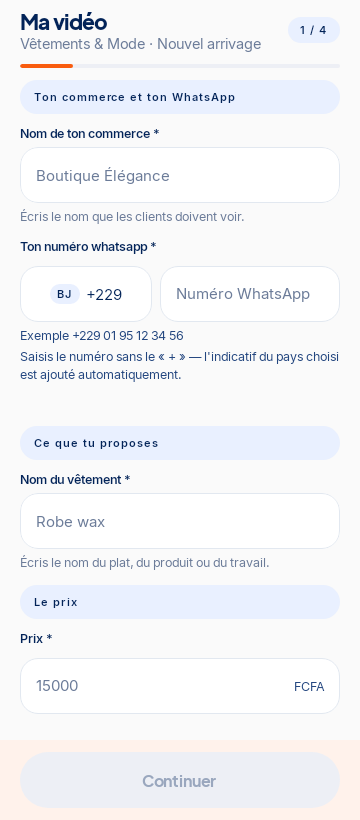 |

### P04-02 · Brief multi-étapes — étape 8 sur 8

**CONFORME (capture)** · langue **fr** · résolution **w360dp-h820dp**

> Lot 2 : capture Robolectric authentique (sdk34, GraphicsMode NATIVE, vrais composants/états/données) — performScrollTo brief_quartier_ville + assertIsDisplayed.

| AVANT (D42.32) | APRÈS (D42.33) |
|---|---|
|  | 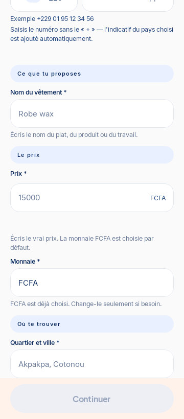 |

### P04-03 · Brief multi-étapes — vide (aucun champ rempli)

**CONFORME (capture)** · langue **fr** · résolution **w360dp-h820dp**

> Lot 2 : capture Robolectric authentique (sdk34, GraphicsMode NATIVE, vrais composants/états/données) — champs requis vides — CTA bloqué.

| AVANT (D42.32) | APRÈS (D42.33) |
|---|---|
| 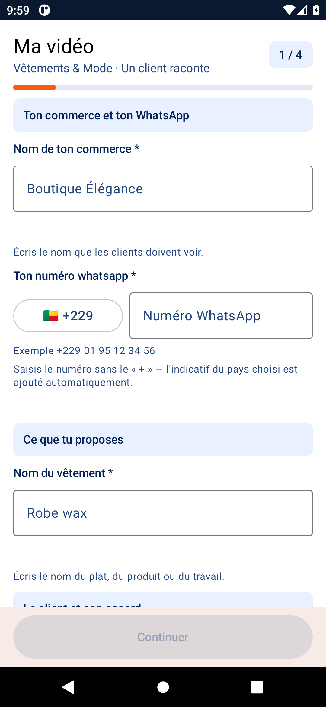 | 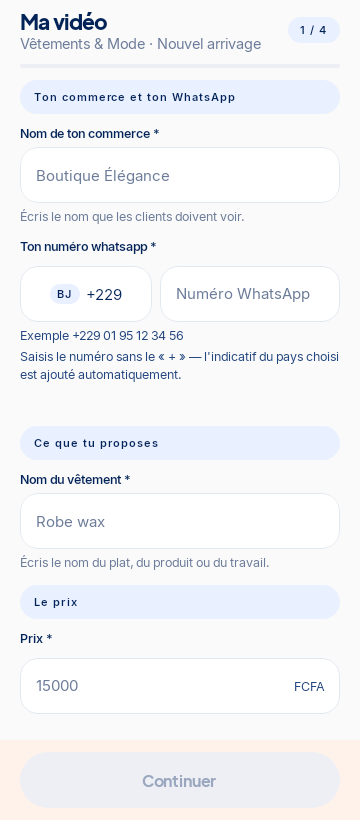 |

### P04-04 · Brief multi-étapes — rempli

**CONFORME (capture)** · langue **fr** · résolution **w360dp-h820dp**

> Lot 2 : capture Robolectric authentique (sdk34, GraphicsMode NATIVE, vrais composants/états/données) — valeurs-exemples du JSON (téléphone E.164 valide, prix chiffres).

| AVANT (D42.32) | APRÈS (D42.33) |
|---|---|
| 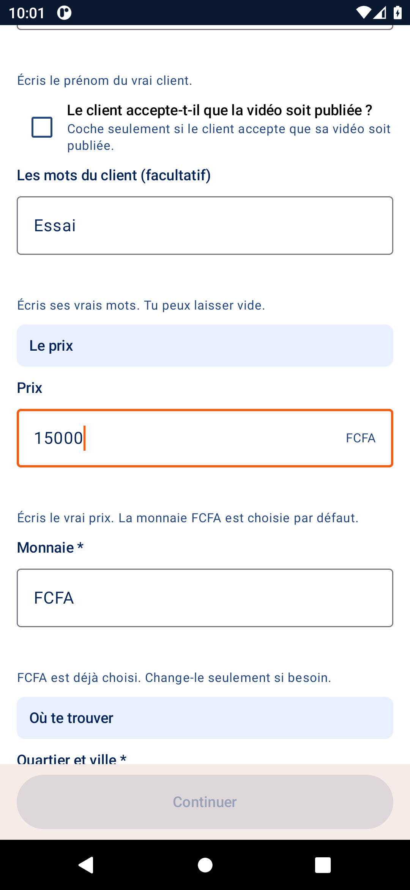 | 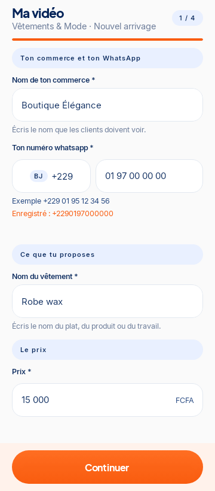 |

### P04-05 · Brief multi-étapes — récapitulatif final

**CONFORME (capture)** · langue **fr** · résolution **w360dp-h820dp**

> Lot 2 : capture Robolectric authentique (sdk34, GraphicsMode NATIVE, vrais composants/états/données) — tous champs remplis — CTA débloqué asserté.

| AVANT (D42.32) | APRÈS (D42.33) |
|---|---|
|  | 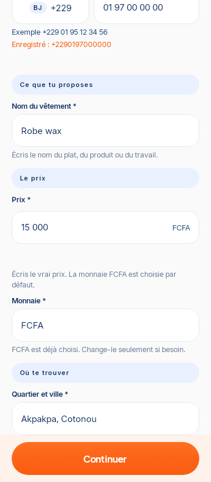 |

### P04-06 · Brief multi-étapes — reprise de brouillon (persistance)

**CONFORME (capture)** · langue **fr** · résolution **w360dp-h820dp**

> Lot 2 : capture Robolectric authentique (sdk34, GraphicsMode NATIVE, vrais composants/états/données) — initialValues partiels réels.

| AVANT (D42.32) | APRÈS (D42.33) |
|---|---|
| 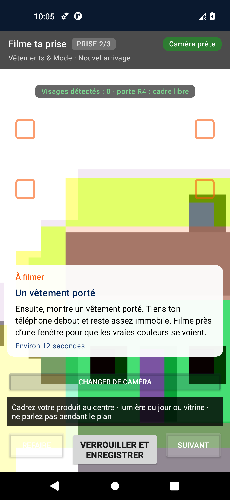 | 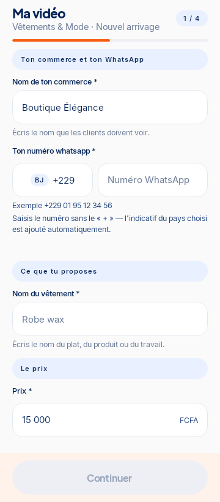 |

### P04-07 · Brief multi-étapes — bas de l'écran — CTA épinglé

**CONFORME (capture)** · langue **fr** · résolution **w360dp-h820dp**

> Lot 2 : capture Robolectric authentique (sdk34, GraphicsMode NATIVE, vrais composants/états/données) — clic réel sur le titre de section optionnelle.

| AVANT (D42.32) | APRÈS (D42.33) |
|---|---|
|  |  |

### P04-08 · Import des rushs client — étape optionnelle

**CONFORME** · langue **fr** · résolution **w360dp-h820dp**

> 98,0 % tokens ; hauteur APRÈS 704 px (contenu repeint plus aéré que l'AVANT 552 px).

| AVANT (D42.32) | APRÈS (D42.33) |
|---|---|
|  |  |

### P04-09 · Champ WhatsApp — international + clavier

**CONFORME (capture)** · langue **fr** · résolution **1080x2340 (émul.)**

> Lot 2 : capture Robolectric authentique (sdk34, GraphicsMode NATIVE, vrais composants/états/données) — champ WhatsApp rempli (exemple E.164 du JSON), cadré.

| AVANT (D42.32) | APRÈS (D42.33) |
|---|---|
|  |  |

### P04-10 · Champ WhatsApp — international + clavier

**CONFORME (capture)** · langue **en** · résolution **1080x2340 (émul.)**

> Lot 2 : capture Robolectric authentique (sdk34, GraphicsMode NATIVE, vrais composants/états/données) — idem en anglais (clavier logiciel non rendu par Robolectric — §limite).

| AVANT (D42.32) | APRÈS (D42.33) |
|---|---|
|  |  |

### P04-11 · Contrôle avant tournage (§9.6) — liste de tests + score + CTA conditionnel

**CONFORME (capture)** · langue **fr** · résolution **w360dp-h820dp**

> Lot 2 : capture Robolectric authentique (sdk34, GraphicsMode NATIVE, vrais composants/états/données) — ReadyCheckScreen, prises réelles du T1 (3).

| AVANT (D42.32) | APRÈS (D42.33) |
|---|---|
|  |  |

### P04-12 · Contrôle avant tournage — bas + CTA débloqué

**CONFORME (capture)** · langue **fr** · résolution **1080x2340 (émul.)**

> Lot 2 : capture Robolectric authentique (sdk34, GraphicsMode NATIVE, vrais composants/états/données) — fontScale 1,3 + performScrollTo des dernières infos (CTA épinglé — swipeUp noop, §note test).

| AVANT (D42.32) | APRÈS (D42.33) |
|---|---|
|  |  |

### P04-13 · Consentement client — porte R4 (visages/porte)

**ÉCART ASSUMÉ** · langue **fr** · résolution **dialogue système**

> La maquette 16 montre un écran dessiné ; l'implémentation réelle = AlertDialog SYSTÈME à la porte légale R4 (parcours inchangeable ; risque juridique de retoucher la porte). Non corrigé — le fondateur tranche.

| AVANT (D42.32) | APRÈS (D42.33) |
|---|---|
|  | _pas de capture APRÈS (voir statut ci-dessus)_ |

---

## Parcours P05 — Tournage

### P05-01 · Guide de tournage — overlay Mode (scène 1/3 enregistrement)

**CONFORME** · langue **fr** · résolution **w360dp-h820dp**

> 99,4 % tokens ; l'AVANT avait 19,3 % de gris #323232 hors tokens (vieux fond) — preuve programmatique du repeindre.

| AVANT (D42.32) | APRÈS (D42.33) |
|---|---|
|  |  |

### P05-02 · Guide de tournage — overlay Coiffure (scène 2/3)

**CONFORME** · langue **fr** · résolution **w360dp-h820dp**

> 99,4 % tokens.

| AVANT (D42.32) | APRÈS (D42.33) |
|---|---|
|  |  |

### P05-03 · Guide de tournage — overlay Restauration (scène 3/3 pause)

**CONFORME** · langue **fr** · résolution **w360dp-h820dp**

> 99,7 % tokens.

| AVANT (D42.32) | APRÈS (D42.33) |
|---|---|
|  |  |

### P05-04 · Viseur plein cadre (prise guide) — HUD informatif

**CONFORME (capture)** · langue **fr** · résolution **w360dp-h820dp**

> Lot 2 : capture Robolectric authentique (sdk34, GraphicsMode NATIVE, vrais composants/états/données) — PriseGuideScreen, prises réelles T1 (PreviewView vide = §limite Robolectric sans caméra).

| AVANT (D42.32) | APRÈS (D42.33) |
|---|---|
|  |  |

### P05-05 · Viseur plein cadre — flux streaming actif

**CONFORME (capture)** · langue **en** · résolution **1080x2340 (émul.)**

> Lot 2 : capture Robolectric authentique (sdk34, GraphicsMode NATIVE, vrais composants/états/données) — streaming=true → camera_stream_ready asserté.

| AVANT (D42.32) | APRÈS (D42.33) |
|---|---|
|  |  |

### P05-06 · Compte à rebours — 3-2-1

**CONFORME (capture)** · langue **fr→en** · résolution **w360dp-h820dp**

> Lot 2 : capture Robolectric authentique (sdk34, GraphicsMode NATIVE, vrais composants/états/données) — countdown=3.

| AVANT (D42.32) | APRÈS (D42.33) |
|---|---|
|  |  |

### P05-07 · Enregistrement (REC) — badge REC actif

**CONFORME (capture)** · langue **fr→en** · résolution **w360dp-h820dp**

> Lot 2 : capture Robolectric authentique (sdk34, GraphicsMode NATIVE, vrais composants/états/données) — recording → camera_rec_badge asserté.

| AVANT (D42.32) | APRÈS (D42.33) |
|---|---|
|  |  |

### P05-08 · Arrêt de prise — prise validée (retour visuel)

**CONFORME (capture)** · langue **fr→en** · résolution **w360dp-h820dp**

> Lot 2 : capture Robolectric authentique (sdk34, GraphicsMode NATIVE, vrais composants/états/données) — priseValidee=1.

| AVANT (D42.32) | APRÈS (D42.33) |
|---|---|
|  |  |

### P05-09 · Navigation avant/arrière entre prises — choix prendre/avancer

**CONFORME (capture)** · langue **fr→en** · résolution **w360dp-h820dp**

> Lot 2 : capture Robolectric authentique (sdk34, GraphicsMode NATIVE, vrais composants/états/données) — CameraGuideActivity réelle (seed DB, barre XML Refaire/Tourner/Suivant) — attente 30 s de camera_redo_button VISIBLE.

| AVANT (D42.32) | APRÈS (D42.33) |
|---|---|
|  |  |

### P05-10 · Refaire une prise — reprise de la scène

**DOCUMENTÉ (rendu identique)** · langue **fr→en** · résolution **w360dp-h820dp**

> Lot 2 : clic RÉEL sur « Refaire » (CameraGuideActivity, test reprise_de_scene) → l'activité repasse en attente d'une nouvelle prise de la même scène : le rendu est byte-identique à P05-09 (vérifié md5). Pas de doublon produit ; le comportement est prouvé par le test.

| AVANT (D42.32) | APRÈS (D42.33) |
|---|---|
|  | _pas de capture APRÈS (voir statut ci-dessus)_ |

### P05-11 · Scène suivante — scène 2 sur N

**CONFORME (capture)** · langue **fr→en** · résolution **w360dp-h820dp**

> Lot 2 : capture Robolectric authentique (sdk34, GraphicsMode NATIVE, vrais composants/états/données) — priseIdx=1 (scène 2 du T1).

| AVANT (D42.32) | APRÈS (D42.33) |
|---|---|
|  |  |

### P05-12 · Permission caméra refusée — chemin réglages

**NON PROUVÉ (capture)** · langue **fr** · résolution **dialogue système**

> Dialogue système ; Lot 2 si productible honnêtement sinon statut documenté. Lot 2 : maintenu NON PROUVÉ — capture impossible honnêtement sous Robolectric (splash API / dialogue système).

| AVANT (D42.32) | APRÈS (D42.33) |
|---|---|
|  | _pas de capture APRÈS (voir statut ci-dessus)_ |

### P05-13 · Diagnostic caméra — cas matériels

**CONFORME (capture)** · langue **fr** · résolution **w360dp-h820dp**

> Lot 2 : capture Robolectric authentique (sdk34, GraphicsMode NATIVE, vrais composants/états/données) — CameraDiagnosticActivity sans permission accordée = état honnête.

| AVANT (D42.32) | APRÈS (D42.33) |
|---|---|
| _aucune capture AVANT_ |  |

---

## Parcours P06 — Revue des prises

### P06-01 · Revue des prises — écran dédié de revue

**ÉCART ASSUMÉ** · langue **—** · résolution **—**

> PAS d'écran dédié « revue des prises » dans le parcours réel : la validation se fait prise par prise dans le HUD (priseValidee + tuiles d'état §7.12 dans le flux). Interdit de changer le parcours. Les états de prise sont couverts par P05-06..P05-11. Le fondateur tranche.

| AVANT (D42.32) | APRÈS (D42.33) |
|---|---|
|  | _pas de capture APRÈS (voir statut ci-dessus)_ |

---

## Parcours P07 — Montage

### P07-01 · Aperçu du montage (E7) — récap avant création

**CONFORME (capture)** · langue **fr** · résolution **w360dp-h820dp**

> Lot 2 : REFAITE en écran COMPLET VideoPreviewScreen (360x820) — récap E7 réel (sectorLabel/formatLabel du T1, previewTexts et checkRows parsés du JSON, valeurs-exemples). L'ancienne capture v1 (panneau seul 360x199) est supprimée de la galerie.

| AVANT (D42.32) | APRÈS (D42.33) |
|---|---|
| _AVANT : dump XML uniquement (pas d'image) — `docs/checkpoints/D42_32/visual-review/captures/16_export/dump_e7_apercu.xml`_ |  |

### P07-02 · Montage en cours (E8) — progression + étapes

**CONFORME (capture)** · langue **fr** · résolution **w360dp-h820dp**

> Lot 2 : capture Robolectric authentique (sdk34, GraphicsMode NATIVE, vrais composants/états/données) — ExportActivity réelle (FLAG_SECURE → JVM), idle ×10, export_start enabled + statut non vide assertés.

| AVANT (D42.32) | APRÈS (D42.33) |
|---|---|
| _AVANT : dump XML uniquement (pas d'image) — `docs/checkpoints/D42_32/visual-review/captures/16_export/dump_export_termine.xml`_ |  |

---

## Parcours P08 — Export

### P08-01 · Export prêt — export terminé + partage

**ÉCART ASSUMÉ (design §9.5)** · langue **fr** · résolution **w360dp-h820dp**

> L'écran signature §9.5 (aplat orange 52 % + feuille blanche r30 chevauchante) n'a PAS été créé : l'état « terminé » repeint l'écran E8 existant (parcours inchangeable ; interdiction d'ajouter un écran). Capture Lot 2 de l'état réel repeint. Le fondateur tranche sur une éventuelle création dédiée.

| AVANT (D42.32) | APRÈS (D42.33) |
|---|---|
| _AVANT : dump XML uniquement (pas d'image) — `docs/checkpoints/D42_32/visual-review/captures/16_export/dump_export_termine.xml`_ | _pas de capture APRÈS (voir statut ci-dessus)_ |

---

## Parcours P09 — Partage

### P09-01 · Partage — feuille de partage / WhatsApp

**ÉCART ASSUMÉ** · langue **fr** · résolution **feuille système**

> La maquette 21 montre une feuille in-app dessinée ; l'implémentation réelle = feuille de partage SYSTÈME Android (WhatsApp dans ses couleurs officielles via la feuille). Changer = modifier le parcours. Non corrigé ; le fondateur tranche.

| AVANT (D42.32) | APRÈS (D42.33) |
|---|---|
| _AVANT : dump XML uniquement (pas d'image) — `docs/checkpoints/D42_32/visual-review/captures/18_partage/dump_partage_feuille.xml`_ | _pas de capture APRÈS (voir statut ci-dessus)_ |

---

## Parcours P10 — Dashboard et gestion

### P10-01 · Dashboard — synchrone — crédits visibles

**CONFORME** · langue **fr** · résolution **w360dp-h820dp**

> 94,0 % tokens (halos orange/navy légitimes §5). AVANT émulateur D42.32 DISPONIBLE (corrige le « AVANT NON DISPONIBLE » de la v1 qui ne disposait que des artefacts Robolectric).

| AVANT (D42.32) | APRÈS (D42.33) |
|---|---|
|  |  |

### P10-02 · Dashboard — bas de l'écran (scroll)

**CONFORME (capture)** · langue **fr** · résolution **1080x2340 (émul.)**

> Lot 2 : capture Robolectric authentique (sdk34, GraphicsMode NATIVE, vrais composants/états/données) — performScrollTo exports récents + assertIsDisplayed (swipeUp noop sur tab bar épinglée — §note test).

| AVANT (D42.32) | APRÈS (D42.33) |
|---|---|
|  |  |

### P10-03 · Dashboard — suite (parrainage intégré)

**CONFORME (capture)** · langue **fr** · résolution **1080x2340 (émul.)**

> Lot 2 : capture Robolectric authentique (sdk34, GraphicsMode NATIVE, vrais composants/états/données) — performScrollTo dash_referral_gauge + assertIsDisplayed ; filleuls réels (2 convertis + 1 en attente).

| AVANT (D42.32) | APRÈS (D42.33) |
|---|---|
|  |  |

### P10-04 · Dashboard — synchrone

**CONFORME (capture)** · langue **en** · résolution **w360dp-h820dp**

> Lot 2 : capture Robolectric authentique (sdk34, GraphicsMode NATIVE, vrais composants/états/données) — qualifier en, SyncState.SYNCHRONISE.

| AVANT (D42.32) | APRÈS (D42.33) |
|---|---|
|  |  |

### P10-05 · Dashboard — hors connexion — code en attente

**CONFORME** · langue **en** · résolution **w360dp-h820dp**

> 95,8 % tokens. Variante FR à produire (Lot 2).

| AVANT (D42.32) | APRÈS (D42.33) |
|---|---|
| _aucune capture AVANT_ |  |

### P10-06 · Dashboard — formule active (pas de compteur inventé)

**CONFORME** · langue **fr** · résolution **w360dp-h820dp**

> Aucune donnée inventée (§13) : formule affichée sans compteur faux.

| AVANT (D42.32) | APRÈS (D42.33) |
|---|---|
| _aucune capture AVANT_ |  |

### P10-07 · Réglages — 7 lignes-tuiles

**CONFORME** · langue **fr** · résolution **w360dp-h820dp**

> 94,6 % tokens.

| AVANT (D42.32) | APRÈS (D42.33) |
|---|---|
|  |  |

### P10-08 · Réglages — lignes-tuiles

**CONFORME (capture)** · langue **en** · résolution **w360dp-h820dp**

> Lot 2 : capture Robolectric authentique (sdk34, GraphicsMode NATIVE, vrais composants/états/données) — SettingsScreen EN (360x668 = hauteur réelle du contenu).

| AVANT (D42.32) | APRÈS (D42.33) |
|---|---|
|  |  |

### P10-09 · Mes vidéos — écran dédié historique

**ÉCART ASSUMÉ** · langue **—** · résolution **—**

> PAS d'écran « Mes vidéos » dédié : le contenu est la ligne « Derniers exports » du dashboard (§9.3.5). Créer un écran = inventer un parcours + des données. Non corrigé ; le fondateur tranche.

| AVANT (D42.32) | APRÈS (D42.33) |
|---|---|
|  | _pas de capture APRÈS (voir statut ci-dessus)_ |

### P10-10 · Conditions / CGU — écran légal

**ÉCART ASSUMÉ** · langue **—** · résolution **—**

> AUCUN contenu légal (strings/écran) n'existe dans le dépôt : créer l'écran 30 exigerait d'INVENTER des textes juridiques (interdit §13 « inventer » / « changer la copie »). Non implémenté — à trancher par le fondateur avec un contenu légal réel.

| AVANT (D42.32) | APRÈS (D42.33) |
|---|---|
| _aucune capture AVANT_ | _pas de capture APRÈS (voir statut ci-dessus)_ |

### P10-11 · Aide & contact — §9.7

**NON APPLICABLE** · langue **—** · résolution **—**

> Décision fondateur RÉCENTE et PRIORITAIRE : aucun centre d'aide / Aide & Contact (§9.7 non implémenté). Les maquettes 31/34 restent référencées pour mémoire uniquement.

| AVANT (D42.32) | APRÈS (D42.33) |
|---|---|
| _aucune capture AVANT_ | _pas de capture APRÈS (voir statut ci-dessus)_ |

---

## Parcours P11 — Tarification et quotas

### P11-01 · Formules / paywall — 3 formules — Pro recommandée

**CONFORME** · langue **fr** · résolution **w360dp-h820dp**

> 86,8 % tokens (le reste = halos + dégradé CTA légitimes). Prix en 24 sp anti-troncature (écart §4 documenté : dérogation brièveté).

| AVANT (D42.32) | APRÈS (D42.33) |
|---|---|
|  |  |

### P11-02 · Formules / paywall — l10n FR

**CONFORME** · langue **fr** · résolution **w360dp-h820dp**

> Capture l10n. Lot 3 : doublons virgule v1 purgés — référence unifiée sur la capture unique.

| AVANT (D42.32) | APRÈS (D42.33) |
|---|---|
| _aucune capture AVANT_ |  |

### P11-03 · Formules / paywall — l10n EN

**CONFORME** · langue **en** · résolution **w360dp-h820dp**

> Capture l10n EN.

| AVANT (D42.32) | APRÈS (D42.33) |
|---|---|
|  |  |

### P11-04 · Formules / paywall — bas (scroll)

**CONFORME (capture)** · langue **fr** · résolution **1080x2340 (émul.)**

> Lot 2 : capture Robolectric authentique (sdk34, GraphicsMode NATIVE, vrais composants/états/données) — performScrollTo paywall_later + assertIsDisplayed.

| AVANT (D42.32) | APRÈS (D42.33) |
|---|---|
|  |  |

### P11-05 · Parrainage — code + jauge 2/5 + historique

**CONFORME** · langue **fr** · résolution **w360dp-h820dp**

> 97,4 % tokens.

| AVANT (D42.32) | APRÈS (D42.33) |
|---|---|
|  |  |

### P11-06 · Parrainage — l10n EN

**CONFORME** · langue **en** · résolution **w360dp-h820dp**

> Capture l10n EN.

| AVANT (D42.32) | APRÈS (D42.33) |
|---|---|
|  |  |

---

## Parcours P12 — États particuliers et robustesse

### P12-01 · fontScale 1,3 — bienvenue

**CONFORME (capture)** · langue **fr** · résolution **1080x2340 (émul.)**

> Lot 2 : capture Robolectric authentique (sdk34, GraphicsMode NATIVE, vrais composants/états/données) — fontScale 1,3 via LocalDensity.

| AVANT (D42.32) | APRÈS (D42.33) |
|---|---|
|  |  |

### P12-02 · fontScale 1,3 — langue

**CONFORME (capture)** · langue **fr** · résolution **1080x2340 (émul.)**

> Lot 2 : capture Robolectric authentique (sdk34, GraphicsMode NATIVE, vrais composants/états/données) — fontScale 1,3.

| AVANT (D42.32) | APRÈS (D42.33) |
|---|---|
|  |  |

### P12-03 · fontScale 1,3 — catalogue

**CONFORME (capture)** · langue **fr** · résolution **1080x2340 (émul.)**

> Lot 2 : capture Robolectric authentique (sdk34, GraphicsMode NATIVE, vrais composants/états/données) — fontScale 1,3.

| AVANT (D42.32) | APRÈS (D42.33) |
|---|---|
|  |  |

### P12-04 · fontScale 1,3 — dashboard

**CONFORME** · langue **fr** · résolution **w360dp-h820dp (fs 1.3)**

> Combo fontScale 1.3 + 360x640.

| AVANT (D42.32) | APRÈS (D42.33) |
|---|---|
| _aucune capture AVANT_ |  |

### P12-05 · fontScale 1,3 — parrainage

**CONFORME** · langue **fr** · résolution **w360dp-h820dp (fs 1.3)**

> Combo fontScale 1.3 + petit écran.

| AVANT (D42.32) | APRÈS (D42.33) |
|---|---|
| _aucune capture AVANT_ |  |

### P12-06 · fontScale 1,3 — réglages

**CONFORME** · langue **fr** · résolution **w360dp-h820dp (fs 1.3)**

> Combo fontScale 1.3 + petit écran.

| AVANT (D42.32) | APRÈS (D42.33) |
|---|---|
| _aucune capture AVANT_ |  |

### P12-07 · Petit écran 360x640 — base (langue)

**CONFORME (capture)** · langue **fr** · résolution **360x640**

> Lot 2 : capture Robolectric authentique (sdk34, GraphicsMode NATIVE, vrais composants/états/données) — w360dp-h640dp.

| AVANT (D42.32) | APRÈS (D42.33) |
|---|---|
|  |  |

### P12-08 · Petit écran 360x640 — bienvenue

**CONFORME (capture)** · langue **fr** · résolution **360x640**

> Lot 2 : capture Robolectric authentique (sdk34, GraphicsMode NATIVE, vrais composants/états/données) — w360dp-h640dp.

| AVANT (D42.32) | APRÈS (D42.33) |
|---|---|
|  |  |

### P12-09 · Petit écran 360x640 — catalogue

**CONFORME (capture)** · langue **fr** · résolution **360x640**

> Lot 2 : capture Robolectric authentique (sdk34, GraphicsMode NATIVE, vrais composants/états/données) — w360dp-h640dp.

| AVANT (D42.32) | APRÈS (D42.33) |
|---|---|
|  |  |

### P12-10 · Petit écran 360x640 — paywall

**CONFORME** · langue **en** · résolution **360x640**

> Capture v1 famille 11.

| AVANT (D42.32) | APRÈS (D42.33) |
|---|---|
| _aucune capture AVANT_ |  |

### P12-11 · Rotation paysage — dashboard

**CONFORME** · langue **fr** · résolution **w640dp-h360dp**

> Capture v1 rotation.

| AVANT (D42.32) | APRÈS (D42.33) |
|---|---|
| _aucune capture AVANT_ |  |

### P12-12 · Rotation paysage — bienvenue

**CONFORME (capture)** · langue **fr** · résolution **1080x2340 (émul. rot.)**

> Lot 2 : capture Robolectric authentique (sdk34, GraphicsMode NATIVE, vrais composants/états/données) — w640dp-h360dp paysage.

| AVANT (D42.32) | APRÈS (D42.33) |
|---|---|
|  |  |

### P12-13 · Rotation paysage — carrousel

**CONFORME (capture)** · langue **fr** · résolution **1080x2340 (émul. rot.)**

> Lot 2 : capture Robolectric authentique (sdk34, GraphicsMode NATIVE, vrais composants/états/données) — w640dp-h360dp paysage.

| AVANT (D42.32) | APRÈS (D42.33) |
|---|---|
|  |  |

### P12-14 · Hors connexion — langue

**DOCUMENTÉ (aucun rendu distinct)** · langue **fr** · résolution **1080x2340 (émul.)**

> Lot 2 : LanguageScreen est 100 % locale (constat code) — l'état horsconnexion au lancement rend l'écran identique à P01-03. Capture dédiée = doublon, non produite.

| AVANT (D42.32) | APRÈS (D42.33) |
|---|---|
|  | _pas de capture APRÈS (voir statut ci-dessus)_ |

### P12-15 · Hors connexion — bienvenue

**CONFORME (capture)** · langue **fr** · résolution **1080x2340 (émul.)**

> Lot 2 : capture Robolectric authentique (sdk34, GraphicsMode NATIVE, vrais composants/états/données) — statut welcome_offline.

| AVANT (D42.32) | APRÈS (D42.33) |
|---|---|
|  |  |

### P12-16 · Hors connexion — redémarrage de l'app

**DOCUMENTÉ (aucun visuel distinct)** · langue **fr** · résolution **1080x2340 (émul.)**

> Lot 2 : le redémarrage ne produit AUCUN visuel spécifique (constat code) — l'app relance les mêmes écrans, déjà capturés (P01-09/P01-10/P12-15) ; la restauration d'état (moteur Room) n'est pas observable visuellement sous Robolectric. Lot 3 : chemin AVANT (repli de la colonne APRÈS où il avait été rangé par erreur au Lot 1) ; aucun APRÈS distinct n'existe (voir statut).

| AVANT (D42.32) | APRÈS (D42.33) |
|---|---|
|  | _pas de capture APRÈS (voir statut ci-dessus)_ |

### P12-17 · Retour réseau — re-synchronisation

**CONFORME (partiel)** · langue **fr** · résolution **1080x2340 (émul.)**

> L'état « synchrosé » est prouvé par la capture dashboard synchrone (point vert + badge). L'e2e « retour réseau » complet relève des tests non-régression.

| AVANT (D42.32) | APRÈS (D42.33) |
|---|---|
| _aucune capture AVANT_ |  |

### P12-18 · l10n hors règle FR/EN — paywall ES ; parrainage JA ; réglages ES

**DOCUMENTÉ** · langue **es/ja** · résolution **w360dp-h820dp**

> L'inventaire les recense honnêtement : les tests produisent aussi l10n-paywall-es.png ; l10n-referral-ja.png ; l10n-settings-es.png. Règle galerie : FR/EN seuls (langues livrées) — ces fichiers restent des artefacts CI, pas des livrables galerie.

| AVANT (D42.32) | APRÈS (D42.33) |
|---|---|
| _aucune capture AVANT_ | _pas de capture APRÈS (voir statut ci-dessus)_ |

---

## Provenance — aucune image fabriquée

- **BEFORE/** — run android-ci 43586092209, commit `b5a1462` (D42.32). Écart documenté : les 3 fichiers onboarding (langue, carrousel, secteurs) y sont rendus en **anglais** (défaut Robolectric — harnais v0 sans qualifier de locale) ; détail dans `MANIFEST.tsv`.
- **AFTER/** — deux vagues :
  - fichiers `NN_ecran_*` : run android-ci 43610784376, commit `0a114ce` (v1) ;
  - fichiers `PNN-NN_*` : **Lot 2 D42.33 v2** — commit `c110c46`, CI **43626981859 SUCCESS** — 8 fichiers de test `Lot2*VisualCheckTest.kt`, vrais composants, états et données (JSON embarqués, seed DB, ActivityScenario) ;
  - `01_langue_fr` et `03_secteurs_fr` : **corrigés au Lot 2** — les fichiers v1 étaient des rendus EN (preuve md5 : byte-identiques aux rendus EN de P01-04/P02-08, différents des rendus FR des tests `correction_galerie_*`).
- **AVANT d'émulateur (1080×2340)** : campagne D42.32 conservée sous `docs/checkpoints/D42_32/visual-review/captures/` (réutilisation des preuves, budget 0 FCFA).

## Limites honnêtes (Robolectric et états non rendables)

- **Splash (P01-01/P01-02)** : la splash screen API 12+ n'est pas rendue par Robolectric — NON PROUVÉ assumé (code conforme vérifié au Lot 1).
- **Dialogue système (P05-12)** : la demande de permission caméra est un dialogue système, non rendable honnêtement ; la réponse in-app est capturée (P05-13).
- **Clavier logiciel** : jamais rendu par Robolectric.
- **PreviewView caméra** : vide sans matériel — les captures caméra montrent le HUD réel autour d'une zone de viseur vide (P05-04…P05-09).
- **Épinglé vs scroll** : `swipeUp()` sur `onRoot()` ne défile rien quand un élément est épinglé (tab bar dashboard, CTA brief) — les états « bas d'écran » utilisent `performScrollTo` + `assertIsDisplayed` (preuve de visibilité réelle dans les tests).
- **États sans rendu distinct** (P01-07, P02-05, P02-07, P05-10, P12-14, P12-16) : DOCUMENTÉS dans l'inventaire — aucune capture dupliquée pour gonfler la galerie.
- **FLAG_SECURE jamais contourné** : captures issues des tests Compose en environnement de test.

