# D42.34 — Galerie visuelle unique (réf. fondateur ↔ application)

**Porte d'entrée unique de la revue visuelle** — ordre du parcours réel de
l'application. Chaque ligne montre la **maquette fondateur** à gauche et la
**capture réelle de l'application** à droite (composants Android authentiques :
tests Robolectric `@GraphicsMode(NATIVE)`, émulateur D42.31, ou écrans système).

> **Statut au 17/11/2026 (soir) — travaux en cours, rien de simulé :**
> - Lots d'aperçus **1 et 2 livrés** (15/11) : **21/30 gabarits** ont leur
>   aperçu photographique original intégré et vérifié sur GitHub (file
>   ASSET_GENERATION_QUEUE.csv — SHA-256, doublons contrôlés). Lot 3 (9
>   restants) en attente : limite stricte de la plateforme (10 images/tour).
>   La capture catalogue définitive suivra la complétude 30/30.
> - Captures carrousels/secteurs **déjà refaites** avec les images originales
>   (D34-11/13/14/15).
> - Recaptures restantes planifiées (Lot F) : montage phases, dashboard « Bonjour,
>   {prénom} », paywall CTA FR/EN, consentement, dialogue reprise, export.
> - Les états système (splash, flux viseur, feuille de partage) exigent le
>   **téléphone fondateur** — marqués NON PROUVÉ, jamais simulés.

**Légende :** CONFORME = capturé et mesuré · ÉCART = capture obsolète ou
correction en attente de recapture · NON PROUVÉ = exigé sur téléphone réel ·
NON APPLICABLE = hors périmètre (décision fondateur ou UI système).

## Sommaire

1. [Ouverture & marque](#a-ouverture--marque)
2. [Carrousel d'introduction](#b-carrousel-dintroduction)
3. [Langue](#c-langue)
4. [Connexion](#d-connexion)
5. [Code parrain](#e-code-parrain)
6. [Bienvenue & crédits](#f-bienvenue--crédits)
7. [Choix du secteur](#g-choix-du-secteur)
8. [Catalogue de gabarits](#h-catalogue-de-gabarits)
9. [Aperçus des gabarits (8 bis)](#h2-aperçus-des-gabarits)
10. [Brief](#i-brief)
10. [Caméra guidée](#j-caméra-guidée)
11. [Validation des prises](#k-validation-des-prises)
12. [Montage](#l-montage)
13. [Export](#m-export)
14. [Partage](#n-partage)
15. [Dashboard](#o-dashboard)
16. [Formules & paywall](#p-formules--paywall)
17. [Parrainage](#q-parrainage)
18. [Réglages](#r-réglages)
19. [Écrans hors périmètre](#s-écrans-hors-périmètre)
20. [États adaptatifs](#t-états-adaptatifs)

### 1. Ouverture & marque

| Écran / état | Référence fondateur | APRÈS (capture réelle) | Statut |
|---|---|---|---|
| Splash (logo officiel, tuile navy) | 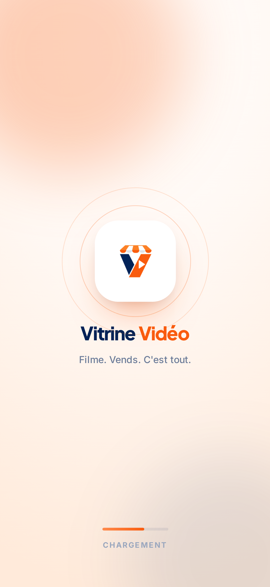 | **à produire — indiqué honnêtement** | NON PROUVÉ |
| Marque officiale (tuile blanche + insigne) | — |  | CONFORME |

Le splash Android système n'est pas capturable honnêtement sous Robolectric. L'identité de marque est prouvée par la tuile D34-12.

[↑ Retour au sommaire](#sommaire)

### 2. Carrousel d'introduction

| Écran / état | Référence fondateur | APRÈS (capture réelle) | Statut |
|---|---|---|---|
| Slide 1 — commerçante boutique |  | 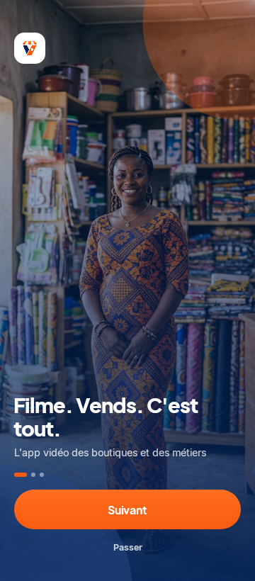 | CONFORME |
| Slide 2 — cheffe de maquis | — | 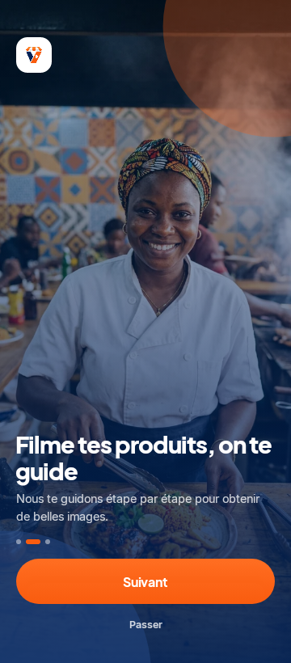 | CONFORME |
| Slide 3 — vendeur mode wax | — |  | CONFORME |
| Slide 1 EN (l10n) | — | 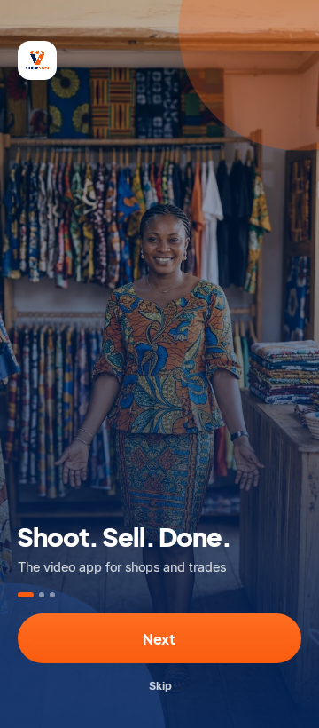 | CONFORME (pré-images) |
| Rotation (paysage) | — | 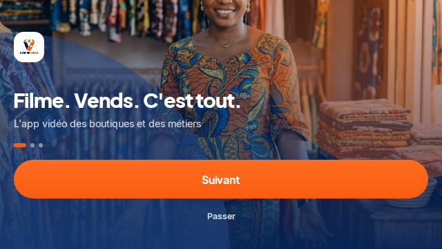 | CONFORME (pré-images) |

Trois univers métiers **distincts** (boutique / restauration / mode) — jamais la même photo répétée (exigence §6.3). Aucun texte marketing ajouté.

[↑ Retour au sommaire](#sommaire)

### 3. Langue

| Écran / état | Référence fondateur | APRÈS (capture réelle) | Statut |
|---|---|---|---|
| Sélection langue FR | 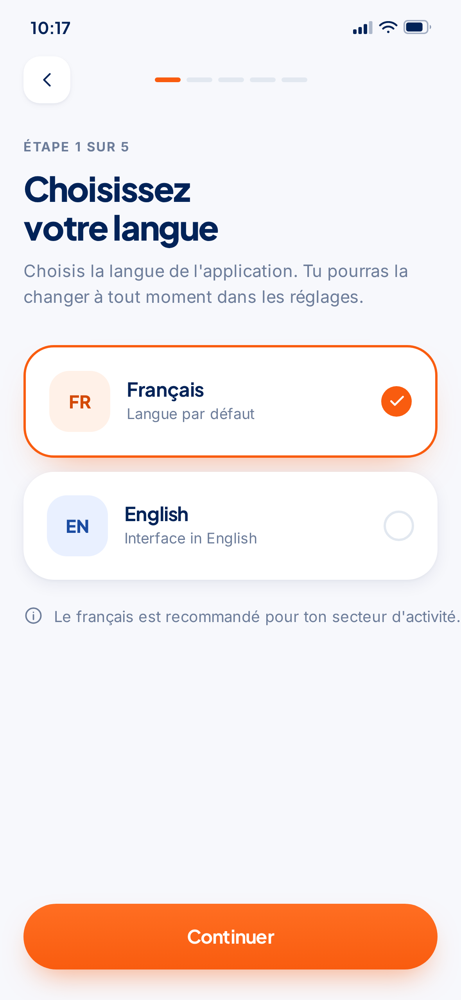 | 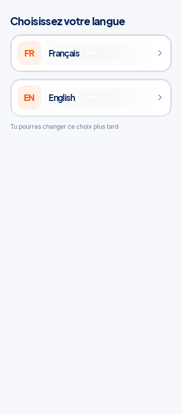 | CONFORME |
| Sélection langue EN | — | 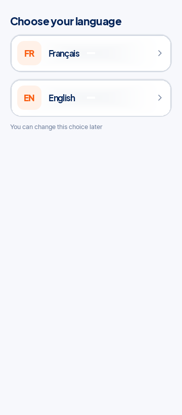 | CONFORME |
| Font scale 1,3 | — | 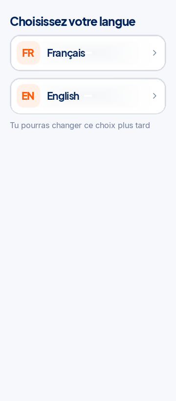 | CONFORME |
| Petit écran w360×640 | — | 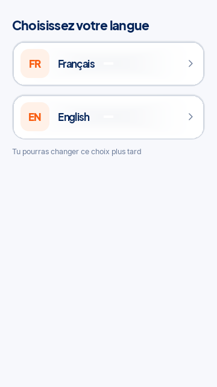 | CONFORME |

[↑ Retour au sommaire](#sommaire)

### 4. Connexion

| Écran / état | Référence fondateur | APRÈS (capture réelle) | Statut |
|---|---|---|---|
| Connexion FR (bouton Google unique) | 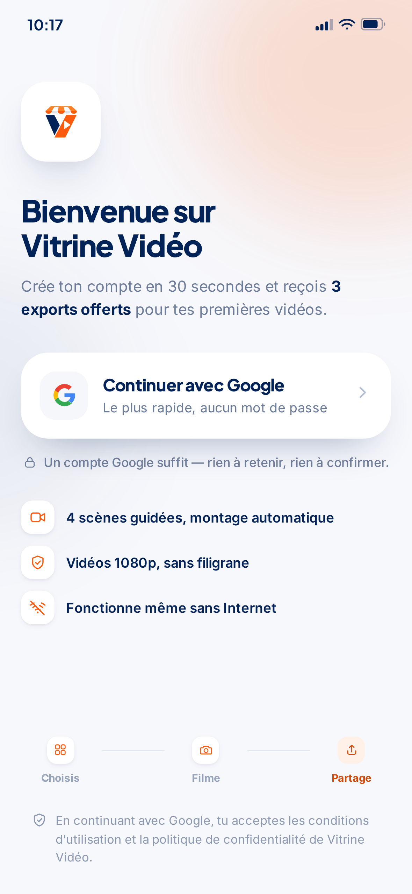 |  | CONFORME |
| Connexion EN | — |  | CONFORME |
| Hors-ligne (erreur réseau) | 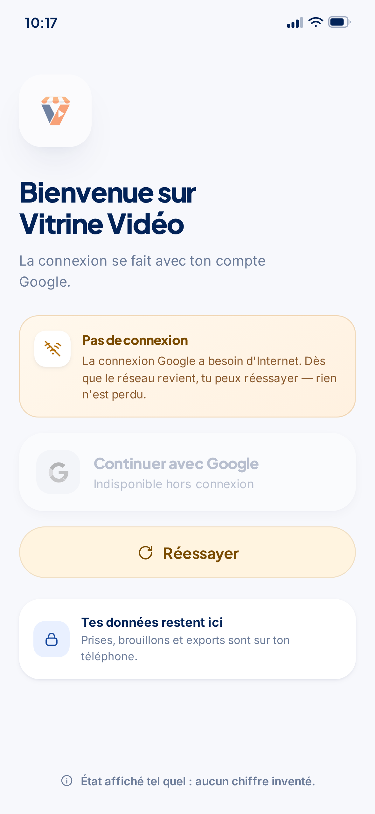 | **à produire — indiqué honnêtement** | NON PROUVÉ |

VR-009 : la variante d'erreur réseau nécessite une coupure réseau réelle — capture à produire, aucune simulation.

[↑ Retour au sommaire](#sommaire)

### 5. Code parrain

| Écran / état | Référence fondateur | APRÈS (capture réelle) | Statut |
|---|---|---|---|
| Saisie manuelle | 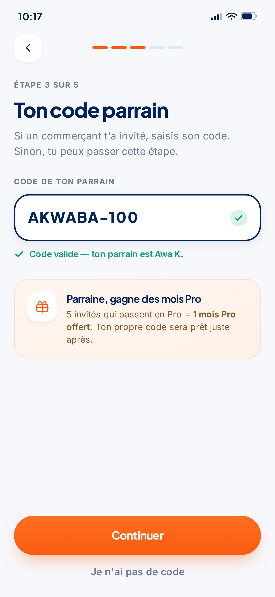 |  | CONFORME |
| Deep-link pré-rempli | — | 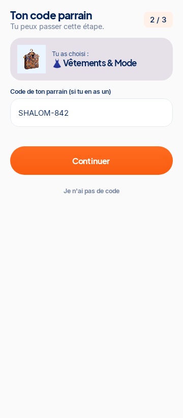 | CONFORME |
| Code détecté (bandeau) | — |  | CONFORME |

[↑ Retour au sommaire](#sommaire)

### 6. Bienvenue & crédits

| Écran / état | Référence fondateur | APRÈS (capture réelle) | Statut |
|---|---|---|---|
| Crédits confirmés | 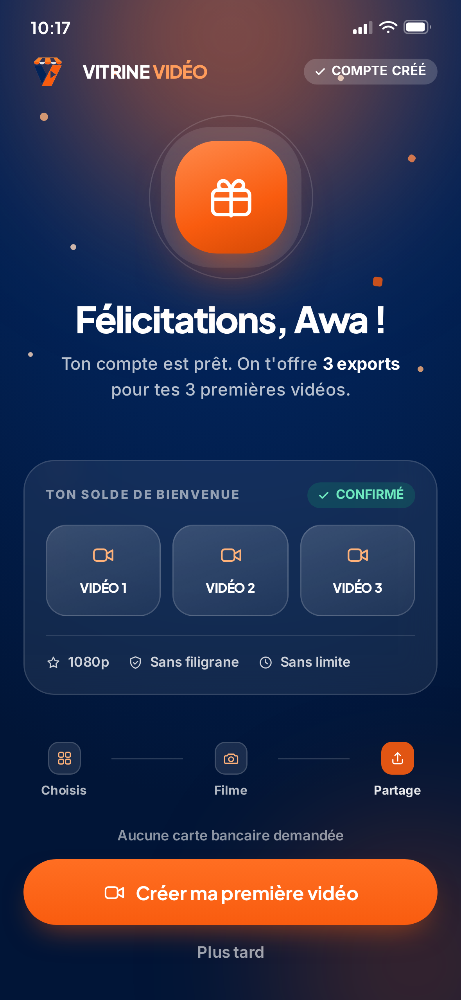 | 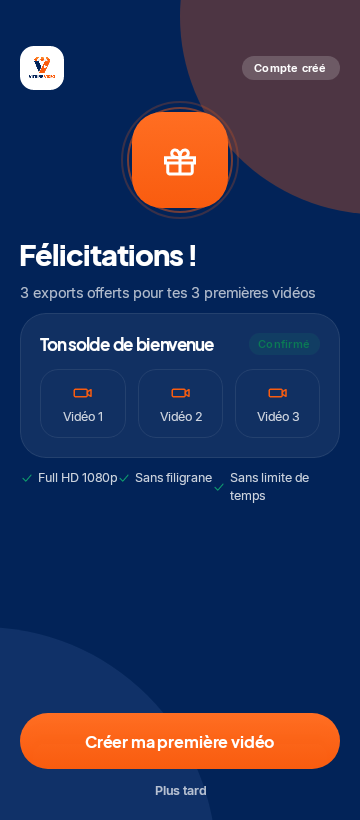 | CONFORME |
| Solde en attente | — |  | CONFORME |
| Font scale 1,3 | — | 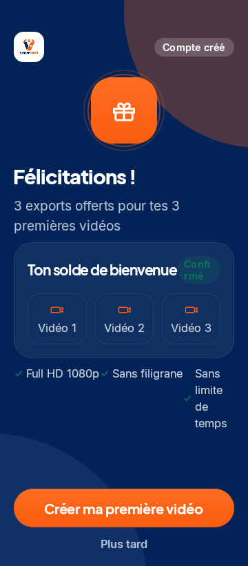 | CONFORME |
| Petit écran | — |  | CONFORME |
| Rotation | — |  | CONFORME |
| Hors-connexion (crédits différés) | — |  | CONFORME |

[↑ Retour au sommaire](#sommaire)

### 7. Choix du secteur

| Écran / état | Référence fondateur | APRÈS (capture réelle) | Statut |
|---|---|---|---|
| Grille 6 secteurs (images originales) | 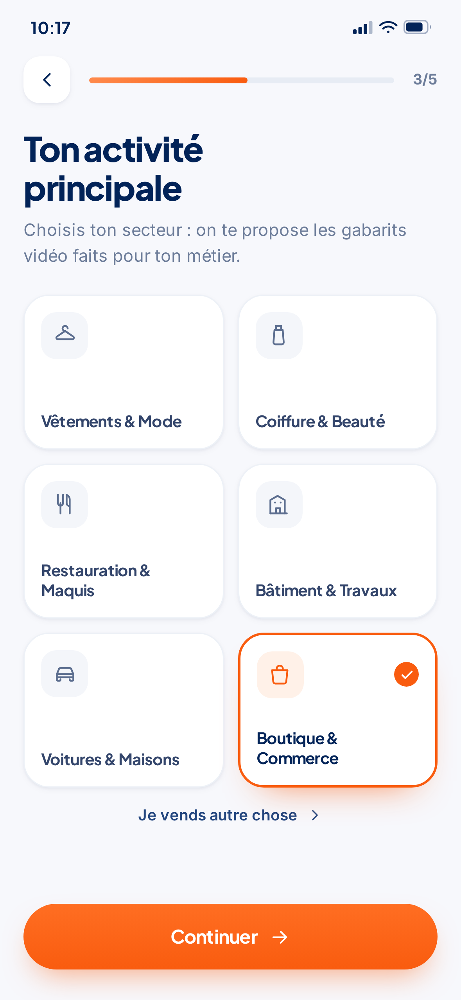 | 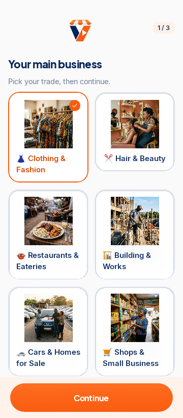 | CONFORME |
| Secteurs EN | — | 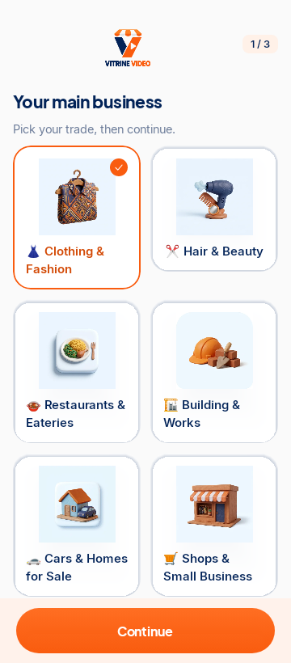 | CONFORME (pré-images) |

Maquette PIL : blanc 86 %, tuiles discrètes — respecté.

[↑ Retour au sommaire](#sommaire)

### 8. Catalogue de gabarits

| Écran / état | Référence fondateur | APRÈS (capture réelle) | Statut |
|---|---|---|---|
| Catalogue secteur choisi | 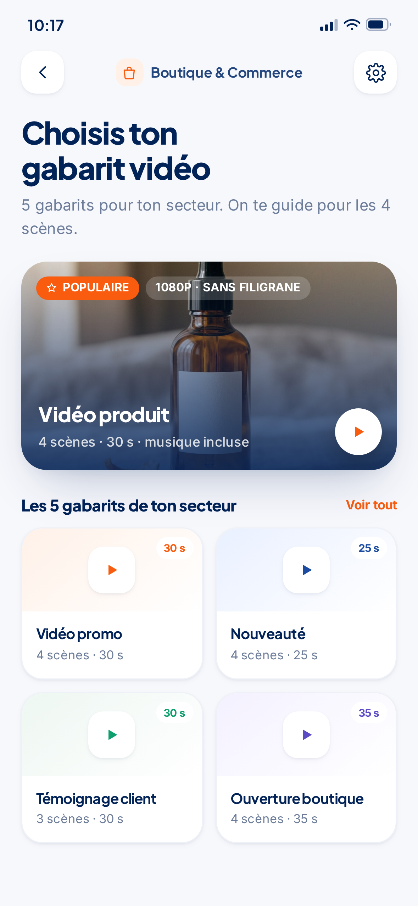 | 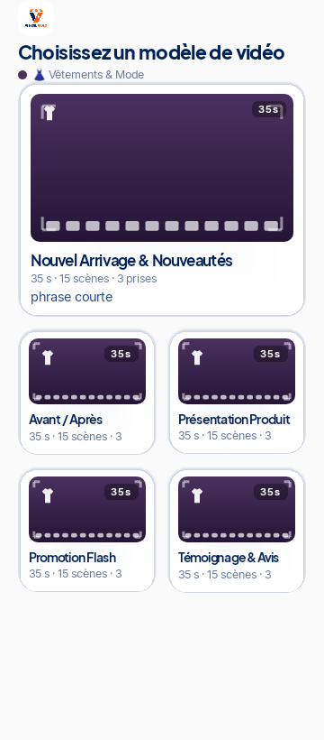 | ÉCART (recapture en attente) |
| Catalogue filtre Mode actif | — | 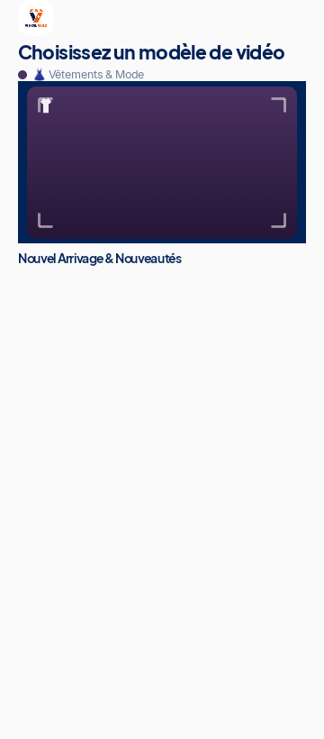 | ÉCART (recapture en attente) |
| Tuiles peuplées (scroll) | — | 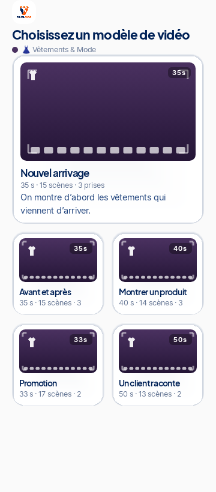 | ÉCART (recapture en attente) |
| Scroll bas | — | 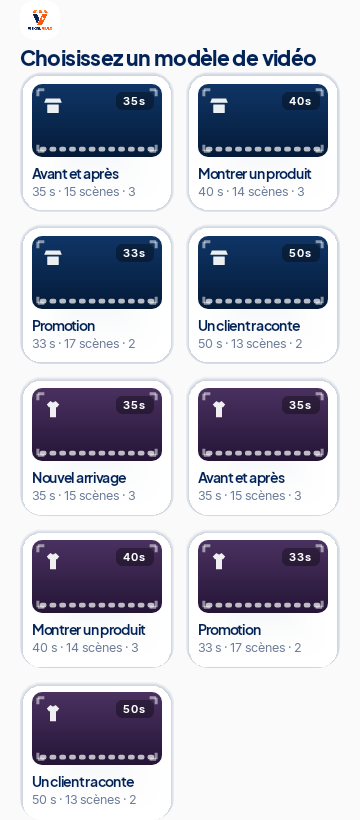 | ÉCART (recapture en attente) |
| Catalogue EN | — | 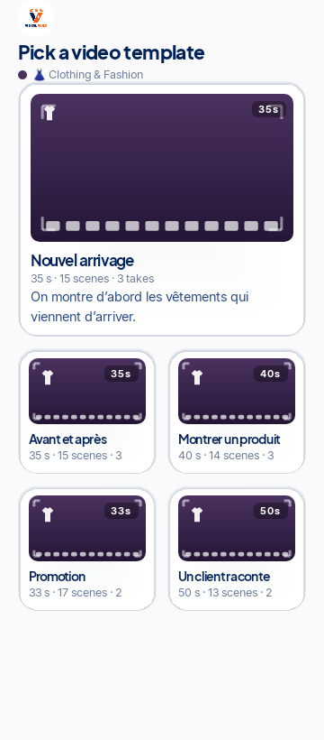 | ÉCART (recapture en attente) |
| Catalogue hors connexion | — | 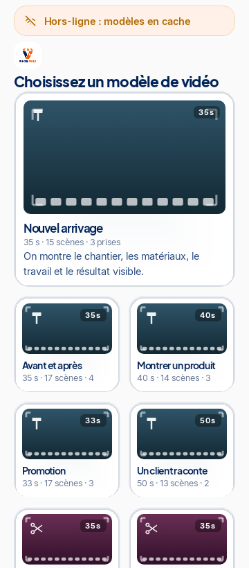 | CONFORME |
| Secteur perdu → récupéré (D42.34) | — | 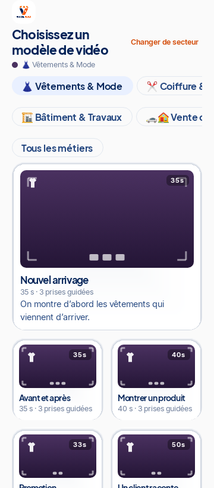 | CONFORME |
| Secteur perdu (D42.34) | — | 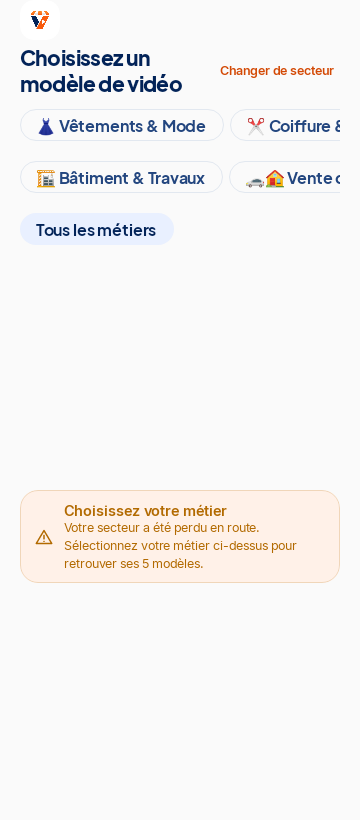 | CONFORME |
| Libellé prises guidées (D42.34) | — | 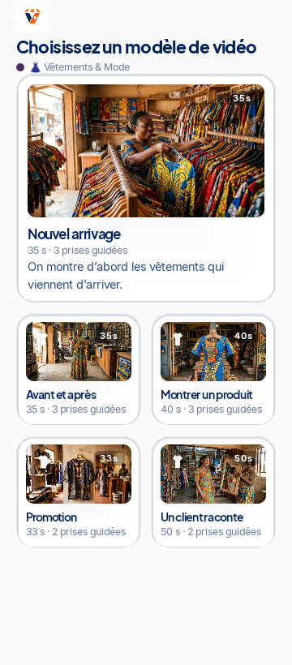 | CONFORME |
| Font scale 1,3 | — | 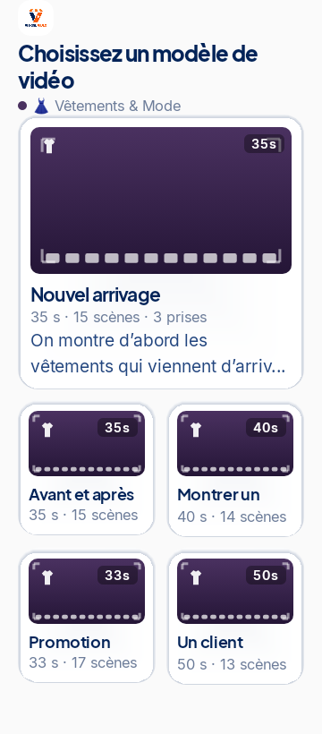 | CONFORME |
| Petit écran | — | 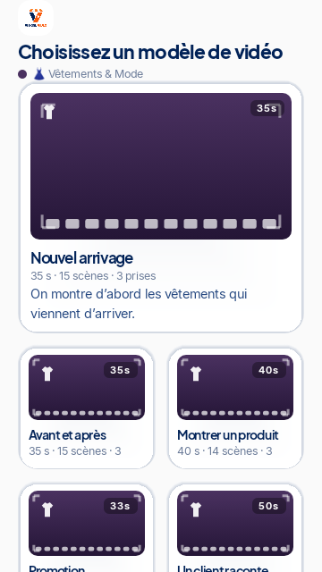 | CONFORME |

**Mécanisme aperçu (Lot D) :** `ApercuGabarit.resPour(gabaritId)` → drawable `apercu_<secteur>_t<n>.webp`, fallback dessiné D42.30 conservé. 10/39 committés (57e720f), 29 en file (limite de génération par session). Les captures actuelles prédatent le mécanisme — remplacées à la complétude, pas avant (aucune capture trompeuse intermédiaire).

[↑ Retour au sommaire](#sommaire)

### 8 bis. Aperçus des gabarits (originaux générés)

Chaque gabarit du catalogue dispose d'un aperçu photographique **original
généré** (640×360 WebP, registre GENERATED_ASSETS.md — aucune licence tierce).
Rendu prouvé dans l'application : corrélations template-matching 0,982/0,988
(D34-16/D34-17).

| Gabarit | Aperçu intégré | Statut |
|---|---|---|
| batiment travaux t1 | 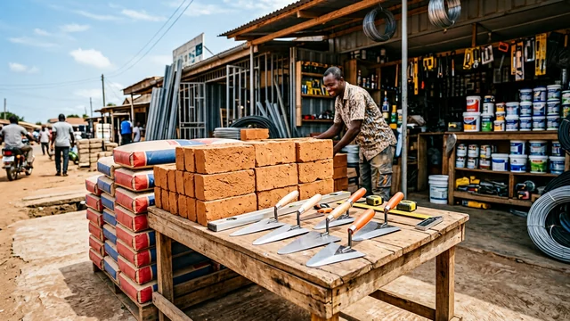 | Intégré · vérifié |
| batiment travaux t2 | 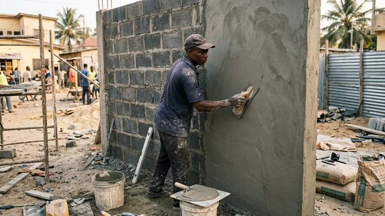 | Intégré · vérifié |
| batiment travaux t3 | 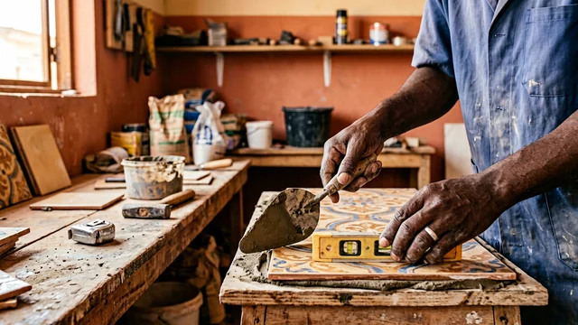 | Intégré · vérifié |
| batiment travaux t4 | 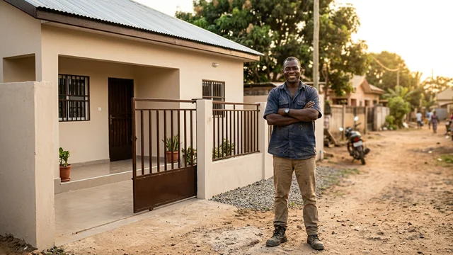 | Intégré · vérifié |
| batiment travaux t5 | 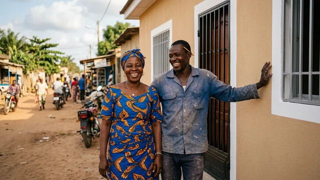 | Intégré · vérifié |
| coiffure beaute t1 | 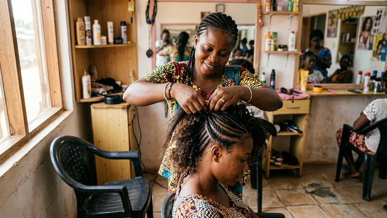 | Intégré · vérifié |
| coiffure beaute t2 | 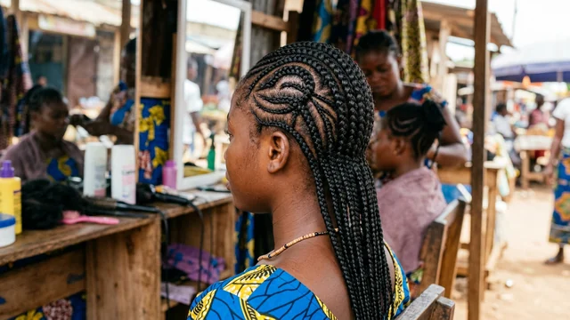 | Intégré · vérifié |
| coiffure beaute t3 | 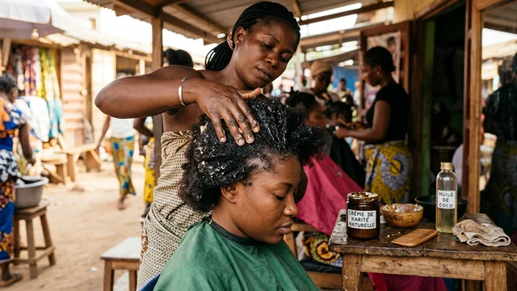 | Intégré · vérifié |
| coiffure beaute t4 | 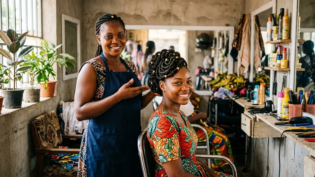 | Intégré · vérifié |
| coiffure beaute t5 | 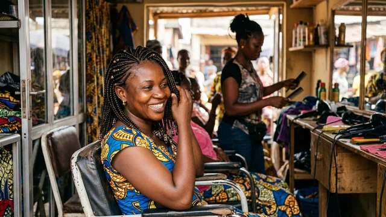 | Intégré · vérifié |
| immo auto t1 |  | Intégré · vérifié |
| immo auto t2 |  | Intégré · vérifié |
| immo auto t3 | 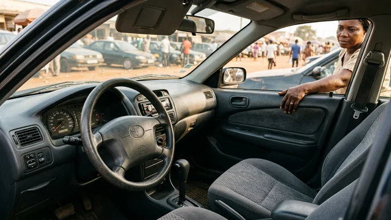 | Intégré · vérifié |
| immo auto t4 | 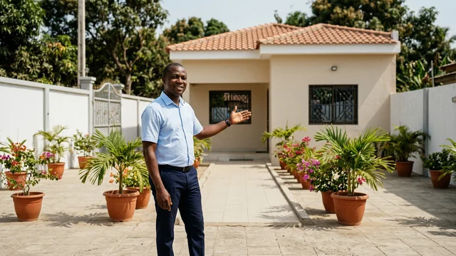 | Intégré · vérifié |
| immo auto t5 | 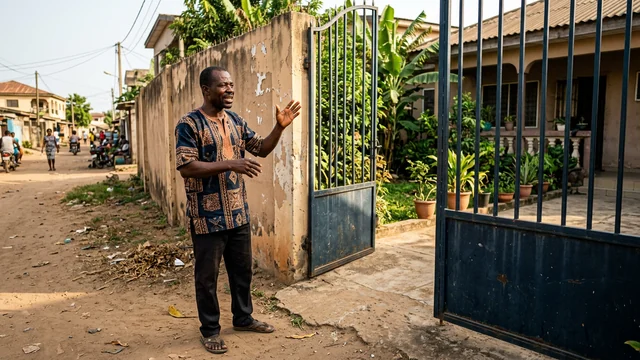 | Intégré · vérifié |
| restaurants maquis t1 | 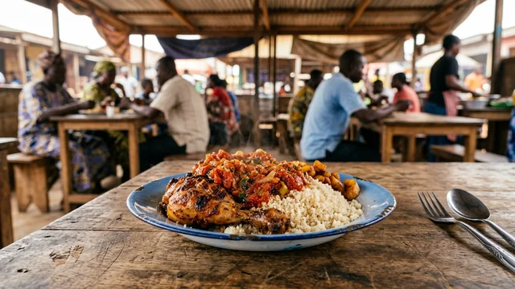 | Intégré · vérifié |
| restaurants maquis t2 |  | Intégré · vérifié |
| restaurants maquis t3 |  | Intégré · vérifié |
| restaurants maquis t4 | 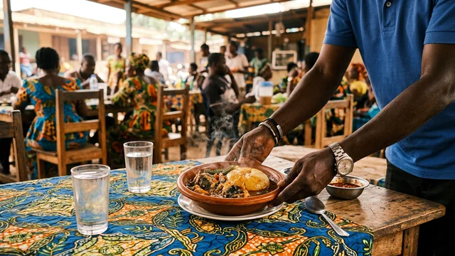 | Intégré · vérifié |
| restaurants maquis t5 |  | Intégré · vérifié |
| shops small business t1 | 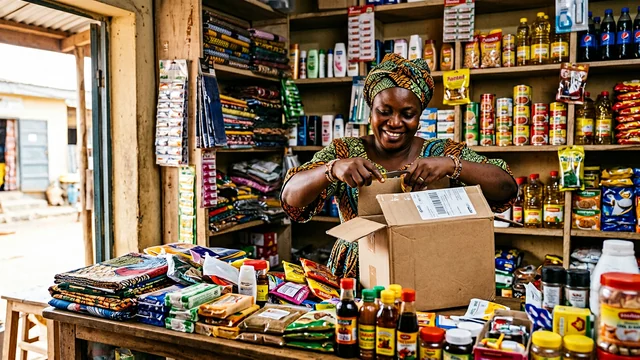 | Intégré · vérifié |

**8 aperçus restants** (shops T2-T5, vêtements T1-T5) : lot 3 en file
(ASSET_GENERATION_QUEUE.csv) — limite stricte de génération par tour de
session ; capture catalogue définitive après complétude 30/30.

[↑ Retour au sommaire](#sommaire)

### 9. Brief

| Écran / état | Référence fondateur | APRÈS (capture réelle) | Statut |
|---|---|---|---|
| Brief — haut (étape 1) | 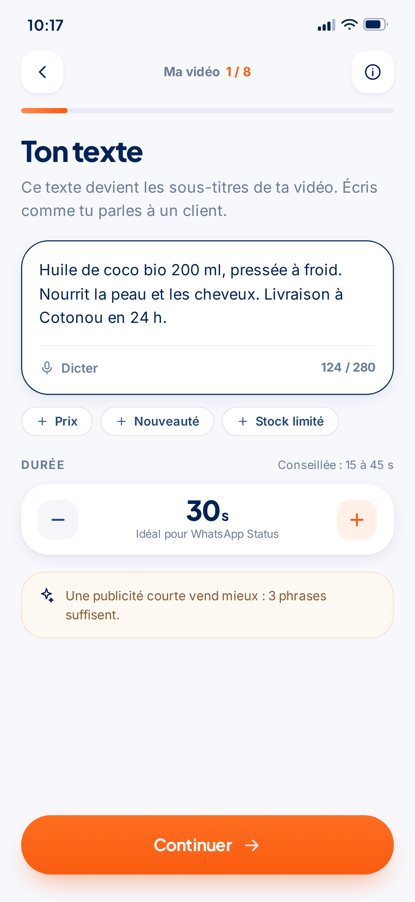 |  | CONFORME |
| Dernière section | 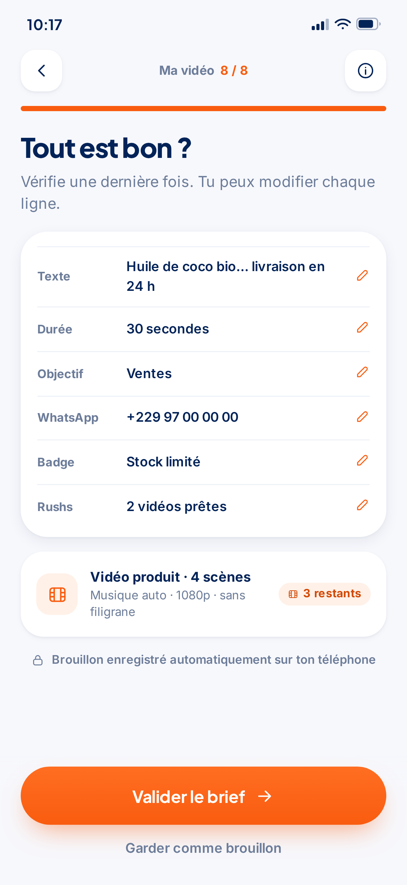 |  | CONFORME |
| Import T5 — slot import (D42.34) | — |  | CONFORME |
| Import T5 — slot rempli (D42.34) | — |  | CONFORME |
| T1 sans import (D42.34) | — |  | CONFORME |
| Reprise de brouillon | — |  | CONFORME |
| Options dépliées | — |  | CONFORME |
| Champ WhatsApp FR | — |  | CONFORME |
| Champ WhatsApp EN | — |  | CONFORME |
| Préparation caméra |  |  | CONFORME |
| Contrôle (bas) |  |  | CONFORME |
| Dialogue choix pays (indicatif) | — | **à produire — indiqué honnêtement** | NON PROUVÉ |

Maquette 09 (fiche détail gabarit) : **NON APPLICABLE** — le catalogue renvoie directement au brief (`pickGabarit()` → setResult), pas d'écran intermédiaire (choix produit D42.3x).

[↑ Retour au sommaire](#sommaire)

### 10. Caméra guidée

| Écran / état | Référence fondateur | APRÈS (capture réelle) | Statut |
|---|---|---|---|
| Viseur + prise guidée |  |  | CONFORME (guide) |
| Flux streaming | — |  | NON PROUVÉ |
| Compte à rebours |  |  | CONFORME |
| Enregistrement (badge REC) |  |  | CONFORME |
| HUD prise T5 (D42.34) | — |  | CONFORME |
| Chargement gabarit (D42.34) | — |  | CONFORME |
| Libre, sans scène, sur zéro (D42.34) | — |  | CONFORME |
| Erreur gabarit (D42.34) | — |  | CONFORME |
| Écran complet + commandes | — |  | CONFORME |
| Scène 2 du gabarit | — |  | CONFORME |
| Permission refusée (diagnostic) | — |  | CONFORME |
| Consentement client (dialogue R4) |  | **à produire — indiqué honnêtement** | NON PROUVÉ |

Le **flux viseur vivant** et le **consentement R4** exigent l'app réelle : marqués NON PROUVÉ, jamais fabriqués.

[↑ Retour au sommaire](#sommaire)

### 11. Validation des prises

| Écran / état | Référence fondateur | APRÈS (capture réelle) | Statut |
|---|---|---|---|
| Prise validée |  |  | CONFORME |

Maquette 17 (écran galerie « revue ») : forme **distribuée** dans l'app — validation par prise + `ReadyCheckScreen` final. Pas d'écran galerie séparé.

[↑ Retour au sommaire](#sommaire)

### 12. Montage

| Écran / état | Référence fondateur | APRÈS (capture réelle) | Statut |
|---|---|---|---|
| Aperçu E7 (montage complet) |  |  | CONFORME |
| Montage E8 en cours (phases métier) |  |  | NON PROUVÉ |

VR-051 : la correction de code est **faite** (D42.34 CR-4) — reste la capture.

[↑ Retour au sommaire](#sommaire)

### 13. Export

| Écran / état | Référence fondateur | APRÈS (capture réelle) | Statut |
|---|---|---|---|
| Export prêt |  |  | NON PROUVÉ |

Écrans D42.31 (émulateur) donnés en référence honnête, marqués NON PROUVÉ pour D42.34 tant que la recapture n'est pas faite.

[↑ Retour au sommaire](#sommaire)

### 14. Partage

| Écran / état | Référence fondateur | APRÈS (capture réelle) | Statut |
|---|---|---|---|
| Feuille de partage système |  |  | NON APPLICABLE |

La feuille de partage appartient au système : capture émulateur en référence.

[↑ Retour au sommaire](#sommaire)

### 15. Dashboard

| Écran / état | Référence fondateur | APRÈS (capture réelle) | Statut |
|---|---|---|---|
| Synchrone, crédits 6 |  |  | CONFORME |
| Bas de page | — |  | CONFORME |
| Suite parrainage | — |  | CONFORME |
| Dashboard EN synchrone |  |  | CONFORME |
| Hors connexion (code en attente) |  |  | CONFORME |
| Bonjour, {prénom} (variante nom réel) | — |  | CONFORME |
| Petit écran w360×640 | — |  | CONFORME |
| Rotation paysage w640×360 | — |  | CONFORME |

[↑ Retour au sommaire](#sommaire)

### 16. Formules & paywall

| Écran / état | Référence fondateur | APRÈS (capture réelle) | Statut |
|---|---|---|---|
| Formule active (pas de compteur inventé) |  |  | CONFORME |
| Paywall FR (3 formules, CTA « Choisir … » actifs) |  |  | CONFORME |
| Paywall EN (CTA « Choose … ») | — |  | CONFORME |
| Paywall bas (scroll) | — |  | CONFORME (identique D42.33) |
| Petit écran famille 11 | — |  | CONFORME |

Checkout : CinetPay renvoie 501 `billing_not_configured` (budget 0 FCFA, aucune transaction fictive) — comportement d'erreur réel déjà couvert par les tests.

[↑ Retour au sommaire](#sommaire)

### 17. Parrainage

| Écran / état | Référence fondateur | APRÈS (capture réelle) | Statut |
|---|---|---|---|
| Historique replié |  |  | CONFORME |
| Parrainage EN | — |  | CONFORME |
| Petit écran | — |  | CONFORME |

[↑ Retour au sommaire](#sommaire)

### 18. Réglages

| Écran / état | Référence fondateur | APRÈS (capture réelle) | Statut |
|---|---|---|---|
| Réglages FR (7 lignes) |  |  | CONFORME |
| Réglages EN | — |  | CONFORME |
| Petit écran | — |  | CONFORME |
| Dialogue changement langue (FR/EN) | — | **à produire — indiqué honnêtement** | NON PROUVÉ |
| Dialogue changement secteur | — | **à produire — indiqué honnêtement** | NON PROUVÉ |
| Dialogue accords de diffusion | — | **à produire — indiqué honnêtement** | NON PROUVÉ |
| Dialogue nettoyage espace | — | **à produire — indiqué honnêtement** | NON PROUVÉ |

Le **dialogue de reprise** (VR-062, D42.27) et les **accords de diffusion** (consentements enregistrés) sont listés pour capture au Lot F.

[↑ Retour au sommaire](#sommaire)

### 19. Écrans hors périmètre

| Écran / état | Référence fondateur | APRÈS (capture réelle) | Statut |
|---|---|---|---|
| Conditions d'utilisation (navigateur) |  | **à produire — indiqué honnêtement** | NON APPLICABLE |
| Aide |  | **à produire — indiqué honnêtement** | NON APPLICABLE |
| Aide & contact |  | **à produire — indiqué honnêtement** | NON APPLICABLE |
| Mes vidéos (bibliothèque) |  | **à produire — indiqué honnêtement** | NON APPLICABLE |
| Marque (bandeau header) | — |  | CONFORME |

[↑ Retour au sommaire](#sommaire)

### 20. États adaptatifs

| Écran / état | Référence fondateur | APRÈS (capture réelle) | Statut |
|---|---|---|---|
| Font scale 1,3 (langue) | — |  | CONFORME |
| Font scale 1,3 (bienvenue) | — |  | CONFORME |
| Font scale 1,3 (catalogue) | — |  | CONFORME |
| Petit écran (langue) | — |  | CONFORME |
| Petit écran (bienvenue) | — |  | CONFORME |
| Petit écran (catalogue) | — |  | CONFORME |
| Rotation (bienvenue) | — |  | CONFORME |
| Rotation (carrousel) | — |  | CONFORME |
| Hors-connexion (bienvenue) | — |  | CONFORME |

Vue regroupée par contrainte (fontScale / petit écran / rotation / hors-connexion). Ces captures sont les mêmes fichiers que ceux de leurs sections de parcours — aucun fichier dupliqué dans le dépôt. Les états NON PROUVÉ ci-dessus restent à produire sur téléphone fondateur ou en recapture Lot F.

[↑ Retour au sommaire](#sommaire)

---

## Traçabilité

- Registre des images originales : `../GENERATED_ASSETS.md` (provenance de chaque
  ressource générée — aucune image à licence inconnue conservée).
- Inventaire exhaustif des 73 écrans/états : `../11_INVENTAIRE_COMPLET_ECRANS.csv`.
- Audit fidélité des 34 maquettes : `../10_AUDIT_FIDELITE_DESIGN.md`.
- Manifeste vérifiable de cette galerie : `../12_MANIFEST_GALERIE.csv`
  (chemin → statut → note, une ligne par image référencée).
- Crédits photo : `../CREDITS_PHOTOS.md`.

**Rappel fondateur :** CI verte ≠ approbation artistique. L'approbation finale
du design appartient au fondateur, sur son téléphone.
